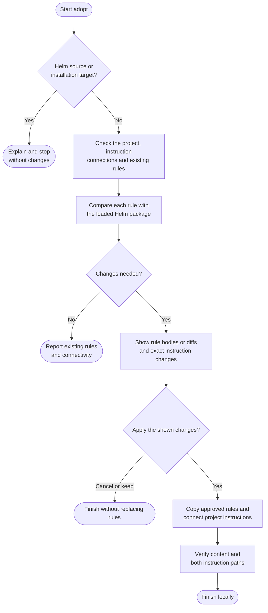

# adopt

Install shared working rules for Claude and Codex, then review updates when the bundled rules change.

## Start the command

```text
adopt
```

Use the prefix for your app or terminal from [Setup]({{ '/docs/setup/' | relative_url }}#run-a-command).

Preview rules in a consumer project. Git-backed writes require clean **main or master**; a folder without Git history can receive uncommitted files.

Adopt blocks Helm's own source checkout, its nested directories and package installations. These use maintained source rules directly; copied rules could redirect them to an older version. Test adoption in a separate consumer project.

## Flow



## Available rules

| Rule | Purpose |
|---|---|
| [Git](../rules/git.html) | Commit conventions and publication policy. |
| [Safety](../rules/safety.html) | Boundaries around consequential actions. |
| [Writing](../rules/writing.html) | Clear, useful prose. |

New adoption proposes all three; you can omit Writing or explicitly request it alone. Git and Safety stay paired. Existing installations offer Writing as an optional addition in the same review.

## What to expect

Adopt compares actual bodies, not just version markers. It shows new rule bodies, replacement diffs and exact instruction changes before asking to install, replace, repair or connect them. Approve all shown changes or name a subset; approved changes are applied without another per-file or final confirmation. Optional Writing needs explicit inclusion, and custom-file overwrites or downgrades must be named in the proposal. New or changed effects still need review.

Equivalent content stays untouched even with an older marker. Keep/Skip preserves existing files and pointers; customizations are not merged automatically.

Suitable copies can be connected without replacement. Independent instruction files or a `CLAUDE.md`-only layout need [log](log.html) first. A fresh project can receive minimal shared instructions during installation.

## Your result

Selected copies live under `.claude/rules/`, using `git.md`, `safety.md` and `writing.md`. Shared pointers belong in `AGENTS.md`; `CLAUDE.md` imports it.

The report shows installed, kept, skipped and missing rules. File connections are checked; native startup loading needs separate observation. Start a fresh agent session after instruction changes.

Updates follow your local commit policy on the same branch. Plugin updates do not refresh project copies: rerun adopt to review them. External installation references need separate maintenance; adopt does not convert them. Use [ship](ship.html) to publish.
