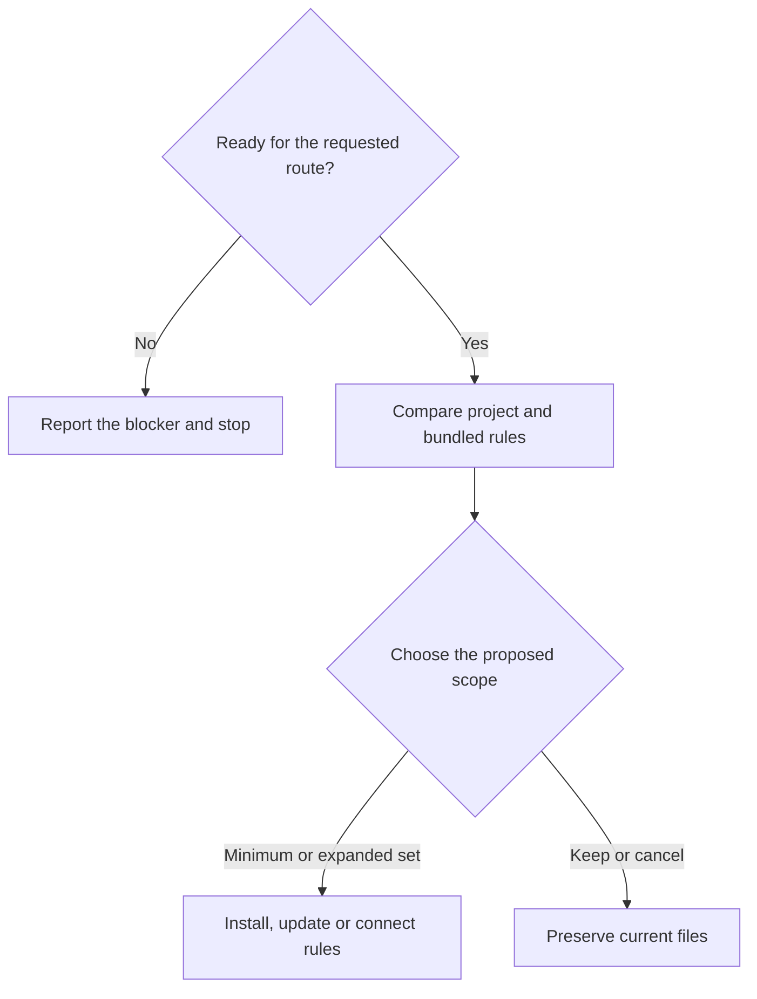

# Adopt



Use adopt to give Claude and Codex shared working rules in a consumer project. Run it again when you want to review updates from the installed Helm package.

## Flow



## Start the command

```text
Codex → $adopt    Claude → /adopt
```

Use your client's [command prefix]({{ '/docs/setup/' | relative_url }}#run-a-command). Normal adoption checks for clean **main or master** before comparing rules or showing the action table. A project without Git history can receive uncommitted files. Request a read-only inspection explicitly if that is your goal.

A blocker ends the run with its reason and known checkout facts. It does not continue into rule comparisons, a suggested-action table or an apply question.

**Adopt cannot run on Helm's own source checkout or a plugin installation.** Those use maintained source rules directly. Try adoption in a separate consumer project.

## Available rules

| Rule | What it guides |
|---|---|
| [Git](../rules/git.html) | Local work, commits and publication. |
| [Safety](../rules/safety.html) | Decisions about consequential actions and preserving work. |
| [Writing](../rules/writing.html) | Clear prose and useful reference links. |
| [Design](../rules/design.html) | Responsive, accessible interfaces and predictable navigation. |

Git and Safety stay paired. The recommended fresh set adds optional Writing. An unscoped fresh installation can also offer all four rules; that choice explicitly includes Design. Writing and Design can each be adopted independently.

## What to expect

You see a plain table with each file, suggested action, reason and local-to-package version. Clear labels distinguish updates, repairs, kept files and optional installations; custom-file replacements and downgrades are explicit. No colors or badges are required. Full rule bodies and diffs are available on request.

When existing rules need maintenance and other rules are available, choose maintenance only or maintenance plus the named missing rules. Required repairs stay in the minimum choice. If only one kind of work applies, only that action is offered alongside the relevant keep/cancel exits. You can select a subset in the same response; an explicitly limited request does not offer unrelated installations.

Matching content stays untouched even if its version marker differs. Keeping a rule preserves its file and pointers; adopt does not merge customizations automatically. Missing files or connections can be repaired as part of the same review.

A `CLAUDE.md`-only project or independent instruction files may need [log's shared setup](log.html#shared-project-instructions) first.

## Your result

Approved copies live in `.claude/rules/`, connected through shared project instructions. The report separates installed, kept, skipped and missing rules. Start a fresh agent session after changes; file checks alone do not prove native startup loading.

With auto-commit off, an exact known update can be approved with or without its local commit. Plugin updates do not refresh these copies automatically. Rerun adopt to review them, and use [ship](ship.html) separately for publication.
