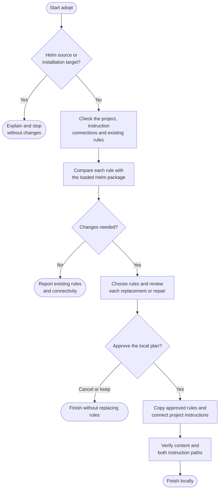

# adopt

Add reusable working rules to a project without explaining them in every session. Adopt installs shared local copies that Claude and Codex can both read, then helps you review updates when the bundled rules change.

## Start the command

```text
adopt
```

Use the prefix for your app or terminal from [Setup]({{ '/docs/setup/' | relative_url }}#run-a-command).

You can preview existing rules in a consumer checkout. Git-backed installation and updates require a clean **main or master** branch. A fresh consumer folder without Git history can receive uncommitted files without initializing a repository.

Adopt stops without changes when the target is Helm's own source project, a nested directory inside it, or a loaded/selected Helm package installation. It checks physical paths plus package identity and layout, so renamed checkouts and symlink aliases are covered; a folder name alone does not trigger the guard. A consumer containing Helm as a separate dependency can still adopt at its own project root when that target is outside all protected roots. Unresolved material identity or path ambiguity stops adoption for clarification.

This source project already loads its maintained `rules/` files directly. Adopting here could install stale copies from an older loaded package and redirect project instructions to them. Use ordinary authorized development to maintain the sources, and a separate consumer fixture outside the protected roots to test adoption. The guard leaves existing rules and pointers untouched and offers no Continue anyway option.

## Flow



## Available rules

| Rule | What it covers |
|---|---|
| [Git](../rules/git.html) | Commit conventions, configuration and publication policy. |
| [Safety](../rules/safety.html) | Boundaries around consequential or hard-to-recover actions. |
| [Writing](../rules/writing.html) | Clear, natural text for people. |

A new installation proposes all three for review; you can omit Writing. Git and Safety work as a pair. On an existing installation, a newly available Writing rule is offered separately rather than added automatically.

## What to expect

Adopt checks each destination before writing. It distinguishes Helm-marked copies, other existing files and missing files, then compares actual content with the bundled source. A version marker alone does not prove a file is unchanged or safe to replace.

For changed Helm copies, you see the before-and-after diff and choose **Replace**, **Keep** or **Cancel** per file. Other existing files need their own **Overwrite** or **Skip** decision. Equivalent content stays untouched even if its marker is older. Local customizations are never silently merged away, and downgrades need explicit review.

If the copies are already suitable but the instruction connection is missing, adopt can repair that connection without replacing the rules. Existing independent instruction files or a `CLAUDE.md`-only layout go through [log](log.html) first. A fresh project can receive a minimal `AGENTS.md` and its `CLAUDE.md` import as part of installation.

## Your result

Selected copies live at:

```text
.claude/rules/git.md
.claude/rules/safety.md
.claude/rules/writing.md
```

There is one copy of each selected rule. Claude discovers project rules through its own mechanism; `AGENTS.md` also explicitly tells agents to read the same paths, so Codex uses them too. Shared pointers belong in `AGENTS.md`, with `CLAUDE.md` importing that owner.

The report identifies installed, updated, kept, skipped and missing rules. It verifies the local file connections; actual startup loading remains unverified unless observed. Start a fresh agent session after instruction changes.

Adopt follows your local commit policy and finishes on the same branch. Plugin updates do not update project copies automatically: rerun adopt to review them. Publication is a separate [ship](ship.html) action. Unsupported external references need a separate reviewed update; adopt does not convert or delete them.
