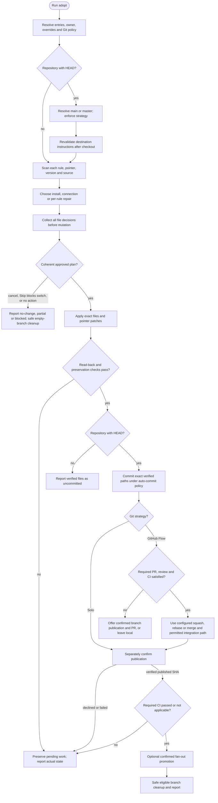

# /helm:adopt

Installs, updates, repairs, or connects Helm's `git.md` and `safety.md` rules in the selected project. It preserves project knowledge and configuration, and does no product work or release. Publication still follows the project's required quality, review, and CI gates.

Command names use Claude notation. In Codex, choose the same workflow from the skill picker. Questions use the host's available interface, or ordinary conversation with an explicit reply when a picker cannot represent the choices faithfully. See [compatibility](../setup/compatibility.html).

## Instruction and storage ownership

| Layout or storage | Adopt behavior |
|---|---|
| Shared AGENTS.md owner | Patches only approved Helm rule pointers there. Preserves configuration, knowledge, review markers and unrelated instructions. |
| CLAUDE.md adapter | Preserves an existing correct adapter. Creates a missing adapter containing `@AGENTS.md` as part of an approved shared install or connection. No duplicated Rules or settings. |
| Neither root entry exists | An approved install creates minimal AGENTS.md rule instructions and the Claude adapter. Log can add project knowledge later. |
| Legacy owner or bridge | Preserves ownership. A Codex connection may create a missing bridge to the existing CLAUDE.md owner; only log performs reviewed owner migration. |
| Independent/partially connected entries | Stops before branching or writing and directs the user to log for reconciliation. |
| AGENTS.override.md | Preserves it. Shared adoption stops unless it explicitly reads AGENTS.md; connected overrides retain their host-specific policy. |
| `.claude/rules/` | Shared rule storage. AGENTS.md gives explicit read-and-follow directives so Codex can load the rules. The directory name remains for Claude compatibility. |
| `.helm/`, `.claude/helm/`, flat legacy ledgers | No reads, writes, staging, or migration. Adopt owns no operational ledger. |

Adopt reads both applicable entries and their explicit chains when detecting existing pointers, including pointers outside `## Rules`. It reuses an effective pointer. A mode switch that would leave an old pointer active outside the managed section stops for a reviewed reconciliation before any write or deletion.

## Flow

Any failed mutation stops finalization with the actual branch and files preserved. The diagram's successful commit, integration, promotion, and cleanup paths all require their preceding checks to succeed.

## Before starting

Resolve effective configuration through the owner, bridges, and active overrides. Recognized standalone and fenced configuration blocks use the same rules on both hosts. State the effective settings; defaults are GitHub Flow, auto-commit off, and squash merging. Adopt never creates or changes configuration declarations just to apply these defaults.

Only the absence of a repository or HEAD skips branch setup. Missing AGENTS.md or CLAUDE.md in an existing repository does not: Git history still exists and the default strategy applies.

For a repository with HEAD, resolve the actual base branch, `main` or `master`, and use that exact name throughout. Ambiguous/missing base identity or uncommitted work stops the operation without an automatic reset, stash, or unrelated commit.

- **Solo:** requires the selected base branch, with no temporary branch.
- **GitHub Flow:** records the original branch, safely updates the base by fast-forward from its configured upstream when available, and creates an unused `chore/adopt-{date}` branch from that base. An existing date-named branch is never reused or deleted.

After every checkout/update, re-read destination entries, owner, chains, overrides, and settings. Changed ownership, policy, or dependencies stop before writing. Rule scans and patches come from the actual destination branch. Relevant entries, rule files and package sources are snapshotted and rechecked before applying the plan. Installing newer rules does not silently change the invocation's finalization policy.

## 1. Sanity check

Project markers include `.git` (directory or worktree file), AGENTS.md, CLAUDE.md, and recognized package manifests. An empty directory is valid for setup. A populated directory with no markers requires Continue/Cancel confirmation.

## 2. Scan rules and resolve the source

For each expected rule, record its local existence, marker/version, effective pointers and readability:

- **Helm-marked:** a local file begins with `<!-- helm-rule: claude-helm@v{X.Y.Z} -->`.
- **Foreign:** a local file lacks that leading marker and remains protected until its overwrite/deletion is approved.
- **Referenced:** no local file, but an existing marketplace pointer exists; its target must be readable before connection succeeds.
- **Absent:** no local file or marketplace pointer. A dangling local pointer requires repair.

Claude prefers the verified stable marketplace checkout at `~/.claude/plugins/marketplaces/claude-helm/`. Its manifest must identify plugin `helm` and both rules must exist. A missing marketplace manifest permits a reported, verified loaded-package fallback for copies; an invalid existing installation stops instead. Different loaded/marketplace versions are disclosed. New reference mode requires the stable source.

Codex uses its actual loaded package and matching manifest version, without guessing cache paths. It installs copies, or connects to existing readable Claude references without changing their mode. Unavailable references cannot be silently replaced with competing copies.

### Complete, partial and mixed installations

The summary states are Fresh, Referenced, Update and Conflict. Decisions still account for each rule:

| Condition | Result |
|---|---|
| Neither rule nor pointer exists | Fresh installation choices. |
| A rule/directive is missing, a reference is dangling, or modes are mixed | Repair review before normal aggregate choices; foreign files still require Conflict review. |
| Both copied rules exist; any marker is ahead | Ahead takes precedence, even if the other rule is behind. |
| Neither marker is ahead; at least one is behind | Update only the approved older copies. |
| Both markers equal the source and effective directives are correct | In sync; no rule overwrite. |

Repair offers Review/Cancel, followed by explicit Apply/Skip decisions for each proposed repair. It can add a missing copy or directive while preserving current/newer copies. Every rollback names the file and old/new versions and needs its own approval. Missing references and mixed modes require a coherent mode plan; Codex stops and recommends Claude's copy-mode flow when repair would otherwise switch modes. Skipped dependencies cannot leave broken active pointers or two versions active. All-Skip creates no entry or adapter; incomplete coverage is reported as partial.

## 3. Choose the action

Claude offers copy/reference/cancel for fresh setup; keep references/switch to copies/cancel for complete reference installs; update/keep/per-rule review as appropriate to copied-rule versions; and review/reference/cancel for foreign conflicts. Reference choices disappear when the stable source is unavailable. Every picker has 2–4 options. In-sync copies with no available reference action exit as no change instead of displaying a one-option picker.

Codex offers copy/cancel for fresh setup, update or connect/cancel for managed copies, per-file conflict review/cancel for foreign files, and connection/cancel for existing readable references. It never switches Claude's reference installation behind the user's back. Keeping an ahead installation preserves both files, even if the companion is behind; per-rule review can update that companion without downgrading the newer file.

For a shared owner with both required readable rules and a missing Claude adapter, an approved connection can add only that adapter and any approved missing directives, preserving rule bytes and actual versions. Existing correct adapters remain unchanged. This action is reported as connection, not copying or updating.

## 4. Plan, apply and verify

Collect all per-file decisions before mutation. The plan shows exact rule writes/deletions, pointer patches, entry/adapter creation, and retained/missing rules. The selected action and per-file answers authorize those concrete changes, without redundant approval. Changed inputs, unsafe destinations or conflicting pointers block application.

Only exact resolved Helm targets are managed: local `git.md`/`safety.md` and those two files in the verified stable marketplace source. A `.claude/rules/` prefix alone is insufficient. Custom pointers such as `.claude/rules/security.md`, unrelated prose and other imports remain unchanged. Ambiguous combined lines require a reviewed patch. There is no whole-section replacement or duplicate Rules heading. An existing final review marker stays last, with additions inserted before it and its value preserved. Targeted updates leave legacy non-final marker placement intact.

- **Copy/update/repair:** writes only approved rule copies from the selected source with its version marker, and adds/patches only their approved explicit read directives. Current/newer preserved files and skipped files retain their bytes.
- **Foreign-file review:** asks Overwrite/Skip per foreign file. A missing/outdated companion is included through its own explicit decision, never silently bundled into another file's overwrite. All foreign files skipped means no entry/adapter creation or rule writes. Partial installation is disclosed; Skip never adds a foreign pointer just to imitate Claude's native loading.
- **Reference switch:** verifies both marketplace sources and all dependencies before deleting anything. Managed-copy removal is covered by the chosen mode; foreign-file removal needs explicit Delete approval. Skip keeps the file and stops the entire switch without writes/deletions, including earlier queued deletions. This prevents Claude retaining extra native rules while Codex follows only marketplace pointers. Other local rule files remain untouched. Direct dependencies in a separate host entry must be reconciled before changing modes.
- **Connection:** preserves rule files and the existing owner, adds only approved missing directives/bridge/adapter, and reports actual versions. An already-connected setup is a no-op.
- **Cancel/no change:** writes nothing. Cancellation after mutation has begun instead reports the actual pending drafts and stops finalization.

Reference instructions describe the source as a machine-local Claude marketplace dependency. If unavailable, they advise restoring that source or using Claude's adopt flow to switch to copies, without telling Codex to run a Claude-only plugin command.

**Before any commit, merge, push or promotion**, read back approved outputs and verify copied content and markers, intended deletions, readable instruction chains, preserved settings/knowledge/review markers, unchanged skipped/custom files, and the shared adapter. Complete shared setup requires both entries and both expected rules; partial or legacy-only coverage is described accurately. Failure blocks publication and preserves pending work. Recheck the approved outputs before staging and after integration; reporting is not the first verification step.

## 5. Commit, review and publish

No repository or HEAD means verified files stay uncommitted, with no Git initialization. Otherwise stage literal, exact approved paths and tracked rule deletions, inspect the staged diff, and follow `git-auto-commit`: true permits the adoption commit silently; false/missing asks for the exact diff. Verify the commit. Operational state and unrelated files are never staged.

**Solo:** commit on the resolved base, separately confirm its exact push, and verify the remote SHA. No publication remote leaves the commit local with push N/A.

**GitHub Flow:** keep the adoption branch until its exact tip satisfies required PR/review/CI gates. When review is outstanding, offer confirmed branch publication and PR creation or leave it local, then report a review handoff without integration or cleanup. Reuse an existing matching PR. Provider/access failures give manual review instructions and no false PR claim.

Integration uses the resolved squash/rebase/merge strategy through a path permitted by branch protection. Provider-required PR merging is never bypassed locally. A shared/pushed branch is not implicitly rebased or force-pushed. Any required integration-commit approval remains under auto-commit policy. Local base publication gets its own confirmation; a provider merge that publishes the base requires that publication confirmation before the API call. Verify the resulting remote base SHA and adoption contents.

Configured local checks must pass before publication. The [shared CI policy](../setup/git-and-ci.html#ci-gates) applies: CI required for integration must pass for the exact adoption tip; configured/applicable CI must pass for the exact published base before promotion. No configured CI is not applicable. Unknown, missing, pending or failed required results, unavailable authentication, or a changed SHA block the action; environment selection does not waive checks.

Environment promotion remains fan-out content sync from the resolved base. Its selection explicitly authorizes merging and pushing each chosen destination, capped at four options; a single environment uses Yes/Skip. Recheck policy, published SHA and required CI, verify each successful push, and stop on failure with completed/pending destinations reported separately.

A declined commit or failed mutation stops with actual work preserved, without automatic reset, stash, promotion, branch deletion or return checkout. A declined/failed push leaves local work intact. No-write exits safely return before deleting only this invocation's empty temporary branch. Successful cleanup uses ancestry checks and `git branch -d`; squash/rebase branches outside ancestry are retained, never force-deleted. Remote branch deletion needs its own push confirmation.

## 6. Report

Report the owner, entry/adapter paths, exact rule actions and actual versions, skipped/missing coverage, current branch, and separate draft/commit/integration/push status. Include PR URL, CI status, partial promotions and remaining action when relevant. Verified local installation does not imply publication. Pending, blocked or partial outcomes never receive an unqualified ADOPT COMPLETE or a claim that both agents are fully connected.

Adopt may read verified sources under `~/.claude/`; it never writes there or changes client settings. It never reads or migrates operational Helm state.

## See also

- [`git.md`](../rules/git.html): configuration, review, commit and publication rules.
- [`safety.md`](../rules/safety.html): confirmation boundaries and project-owned safety instructions.
- [`/helm:log`](log.html): reviewed shared-owner migration and project knowledge.
- [`/helm:ship`](ship.html): release workflow and environment discovery.
