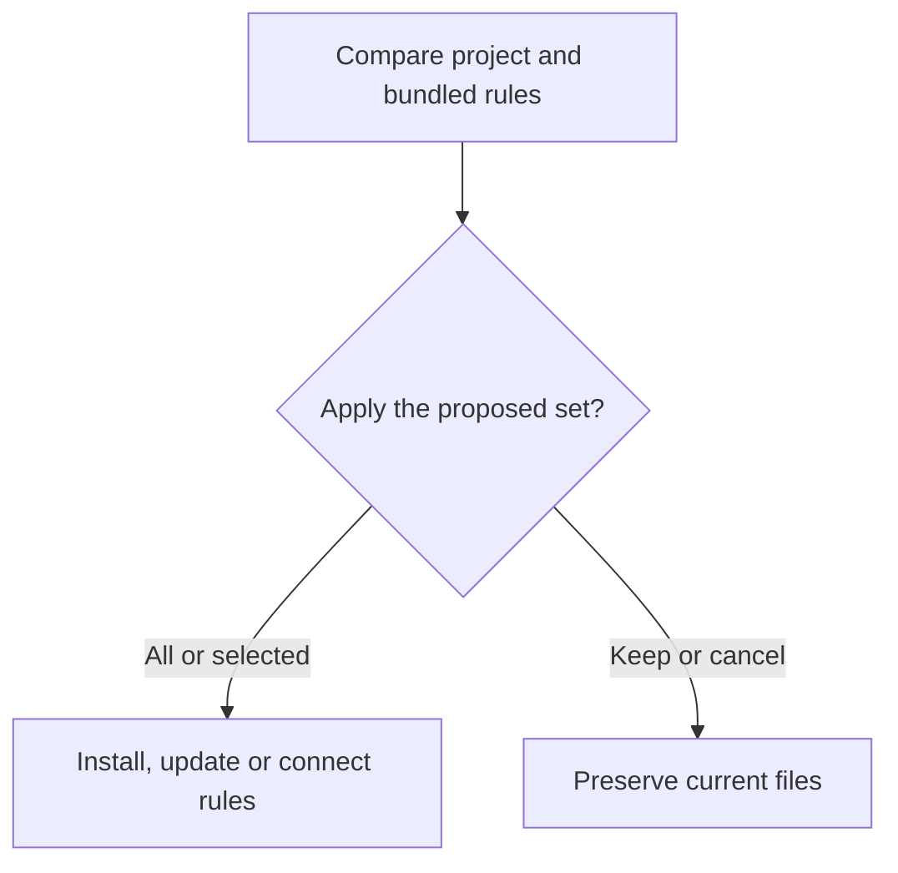

# adopt



Use adopt to give Claude and Codex shared working rules in a consumer project. Run it again when you want to review updates from the installed Helm package.

## Flow



## Start the command

```text
Codex → $adopt    Claude → /adopt
```

Use your client's [command prefix]({{ '/docs/setup/' | relative_url }}#run-a-command). Git-backed writes require clean **main or master**; a project without Git history can receive uncommitted files.

**Adopt cannot run on Helm's own source checkout or a plugin installation.** Those use maintained source rules directly. Try adoption in a separate consumer project.

## Available rules

| Rule | What it guides |
|---|---|
| [Git](../rules/git.html) | Local work, commits and publication. |
| [Safety](../rules/safety.html) | Decisions about consequential actions and preserving work. |
| [Writing](../rules/writing.html) | Clear prose and useful reference links. |
| [Design](../rules/design.html) | Responsive, accessible interfaces and predictable navigation. |

Git and Safety stay paired. New adoption also proposes Writing, which you can omit. Design is optional and needs explicit selection; Writing and Design can each be adopted independently.

## What to expect

You see which files would be installed, replaced, connected or kept, with versions and meaningful policy changes. Custom-file overwrites and downgrades are called out. Approve the whole proposal or a subset once; full rule bodies and diffs are available on request.

Matching content stays untouched even if its version marker differs. Keeping a rule preserves its file and pointers; adopt does not merge customizations automatically. Missing files or connections can be repaired as part of the same review.

A `CLAUDE.md`-only project or independent instruction files may need [log's shared setup](log.html#shared-project-instructions) first.

## Your result

Approved copies live in `.claude/rules/`, connected through shared project instructions. The report separates installed, kept, skipped and missing rules. Start a fresh agent session after changes; file checks alone do not prove native startup loading.

Plugin updates do not refresh these copies automatically. Rerun adopt to review them, and use [ship](ship.html) separately for publication.
