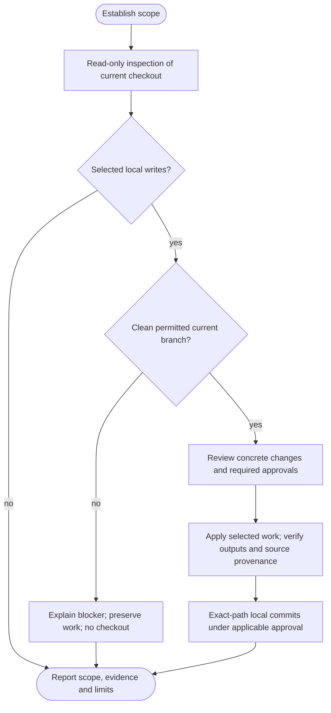

# /agent-helm:adopt

Install, update, repair or connect selected Helm rules as shared local copies in `.claude/rules/`. Both agents use those same project files; Claude need not be installed for Codex to read them. External-reference installation is no longer offered; existing references remain until an explicitly reviewed conversion. Adopt preserves project knowledge and configuration. It does no product work, owner migration or release, and owns no operational ledger.

Command names use Claude notation. In Codex, choose adopt from the skill picker and supply your request. Questions use the available host interface, or conversation with an explicit reply when a picker cannot represent the choices faithfully. See [compatibility](../setup/compatibility.html).

## Rules and selection

The workflow's catalog supplies the rule names, sources and destinations for every installation/update step. It no longer assumes exactly two files.

| Rule | Shared local copy | Relationship |
|---|---|---|
| [git.md](../rules/git.html) | `.claude/rules/git.md` | Git policy, paired with safety. |
| [safety.md](../rules/safety.html) | `.claude/rules/safety.md` | Operational boundaries, paired with Git policy. |
| [writing.md](../rules/writing.html) | `.claude/rules/writing.md` | Independent clear-writing guidance. |

For a new adoption, the reviewed plan proposes all three rules and their actual bodies, destinations and pointer changes unless the developer explicitly requested particular rules. Writing may be omitted. A proposed default never supplies consent or bypasses a foreign/custom-file decision.

For an existing installation, writing without an established Helm copy/pointer appears separately as **new rule available, not selected**. Normal general adoption/update offers Add writing / Not now; installation needs explicit acceptance of its body and exact file/pointer changes. A narrowly requested Git/safety connection, repair only reports availability and does not wait for another writing decision. Declining creates no stored preference or file changes; a later applicable run may offer it again.

An already adopted writing rule receives the same content/marker, replacement, rollback, connection and repair handling as other rules. A missing target of an established writing pointer is a repair; a foreign file with that name is protected user content. Neither presence nor a basename establishes Helm ownership.

Writing is not a required companion to Git/safety. A healthy pair remains complete without it, and updating or reconnecting that pair never installs writing implicitly. Preserve existing pair dependencies. An explicitly approved writing-only result makes no Git/safety coverage claim. Selection is transient; no setting, selection ledger, deletion action or second client copy is added.

## Usage and initial inspection

```text
/agent-helm:adopt
```

Inspect first, choose intent, then prepare the actual destination and review concrete changes before writing. Developer requests and explicit source requests are passed safely; ambiguous requests are clarified rather than interpreted as shell code.

Initial read-only inspection works on dirty/staged/untracked inputs, feature branches, detached checkouts or without Git/HEAD. Output identifies the adoption root, inspected checkout/branch/SHA and unknowns. It does not certify an unseen base or upstream. Proposed changes supply no approval for later writes.

Static inspection runs no project code, hooks, dynamic configurations, tests or test discovery, linters, builds, installers or services. It does not fetch, check out, create branches, refresh/write the index, write files/report artifacts/state, or publish. Local Git reads suppress optional index locks and executable helpers where supported; unavailable reads remain limitations. Keep, Cancel and genuine no-action exits also happen before Git preparation.

## Instruction and storage ownership

| Layout or storage | Adopt behavior |
|---|---|
| Shared AGENTS.md owner | Patches only approved exact Helm rule pointers. Preserves knowledge, settings, review markers, unrelated sections and custom entries. |
| CLAUDE.md adapter | Preserves a correct adapter byte-for-byte. An approved install/connection may create a missing adapter containing `@AGENTS.md`, with no duplicated Rules/settings. |
| Neither root entry exists | An approved install creates minimal AGENTS.md rule instructions and the Claude adapter. Log can add project knowledge later. |
| CLAUDE-only owner or noncanonical bridge | Preserve it and direct shared onboarding to log before adoption writes. No reverse bridge is installed. |
| Independent or partially connected entries | Reports the blocker, prevents writes and directs the developer to log's reviewed reconciliation. |
| AGENTS.override.md | Preserved. Shared writes stop unless it explicitly reads AGENTS.md; an intentional connected host-specific policy remains intact. |
| `.claude/rules/` | Shared rule storage, retained for Claude compatibility. AGENTS.md explicitly tells Codex to read and follow the selected files. |
| `.helm/`, `.claude/helm/`, protected unsupported record paths | No reads, writes, staging or migration. |

Adopt reads applicable entries and local chains, reuses exact managed pointers without duplication and preserves custom instructions. Unsupported external pointers stop with upgrade guidance; no external target loading, recovery or conversion is available. Missing/noncanonical entry ownership is reconciled by log through reviewed first-time onboarding.

## Flow



Failures preserve actual work. No diagram edge bypasses ownership, quality, review, CI or publication gates.

## 1. Establish scope and sanity before Git preparation

State the invocation directory, enclosing Git/workspace root and adoption root. Copy destinations resolve from that root; pointer text resolves from its referring owner. For a preserved in-project non-root owner, review the correct relative path to the same physical local copies, never duplicate the rules or write an external owner. Existing unambiguous ownership or an explicit project selection may establish the target. If a nested package and repository root are both plausible, ask before dependent work; never silently choose one. Relevant ancestor/nested instructions, `.claude/CLAUDE.md`, `CLAUDE.local.md` and overrides can affect that scope. This is not a global-settings scan or a claim that all custom rules are shared.

Project markers include `.git` (directory or worktree file), AGENTS.md, CLAUDE.md and recognized manifests. An empty directory is valid. A populated directory without markers needs Continue/Cancel before writing.

Resolve actual instruction/configuration ownership and local auto-commit policy (default false), including bridges/overrides/fenced blocks. Ship settings do not select adoption branching or completion. Missing entries do not bypass existing Git history; no declarations are written merely to apply defaults.

## 2. Assess each rule and its source

One table inventories every catalog rule and drives planning, execution and reporting: exact path, existence/ownership evidence, effective pointers, actual marker/version, body relation, selected/reference source, selection, proposed action, approval and dependencies. Fresh/Referenced/Update/Conflict/Repair remain display summaries, never overwrite authorization. Absent unselected writing is separate from missing selected/dependent rules.

### Marker and content evidence

A valid leading marker is an entire first line such as `<!-- helm-rule: agent-helm@v2.22.3 -->`; other markers are foreign. Record numeric versions. A marker records a claimed version, not pristine provenance or authenticity.

Compare exact bytes after only the recognized marker line and its line terminator against the selected source. Do not trim blank lines, normalize line endings/BOMs or ignore prose. A new copy is exactly its new marker, one newline and the frozen source bytes.

| Evidence | Decision |
|---|---|
| Body equals source, marker older | Content-equivalent. Preserve file and marker; no version-only rewrite/commit. |
| Body differs, even with an equal version | Protected, customization unknown. Show the actual diff and ask Replace/Keep/Cancel per file. |
| Comparison/source unavailable | Relation unknown. Preserve bytes; valid Keep/connection can remain available. |
| Marker newer than selected source | Ahead rollback protection still applies, with a separate named old/new-version decision. |
| No valid marker | Foreign file. Show the diff and ask Overwrite/Skip individually. |
| Missing file/directive or mixed modes | Coherent per-rule repair review; do not hide a missing companion. |

Without an already available verified old baseline, an unmodified old copy and a locally edited one cannot be distinguished. Adopt does not fetch or reconstruct a baseline. Real content-changing updates therefore need per-file diff review. A short summary of changed policy obligations may accompany the authoritative raw diff. Adopt does not automatically merge policy text, batch away per-file decisions, or add a hash/provenance ledger.

### One copy source on both hosts

Default to the actual loaded Helm package resolved through the shared runtime. Verify its .claude-plugin/plugin.json names agent-helm, has a usable numeric version and supplies readable in-package sources for selected copy/update actions and their dependencies; freeze their exact bytes. Missing source blocks the affected source-dependent action, not Keep/connection to valid local copies or unrelated work merely because writing is unselected. No Claude-marketplace preference, guessed cache/home scan, automatic install/update or source mixing. An explicitly supplied alternative package can be reviewed under the same checks; disclose actual loaded/selected differences, including relevant source availability, and never silently fall back from an invalid selected source.

Source paths are temporary copy inputs, never newly generated project dependencies. The installed Rules directives point only to the project-local copies, with no marketplace/cache path, GitHub URL or separate client copy. Plugin updates/uninstalls do not change copied bytes; rerun adopt to review later source updates.

Keep/connection-only to readable managed local copies needs no unrelated source. Unknown comparison remains unknown. Unsupported external references stop with upgrade guidance, without reading or recovering targets; no marketplace/client installation is required for current local adoption.

## 3. Select intent, then prepare the local write

Offer applicable local install/update, connection, repair, Keep and Cancel choices, with no one-option picker. Content-equivalent bodies need no rule rewrite; different marked bodies take replacement review even when versions match. Ahead rules retain per-file rollback protection. Keeping preserves existing copies, including a companion with an older marker. Updating shared files can affect both clients. The writing offer is independent; its absence alone never turns a healthy pair into a repair.

A missing Claude adapter can be added through an approved connection without rewriting readable rule bodies/markers, including preserved copies whose comparison source is unavailable. Foreign Overwrite/Skip, marked Replace/Keep, missing-companion Apply/Skip and rollback decisions remain independent. If all foreign files are skipped and no independent writing addition or valid connection was explicitly approved, create no entries/adapter and initiate no companion repair. An accepted writing-only addition does not authorise repairing the skipped pair or claiming its coverage. A skipped dependency that would leave broken pointers or two final versions blocks the whole affected plan.

Only a selected write prepares Git:

- **No repository or no HEAD:** no initialization, branch creation, commit or push. Verified files remain uncommitted; Git recovery is not assumed.
- **Repository with HEAD:** require an attached eligible branch, clean index/worktree including untracked project work, no in-progress operation and no conflicting worktree checkout. Resolve actual main/master from policy/default/existing refs; ambiguity blocks writes. Never stash/reset/commit unrelated work.
- **Git-backed writes:** require the current actual main/master base; block elsewhere and explain without creating/switching/updating a branch. The no-Git/no-HEAD bootstrap remains unchanged.

Before local writes, re-read the destination's owner, entries, dependencies and policy. Rebuild the same per-rule table and exact diffs there. Preliminary intent or approvals from another branch/HEAD/input snapshot do not authorize that destination. Collect the missing concrete decisions; changed inputs invalidate dependent approvals. Installing new rule text never silently changes this invocation's policy or weakens its safety rules.

Before preparation and again before writes, check planned paths for ignored outputs, unexpected tracked/untracked occupants, case collisions, non-file targets, symlinks and escapes outside the project. Approved new untracked files are expected. Ignored files needed for a committed installation must be explicitly resolved or remain blocked: no silent force-add or `.gitignore` patch, and no published pointer whose required rule files were omitted. Without Git, report tracking/ignore checks as unavailable while still protecting originals and destinations.

### Unsupported external references

Existing installation/cache/repository pointers stop dependent writes and remain untouched. Follow the [one-time upgrade guide](../setup/upgrading.html) to replace explicitly selected pointers outside adopt. There is no reference-mode converter, unavailable-target recovery or old-brand marker reader. Only approved project-local copies and actual shared instruction connections are supported.

## 4. Apply in order and verify

Collect all concrete decisions before mutation. Show exact bodies, pointer patches, entry/adapter creation, removals and partial coverage. Recheck frozen source/target snapshots, branch and policy immediately before writing. Reuse approval for the same exact destination/snapshot/action rather than asking again. No whole-section replacement: patch only exact approved Helm spans, preserve custom pointers/prose/order, avoid duplicate headings, and keep existing review-marker placement/value.

- **Copy/update:** write only approved missing/replacement copies, read back exact markers/bodies, then patch and read back approved pointers/entries. Content-equivalent and kept copies retain bytes/markers.
- **Connection:** preserve rule bytes and existing owner content except approved missing pointers; add only the approved adapter/bridge. Already connected is a no-op.

Generate new rule directives only for successfully installed copies or verified managed copies whose connection was approved. Do not list every catalog filename or every file found on disk. Omit unselected writing without removing an existing pointer, and never add a pointer to an uninstalled/foreign skipped file. Preserve custom instructions and exact existing pointer spans outside the approved patch.

For an approved full three-rule installation with a root AGENTS.md owner, the minimal section is:

```markdown
## Rules

This project follows the rules shipped in agent-helm:
- .claude/rules/git.md
- .claude/rules/safety.md
- .claude/rules/writing.md

At the start of every session, read the rule files at the paths above and follow them.
```

The reviewed plan omits the writing line when writing was not installed. It reuses existing effective pointers rather than adding duplicates; an allowed non-root owner uses the reviewed relative paths to the same physical copies.

Conversion can temporarily expose newly copied Claude-native rules beside old external pointers until the owner patch finishes. Do not run hooks, checks, plugin reloads or another workflow during that transition. A failure leaves actual drafts/originals preserved and reports mixed/pending; it blocks commit/publication. Never promise an atomic multi-file switch or reset unrelated work. Do not place Markdown backups/temp files under `.claude/rules/`, where Claude discovers rules recursively. Other custom rule files remain untouched.

Before any finalization, read back all outputs and inspect both applicable entry chains. Verify expected new source bytes/markers and preserved local snapshots, exact approved local pointer spans, no unsupported external dependencies, unchanged kept/skipped/custom files and preserved knowledge/settings/review markers/adapters. Complete shared setup for the approved scope needs both effective entries and all selected/established required rules, including the Git/safety pair when in scope. Unselected writing does not invalidate that pair; a writing-only result makes no claim about its coverage. Legacy/partial coverage is disclosed. Recheck before local staging/commit; no integration follows.

This proves static inspected-root Helm connectivity, not native loading, compliance or equality of custom/global/nested policies. Keep explicit Codex read-and-follow pointers and the Claude adapter; do not inline rule bodies into AGENTS.md. Report known trust/import/exclusion/override issues without editing client settings. Codex's configurable startup limit is a combined instruction budget, 32 KiB by default: known large inputs warrant a possible-truncation warning, but a small owner does not prove the whole chain fits. Recommend a fresh session after changes; runtime loading remains unverified unless separately observed.

## 5. Commit and finish locally

Honor local git-auto-commit and stronger review requirements. Stage literal exact approved owner/entry/adapter/bridge/rule paths; unexpected file deletions block the commit for reconciliation. Inspect the complete index and verify scoped commit content. No directories, unrelated changes, state or client settings enter the commit. Missing Git/HEAD leaves verified files uncommitted without initializing Git.

Finish on the same permitted branch after verifying local outputs and eligible commits. No push/PR question, branch creation/switch/update, integration, environment promotion, return checkout or branch cleanup follows. Remote/provider access and published source IDs are not prerequisites merely to finish locally. Invoke [ship](ship.html) separately when the whole selected work is ready to publish. See [Git and CI behavior](../setup/git-and-ci.html).

Apply relevant configured local checks, report user-deferred/unavailable checks honestly and preserve failed/declined writes/commits. A verified local installation can complete without publication. Partial/broken connectivity, missing/skipped dependencies and required local review remain pending. Updating older adopted git.md bodies still requires actual per-file diff approval; reconcile active old branch rules rather than silently bypassing them.

## 6. Report

Keep/Cancel/no-action reports identify the inspected root/branch/SHA, evidence and known blockers/unknowns. State that Git was untouched and do not certify an unseen destination or claim a complete installation when it remains incomplete.

Applied reports reuse the per-rule assessment: actual marker, body relation, source paths/observations, selection/action and kept/skipped/missing coverage. Report writing as installed, retained, selected-but-pending or available/not selected. Unselected writing is not a failed installation and receives no copied-version claim. Distinguish verified local installation, drafts, commits and checks. Publication, PR, integration and promotion are not performed. Pending/partial/mixed results never receive an unqualified completion message. A connection is not a rule update, and retained old markers are not rewritten to claim the selected plugin version.

Shared success means **statically connected for the inspected root Helm rules; fresh session recommended; runtime loading unverified**, unless runtime was separately observed.

## References

- [Codex project instructions](https://learn.chatgpt.com/docs/agent-configuration/agents-md): discovery, overrides and combined startup instruction limits.
- [Claude memory and rules](https://code.claude.com/docs/en/memory): imports and recursive rule loading.
- [Claude marketplaces](https://code.claude.com/docs/en/plugin-marketplaces): actual source locations and cache behavior.
- [Git push](https://git-scm.com/docs/git-push): explicit refspecs and `--no-follow-tags`.

## See also

- [`git.md`](../rules/git.html): configuration, review, commit and publication rules.
- [`safety.md`](../rules/safety.html): confirmation boundaries and project-owned safety instructions.
- [`writing.md`](../rules/writing.html): clear, natural prose, exact-content safeguards and research background.
- [`/agent-helm:log`](log.html): reviewed owner migration and project knowledge.
- [`/agent-helm:ship`](ship.html): release workflow and environment discovery.
