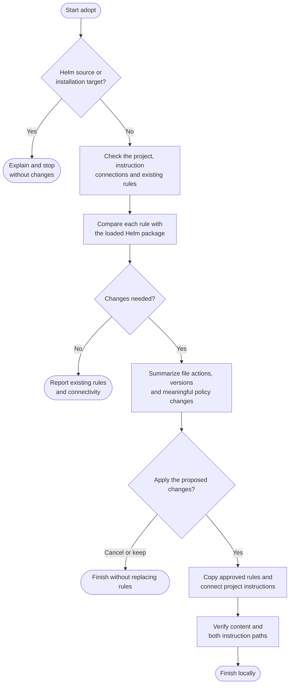

# adopt



Use adopt to give Claude and Codex shared working rules in a consumer project. Run it again when you want to review updates from the installed Helm package.

## Flow

The complete procedure follows, including conditions and exceptions within each phase.

{{ page.guide_source | guide_intro }}

{{ page.guide_source | guide_body }}
