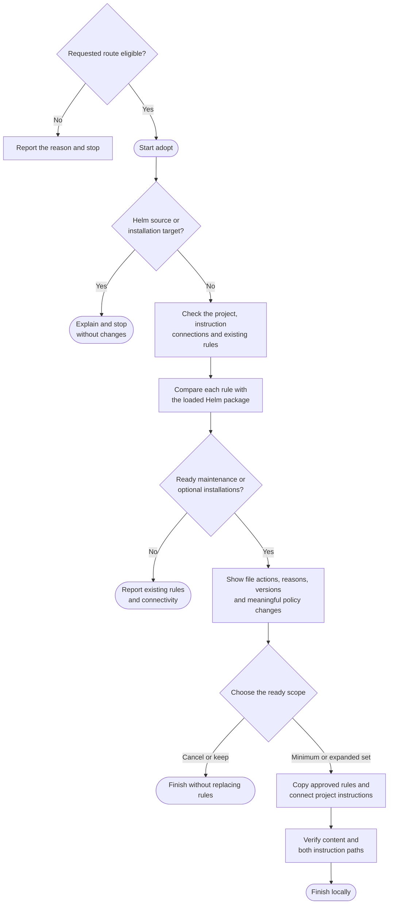

# Adopt



Adopt installs selected Helm rules into another project and connects them to the instructions Claude and Codex read. You review the actual policy changes before a bundled update reaches your project.

## Flow

## Start the command

Use a consumer project, not the Helm source checkout, one of its subdirectories or an installed Helm package. Those locations already contain maintained rule sources. Normal adoption checks for clean main or master and supported instruction connections before comparing rules. A blocker is reported and ends the run before proposals. Without Git history, approved files can remain uncommitted. A read-only comparison must be requested explicitly; it still respects protected-source and instruction-layout guards.

Adopt examines how the current clients reach project instructions before choosing a destination. A `CLAUDE.md`-only setup or conflicting independent entries may need [log's shared setup](../log.html#shared-project-instructions) first.

## Available rules

[Git and Safety](../../rules/git.html) are a pair: commit and publication choices depend on the preservation and authorization rules. The recommended fresh set adds Writing, which can be omitted. For an unscoped fresh installation, choosing the explicitly listed all-five set also selects Design and Interaction. Writing, Design and Interaction can each be used independently; a request for one does not silently install the others.

Interaction owns preference persistence, theme behavior, input feedback, cursors and link behavior. It includes the interface policies extracted from Writing and Design. An update proposal discloses the defaults moving out of an existing copy. You can keep that copy or approve its update with or without separately selecting Interaction. The new rule is not treated as a missing dependency; an updated Writing or Design copy alone no longer supplies those extracted policies.

The installed copies normally live under `.claude/rules/`. Their role is deliberate: a plugin update changes the available upstream rules, while the consumer keeps its reviewed local copies until you adopt again.

## Compare what is already there

Adopt distinguishes content from version labels. Identical text does not need replacing just because its marker differs. A customized file is not automatically outdated, and a newer-looking version is not permission to overwrite it.

| Finding | Possible outcome |
|---|---|
| Missing selected rule | Install the reviewed copy. |
| Existing matching rule | Keep its bytes and repair a missing connection if needed. |
| Different maintained copy | Show the policy changes before updating. |
| Customized or foreign content | Keep it, or explicitly approve the disclosed replacement. |
| External instruction pointer | Report the setup; do not silently convert or merge it. |

## Review the proposed set

The proposal uses a plain table: **File / Suggested action / Reason / Local → Source version**. Bold action labels carry the meaning without relying on color, emoji or badges. A differing file receives an explanation of the material policy changes; a customized-content replacement or downgrade is named explicitly. Full rule bodies and diffs are available when you want to inspect the exact wording.

The action choices depend on what is ready:

| Situation | Choices |
|---|---|
| Existing maintenance and optional additions | Update existing only / Update existing plus the listed missing rules / Keep existing / Cancel. |
| Existing maintenance only | Update existing, apply repairs or apply connections, as appropriate / Keep existing / Cancel. |
| Optional additions only | Install the listed missing rules / Keep existing / Cancel. |
| Unscoped fresh installation | Install the recommended Git, Safety and Writing set / Install all five / Cancel. |
| Everything matches and is connected, with no applicable optional offer | Report no changes without a question. |

The minimum maintenance choice includes required file/dependency repairs and instruction connections. It does not include a new optional rule merely because that rule is absent. The broader choice names every additional installation and pointer effect before approval; a missing Git/Safety pair is offered together when neither was previously adopted. An explicit subset can be supplied in the same response. Limited requests report other available rules without offering unrelated installation actions.

Action labels adapt to the actual effects: a connection-only plan does not pretend to update rule contents, and an overwrite or downgrade is not hidden behind a generic Update label. Unavailable source comparisons leave affected actions pending rather than offered for speculative approval. There is no extra question merely to view the proposal or consider each optional file.

Keeping a rule also preserves its existing pointers. Adopt does not blend custom clauses into a new rule automatically. Required companions are handled as part of the reviewed selection rather than left silently missing.

## Your result

After applying the chosen set, adopt checks the installed content and instruction connections. The report separates installed, updated, kept, skipped and missing items. Matching files stay unchanged.

When auto-commit is off and the exact copies, pointer changes, paths and commit subject are known, the same review can offer Apply and commit or Apply without committing. Installation approval alone does not approve a commit. Changed results need affected review; unchanged approved content is verified without another commit question.

Start a fresh agent session to load the new instructions. File checks establish what was installed, not that every client's next startup has already loaded it. Publication remains a separate [ship](../ship.html) action.

## Explore the source

For implementation details, read [guides/adopt.md](https://github.com/myowinthein/agent-helm/blob/main/guides/adopt.md).
