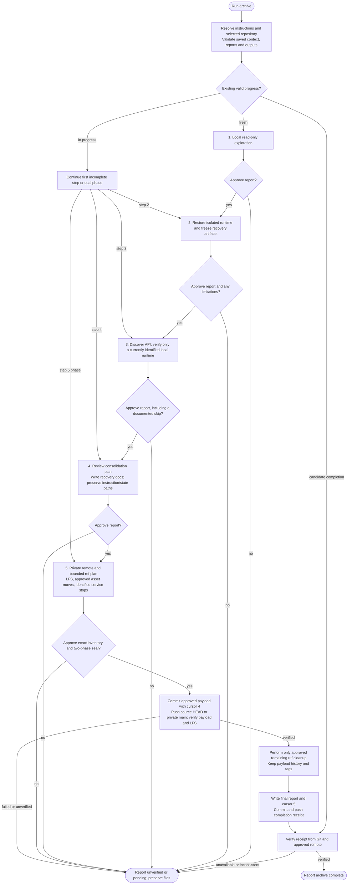

# /helm:archive

Restore an old project, freeze its environment, generate API recovery files, write recovery documentation, and seal the approved snapshot at a verified private remote. Five separately reviewed steps can resume across Claude/Codex sessions without relying on conversation memory.

Command names use Claude notation. In Codex, select the same workflow from the skill picker. The [shared runtime](../setup/compatibility.html) resolves package resources and the project's existing instruction/configuration owner before Git operations. Archive does not create, migrate, or rewrite Helm settings or agent entries. Its explicitly approved archival branch/commit plan does not let auto-commit bypass review, publication, or destructive-action gates.

Run from the branch containing the complete project, with a usable HEAD. Unmerged branches are reported so you can merge needed work yourself before restarting; archive never merges them on your behalf. The final archive branch is always `main`, including when the source was `master`. The actual source branch/commit is validated on resume, rather than inferred from prose.

## Preserved instructions and state

| Files | Archive behavior |
|---|---|
| Root/nested `AGENTS.md`, overrides, `CLAUDE.md`, project-local instructions, in-project imports and adopted rules | Read under active scope and preserve original contents, paths and bridges. Exempt from documentation/asset cleanup and recovery navigation requirements. |
| `.helm/`, `.claude/helm/`, known flat legacy Helm JSON files | Preserve as opaque state at existing paths; no ledger parsing, reconciliation, migration or edits. Tracked files travel with history. Untracked preservation inputs need explicit inventory review. |
| Global/external instructions and private client-local settings | Never copied automatically. Required external imports become documented recovery dependencies. Secret-bearing inputs block publication rather than being silently rewritten. |
| `.archive/` | Archive's own progress, file inventory and verbatim approved reports, committed to the private archive. |

Preservation does not authorize publishing credentials or absorbing another command's pending edits. Known secrets are omitted from report output entirely, including fragments and token-bearing URLs.

## Flow

The resume node continues the applicable step; it never skips unfinished restoration/documentation to finalize. No completed destructive task is blindly replayed after interruption.

## Steps

### [1. Explore](archive/1-explore.html)

Local read-only inspection of source, configuration, manifests, Git metadata, data sources and risks. Native file tools or read-only shell inspection are allowed; project execution, installs, builds, containers and network access are not. Record explicit project name, source branch and full commit. Nothing is written before report approval.

### [2. Restore and Freeze](archive/2-restore-and-freeze.html)

Restore the approved isolated project using the best suitable data source, prefer pinned Docker environments, export validated image tarballs, and make database/file data recoverable separately from images. Where Docker does not apply, document exact toolchain versions. Record actual file changes, outputs, current-host runtime identity and verification results without credentials. Missing data/access and partial outcomes retain their explicit review paths.

### [3. Postman Collection](archive/3-postman.html)

Discover this project's API from source/specifications and generate Collection v2.1 files under `recovery/postman/`, or report why the step is not applicable. A previous `App running: yes` is historical: verify current ownership/access before requests. An unavailable or unidentified runtime uses source-only discovery with requests marked unverified; do not automatically replay restoration after switching agents/hosts.

### [4. Documentation](archive/4-documentation.html)

Approve a per-file recovery-document consolidation plan before edits. Preserve instructions, imports, rules and opaque Helm state in place. Check protected imports before writing: preserve an imported README and approve an alternate archive index or stop for reconciliation. Otherwise write an archive-focused README, `docs/setup.md`, `docs/archive-metadata.md`, and historical notes when needed. Verify recovery-document navigation without treating protected agent/state files as orphaned cleanup candidates.

### [5. Finalize](archive/5-finalize.html)

Confirm the private destination and exact ref plan; choose LFS or separate backups, review asset moves, and stop only currently identified/approved project services. Review exact files and staged changes before seal approval. First commit/push and verify the payload on canonical `main`, with cursor 4. Then execute bounded approved cleanup, persist the final report and cursor 5, and publish a separate completion receipt. Completion requires verified receipt publication, not just a local cursor.

## Progress and resume

`.archive/state.json` retains the last locally approved report and adds an archive ID, source/working context, report/output fingerprints and finalization journal. `.archive/files.json` records baseline paths/fingerprints, workflow changes, protected preservation inputs and approved exclusions. Reports keep their existing `.archive/step{N}-{name}.md` filenames and approved contents. Metadata does not recursively hash itself; Git commit/tree proof covers it.

Validate JSON version/types/range, contained non-symlink paths, repository/branch/history identity, and required reports/outputs before resuming. Later completed steps and verified authorized in-progress changes supersede earlier output fingerprints, while unfinished outputs remain pending without rewriting historical reports. Unexplained changes or malformed/unsupported state stop for reconciliation. Another host/clone can resume after these checks, including canonical main at a proven payload/receipt when the old local source name is absent; absolute paths and old localhost/process assumptions are not identity proofs.

Legacy two-field state is read-only until the user confirms its project, source and remaining work. A legacy cursor of 5 without publication evidence is unverified. Existing metadata/reports without state require reconciliation before a restart; never delete the audit trail blindly. Stored reports do not grant new authorization.

A local cursor 5 with `receipt_prepared` is a candidate completion receipt. Verify its report/inventory tree, payload ancestry, LFS preservation evidence and containment in the approved remote's main. Missing proof/access reports unverified completion. A pending receipt resumes only its missing commit/push, without repeating restoration or ref cleanup. After verified receipt publication no files change again; the final user-facing summary supplies the receipt ID and publication proof separately from the committed report.

## Approvals and stop conditions

Each step report needs explicit approval; Step 4 also reviews its consolidation plan. Step 5 separately reviews local remote changes, tarball handling, referenced asset moves and identified service stops when applicable. Its final seal plan explicitly authorizes the reviewed payload and receipt commits/pushes plus bounded ref cleanup. Auto-commit, tool permission, a report flag or a missing answer does not replace those approvals.

Any declined/failed operation preserves actual completed work and pending files/refs. Report limitations and the exact remaining action; do not claim rollback or completion. No payload verification means no branch cleanup; no receipt publication proof means no Archive complete claim. Partial restoration can proceed only through its explicit informed approval, without promoting unverified output to verified status.

## See also

- [`/helm:log`](log.html): maintain shared project instructions
- [`/helm:manifest`](manifest.html): maintain the project README
