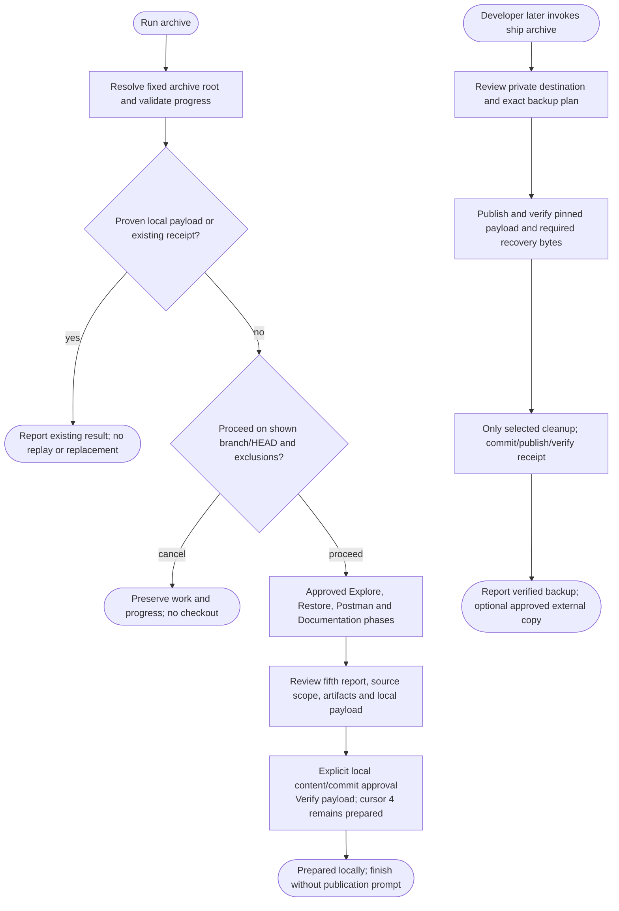

# /helm:archive

Preserve an old project's source, useful working environment, data and recovery documentation, and prepare a reviewed local payload. Invoke ship archive separately to publish/verify the private backup. Five approved phases resume across Claude/Codex sessions. Preserved source, runnable artifacts, offline recovery, offline rebuilds, backups and remote publication have separate evidence and limits.

Claude uses the command names below. In Codex, select the same Helm skill to start the workflow. Both resolve the [existing instruction/configuration owner](../setup/compatibility.html) without rewriting AGENTS.md, CLAUDE.md or Helm settings.

## Investigation depth and coverage

Step 1 covers each relevant recovery category/component and traces build/runtime/data/service/configuration/docs/asset relationships for the chosen goal. Read-only topic workers may help large independent investigations when permitted, returning inspected identities, evidence, unresolved dependencies and unread remainder. The parent reconciles coverage and keeps all execution/state actions. Static source coverage does not verify restoration, offline recovery or remote backup. Fixed reports, roots and resume/checkpoint semantics remain unchanged; no generic Full/Gap mode is added.

Follow the [shared investigation and exclusion rules](../setup/investigation.html). Inventories and worker evidence remain transient; inaccessible required material is not silently excluded or marked complete. Finding counts, duration and reasoning effort do not prove coverage.

## Usage

```text
/helm:archive
```

Follow the five approved report phases on the validated project source. A resume request follows verified existing progress and completes only pending work; it never starts another restoration automatically.

Before source-branch confirmation, only local read-only prerequisite/ref inventory and root/progress validation occur. No project execution, network/fetch, checkout or branch/index/ref/file/report writes occur. Local Git inspection suppresses optional index refresh, executable helpers and lazy fetching where supported; unavailable reads remain explicit limits. Step 1 exploration stays local and static. Later actions retain their separate source, runtime/data, report and payload approvals.

## Flow



Each phase stops for its report approval; the diagram does not grant blanket authorization. A resume continues its actual incomplete step/operation, and a proven completed receipt verifies publication without repeating restoration or cleanup. Failed/declined work preserves actual drafts, refs and earlier verified results.

## Confirm the source branch

Before a pending phase begins, archive shows the current attached branch and full HEAD, unmerged branches/work and other known exclusions from that snapshot, plus unknown coverage. It explains that approved edits/reports and the eventual local payload commit will happen on this branch. Choose **Proceed on this branch / Cancel**. A wrong branch requires a manual switch and rerun; archive never switches for you or absorbs pending work.

Only prerequisite/ref inventory and read-only root/progress validation precede this gate. Reuse explicit human approval for the same repository, branch, inspected snapshot and preservation scope, including verified expected continuation; saved reports, auto-commit or the command alone are insufficient. Unexpected source/branch changes or material new exclusions require reconfirmation; expected approved archive outputs/commits do not cause repeated questions. This adds no confirmation file or schema field and does not replace later report, runtime/data or payload-commit approvals.

Proven already-prepared/completed report-only reruns need no new Proceed question and never replay work or replace files.

## The five phases

1. [Explore](archive/1-explore.html): inspect relevant source/packages, versions, data, docs, assets and local Git metadata. Confirm the recovery goal and gaps, with a compact component handoff when useful. Separate supplementary docs from required runtime/build/data assets. Nothing is written before report approval.
2. [Restore and Freeze](archive/2-restore-and-freeze.html): approve the restore plan, restore and record actual evidence, offer a developer check, then recommend/select and execute the approved freeze. Cross-check component-specific setup evidence; choose useful container/native/static/data/toolchain outputs for the actual goal. Preserve original safe inputs unless another dataset is explicitly chosen. Cold rehearsal remains optional.
3. [Postman Collection](archive/3-postman.html): Retain/Repair/Create/Skip useful owned API recovery materials. Keep existing useful paths, cross-check current contracts against implementation and create an environment file only when valuable. Verify only approved appropriate requests against the identified isolated runtime; otherwise report unverified. No applicable API still gets its approved report.
4. [Documentation](archive/4-documentation.html): preserve useful recovery/build/design/legal/history evidence. Use an archive-specific README for orientation, setup for ordered procedures and metadata for human-readable artifact identities/storage/verification. This does not invoke manifest or use its README style setting. Check protected imports and current references.
5. [Finalize](archive/5-finalize.html): choose per-artifact regular Git/LFS/separate-local storage, retain or usefully consolidate supplementary docs, then review/approve and verify the local payload commit. Finish locally; later `ship archive` separately reviews private publication, verifies the backup and handles only selected cleanup, the completion receipt and optional external portable copying.

The developer check is feedback, not proof every runtime behavior passed. It can be declined/deferred or the pause omitted under an explicitly authorized unattended plan; silence is not consent. Reuse approval for unchanged concrete actions. Code/config/data changes invalidate only affected capture/verification evidence. These additions keep the five phases and schema 1, and do not invalidate older reports lacking optional handoff/check text.

## Preservation and Git defaults

Normal archive work needs an attached source branch and HEAD, with pre-existing changes reconciled before alteration and the source-branch confirmation above before pending phases. Recommend the intentional complete project snapshot, usually main/master after needed source work is integrated; another attached branch is allowed when it is the intended snapshot and project policy permits. No branch creation/switching during any archive phase. Unmerged source work is surfaced for developer action, never merged automatically. Other branches/tags/submodules/LFS/hosted resources are explicit captured or excluded inputs; one branch push is not a complete backup of all repository features.

Source remotes/local names remain by default. Archive never offers push/PR or performs ref cleanup. Later explicit ship archive selects one existing private destination, publishes canonical remote main without renaming local master/custom source and preserves normal fast-forward/review/signing/protection/check requirements. Divergence blocks, never force-pushes. Optional cleanup belongs only to that separately reviewed publication protocol.

Local payload approval authorizes only that reviewed commit, not a backup push. Ship archive separately reviews publication of the existing pinned payload, required artifacts and later completion receipt, using exact refs/no-follow-tags/readback. It alone performs selected post-backup cleanup and receipt updates in the narrow owning bundle. Tag/ref preservation and external copy actions retain separate scope; auto-commit/cursor never proves publication.

## Protected files and progress

Keep root/nested AGENTS.md, overrides, CLAUDE.md, adopted rules and in-project instruction imports at their original paths/content. Check every planned output, including setup/Compose/collection files, before any step writes. A protected target needs an approved alternate path with correct references or a stop for instruction reconciliation. Fixed progress/inventory/report filenames do not relocate: a protected/conflicting checkpoint path stops for reconciliation. Validate output containment and symlink/collision safety. External/global instruction dependencies are documented, not copied automatically.

Archive owns only its reserved progress, inventory and five report files. Preserve other `.helm/` content, including ordinary ledgers and unknown siblings, `.claude/helm/` and known unsupported old Helm records opaquely in place, without parsing, migration or cleanup. Unknown files inside an archive directory are not automatically archive-owned. Tracked history retains preserved inputs; untracked preservation inputs need explicit inventory approval. Secrets/private client inputs do not become publishable because the destination is private. Stage only exact approved files, never all `.helm/` or an archive directory.

### Archive directory and existing projects

Current runs keep their version-controlled schema-1 state and approved reports under `.helm/archive/`:

```text
.helm/archive/
├── state.json
├── files.json
├── step1-explore.md
├── step2-restore-and-freeze.md
├── step3-postman.md
├── step4-documentation.md
└── step5-finalize.md
```

Validate the canonical directory/parents, fixed files, schema/context and current fingerprints before continuation. Partial/reports-only/inventory-only evidence is prior work, never a fresh run. Reject symlinks, escaping paths and conflicting occupants. Switching coding agents alone never authorizes operational-state access.

An exists-only check for reserved old-bundle names under `.archive/` stops this archive route with [upgrade guidance](../setup/upgrading.html). It never reads old state, chooses between roots, converts, moves, merges or restarts a run. Other commands preserve historical archives opaquely. An ordinary `archive/` asset folder is distinct and remains in place. Existing metadata, including known alternate paths, blocks a false fresh run even when the state bundle is absent.

Keep current schema 1, fixed report names, unknown data and verbatim approved historical reports. Before every write, recheck source/branch, supported root, tripwire and latest legitimate output fingerprints. Authorized later outputs can supersede older fingerprints without rewriting reports; unexplained drift blocks work. Missing/unsupported versions are not upgraded automatically.

Local preparation keeps cursor 4/phase prepared with nullable destination/payload fields. Exact committed parent/archive-ID/report/inventory proof identifies the reviewed payload, with no post-commit state-only write. Proven preparation reruns replace nothing or replay services. Only explicit ship archive verifies private payload publication and selected cleanup, then commits/publishes/reads back the completion receipt at cursor 5/receipt_prepared. A cursor alone is not publication proof, and no tracked update follows final receipt verification. Current-format interruptions resume only the proven missing operation; historical unsupported runs require separate maintenance. Portable copies remain separately approved external actions.

## Output files and their purpose

Outputs are conditional on useful recovery needs and exact approval. Developer docs should explain recovery without requiring the raw workflow reports.

| Output or default path | Audience, format and purpose |
|---|---|
| `{archive_root}/state.json` | Agent workflow record, JSON schema 1: cursor/context/journal. Persists in version control. |
| `{archive_root}/files.json` | Agent workflow record, JSON schema 1: baseline, changes, preservation inputs/exclusions and fingerprints. Persists in version control. |
| Five fixed `step1-…` to `step5-…` reports listed above | Approved Markdown historical evidence for resume and human audit. Persistent; not the startup manual. |
| `README.md` or approved alternate index | Developer orientation: source/snapshot/status, purpose/stack/goal, supported recovery route, requirements/data/limits and links. |
| `docs/setup.md` or approved alternate | Ordered restore/data/run/demo/stop instructions. Link full artifact identities in metadata; retain explicit arguments needed by commands. |
| `docs/archive-metadata.md` or approved alternate | Human-readable Markdown inventory: full identity/platform/byte size/SHA-256/provenance/storage and actual scoped verification dates/results. No new machine schema. |
| Optional `docs/historical-notes.md` | Useful separate history only when retained existing documents do not suffice. |
| `recovery/docker/` | Selected unique image exports, normally `.tar.gz`, with stable recoverable mapping. |
| Existing data paths; `recovery/data/` only if useful | Necessary safe database/file/model inputs in engine-native formats, not automatically SQL or relocated. |
| Existing distributable paths; `recovery/native/` only if useful | Useful native builds/firmware/approved inputs. Document lawful acquisition of unavailable/non-redistributable SDKs instead of copying them. |
| Approved native configuration/template paths | Only needed safe recovery configuration with evidenced keys/placeholders/approved defaults; never copies of real `.env` values. |
| Existing API paths or new `recovery/postman/{project-name}.postman_collection.json` | Retained/repaired collections/specs or a useful new Postman v2.1 collection; no forced extra formats. |
| Optional `{project-name}.postman_environment.json` beside the collection | Separate environment selection only when useful beyond collection variables. |
| Existing supplementary paths; optional `recovery/assets/` | Useful approved BA/design/history consolidation, keeping native originals and conditional portable views. Excludes required application/build/data assets. |
| `.gitattributes` and actual local LFS objects | Only for selected LFS storage; a pointer is not the recovery bytes. |
| Separately approved external portable copy | Ship-owned post-receipt Git bundle plus available recovery inputs, checksums and restore index; not a new archive-phase deliverable. |

Use lower-case-kebab-case for new free-form names. Preserve conventional `README.md`, format suffixes such as `.postman_collection.json`, native extensions and existing referenced paths. Role/platform/version suffixes distinguish actual artifacts only. Do not create empty directories/companions, date-stamped duplicates, checksum sidecars or new profiles/ledgers for symmetry. No automatic renaming/migration; operational roots/names/schema stay fixed. No output is secret storage.

The README has its own archive information contract, independent of manifest and `readme-style`. Separate snapshot date from verification date/platform, keep only confirmed licence/maintenance/support claims and never preclaim publication. Link existing recovery docs or the actual tracked run directory, not a future Step 5 receipt. Full artifact tables belong in metadata; setup owns ordered instructions, and reports remain historical evidence. Record actual Retain/Repair/Create/Skip API outcomes and paths alongside the unchanged generated flag.

## Recovery and portable copies

Record actual image IDs/upstream digests where available, stable recoverable tags, OS/architecture, toolchain/Engine/Compose requirements, native locks and required data/files. Documentation of an unavailable SDK is a gap, not a working freeze. Use appropriate consistent backups; synthetic/sanitized data is preferred, and localhost is not automatically safe. Approved acquisition is separate from runtime live-service contact.

Static integrity, build, current run, cold rehearsal and offline rebuild results remain distinct. Honor verification deferral without running deferred checks or claiming Fully Restored. Partial preservation can continue only with its limitations approved. Local-only tarballs are not a verified backup; actual retrievable LFS objects or a verified separate copy are needed for the corresponding backup claim.

In ship archive after verified receipt publication, optionally approve a portable copy to a specific unused external directory: a self-contained Git bundle plus separately available required LFS/submodule/image/data/setup inputs, checksums and omissions. It changes no tracked files/state and creates no scheduler or cloud upload. Missing inputs/copy failure retain the verified seal and an exact copy handoff. A second independent copy is advice unless separately authorized.

## See also

- [Git and CI behavior](../setup/git-and-ci.html): archive publication and protection boundaries.
- [Compatibility](../setup/compatibility.html): shared instructions, capabilities and opaque state preservation.
- [log](log.html) and [manifest](manifest.html): active-project knowledge and README maintenance outside archive.
