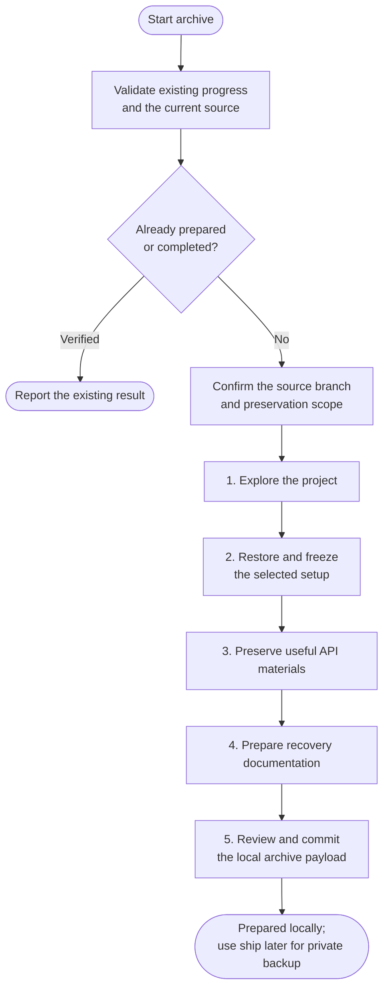

# archive

Preserve an old project's source, setup and useful recovery materials. Archive helps restore the selected scope, capture a suitable setup and prepare it locally for private backup through ship.

## Start the command

```text
archive
```

Use the prefix for your app or terminal from [Setup]({{ '/docs/setup/' | relative_url }}#run-a-command).

Start on the branch you want to preserve. Confirm its commit and excluded work before pending phases begin. Archive does not switch branches or merge missing work.

## Flow



Each phase needs report approval. Execution, data operations and the payload commit retain their concrete approvals; approving a report does not authorize unseen actions.

## The five steps

1. [Explore](archive/1-explore.html): inspect dependencies, data and preservation gaps without execution.
2. [Restore and freeze](archive/2-restore-and-freeze.html): restore the agreed scope, review results and capture a suitable setup.
3. [Postman collection](archive/3-postman.html): retain, repair or create useful API recovery files.
4. [Documentation](archive/4-documentation.html): prepare the recovery entry point, procedure and artifact inventory.
5. [Prepare locally](archive/5-finalize.html): review storage and the exact payload, then approve its commit.

Choose source preservation, a runnable demonstration, offline runtime recovery or additional rebuild inputs. Each needs different evidence; a saved image alone cannot prove all of them.

## Output files

Only useful outputs are created. Existing suitable locations can stay in use.

| Output | Purpose |
|---|---|
| `.helm/archive/` | Saved progress, file inventory and five approved reports. |
| Archive index, normally `README.md` | Where to start and what recovery can achieve. |
| `docs/setup.md` | Ordered recovery, data, run/demo and stop instructions. |
| `docs/archive-metadata.md` | Artifact identities, checksums, storage and verification. |
| Selected `recovery/` files | Captured images, API materials, data or supplementary assets. |

## Returning to an existing archive

Rerun to validate progress and continue incomplete local work. Unexplained source or output changes need reconciliation. Proven prepared payloads are reported without repeating restoration or replacing reports.

Unsupported bundles remain intact. Missing remote proof does not authorize restarting. Instructions, rules, other commands' records and existing recovery evidence are protected from blanket cleanup.

## Your result

You get the local payload commit or pending drafts, recovery instructions and limitations on the same branch. Deferred checks stay unverified.

Use [ship](ship.html#publish-an-archive-backup) separately to select a private destination, publish the payload and verify its completion receipt. Local preparation does not prove a remote backup.
