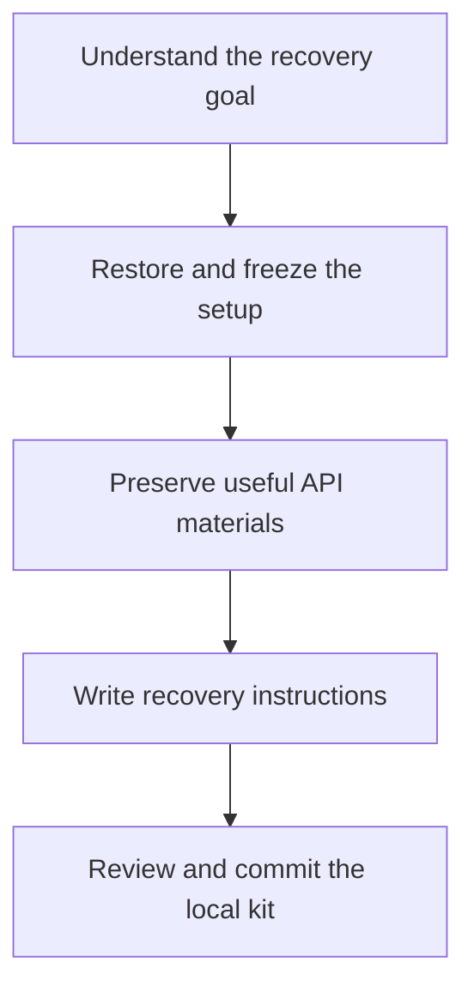

# archive



Use archive when an older project needs a recovery kit: source, setup, useful runtime/data and instructions for running it again. It prepares the kit locally; ship handles the later private backup.

## Flow



## Start the command

```text
Codex → $archive    Claude → /archive
```

Use your client's [command prefix]({{ '/docs/setup/' | relative_url }}#run-a-command). Start on the branch you want to preserve and confirm its commit and exclusions. Archive does not switch branches or merge missing work.

Choose what recovery should achieve: source preservation, a runnable demonstration, offline runtime recovery or rebuild inputs. Those goals need different evidence; a saved image alone cannot prove them all.

## The five steps

| Step | What you review |
|---|---|
| [Explore](archive/1-explore.html) | The project, recovery goal and missing materials. |
| [Restore and freeze](archive/2-restore-and-freeze.html) | An isolated restoration plan, results and capture choices. |
| [Postman collection](archive/3-postman.html) | Useful API collections or specifications, when applicable. |
| [Documentation](archive/4-documentation.html) | The recovery entry point and ordered instructions. |
| [Prepare locally](archive/5-finalize.html) | Storage, exclusions and the exact local payload commit. |

Each phase needs report approval. Execution, data operations and the payload commit keep their own concrete approvals; a report never approves unseen actions.

## Output files

Existing suitable locations can stay. The kit normally includes:

- An index, usually `README.md`, explaining what recovery can achieve.
- Setup instructions and artifact metadata under `docs/`.
- Selected runtime, API and data materials under `recovery/`.
- Progress and approved reports in `.helm/archive/`.

Only useful outputs are created. Secrets and unrelated work stay out.

## Returning to an existing archive

Rerun archive to check progress and continue pending work. Proven preparation is reported without repeating restoration or replacing reports. Unexplained changes need reconciliation; unsupported bundles and existing recovery evidence remain intact.

## Your result

You get a local payload commit or pending drafts, recovery instructions and explicit limitations on the same branch. Deferred checks stay unverified.

**Prepared locally is not backed up remotely.** Use [ship](ship.html#publish-an-archive-backup) separately to approve and verify the private payload and completion receipt.
