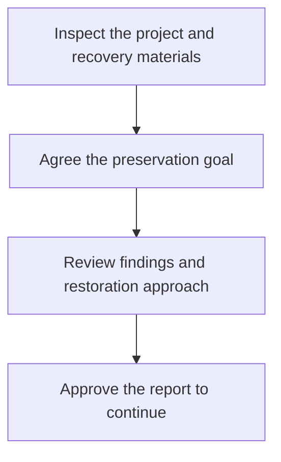

# Step 1: Explore

Agree what you want to preserve before attempting recovery. This phase inspects local source and metadata without running the project or contacting services.

## Flow

## What gets discovered

The agent looks for the last-working stack, setup instructions, data, integrations and useful artifacts. It identifies missing inputs and anything outside the selected snapshot, such as other branches or externally stored objects.

Secret values and private records stay out of reports. Cached information does not prove that an external resource is still available.

## Agree the preservation goal

Choose source preservation, a runnable demonstration, offline runtime recovery or rebuild inputs. The goal determines what needs capturing. Missing services, data, licensed tools or hardware remain explicit limits; restoration does not imply modernization.

## What happens next

Approve the findings and proposed approach, request changes or stop without saving. Approval saves the initial report, inventory and progress under `.helm/archive/`.

[Step 2: Restore and freeze](2-restore-and-freeze.html) proposes the actual restoration work.

[Read the full step](https://github.com/myowinthein/agent-helm/blob/main/prompts/archive/step1-explore.md).
