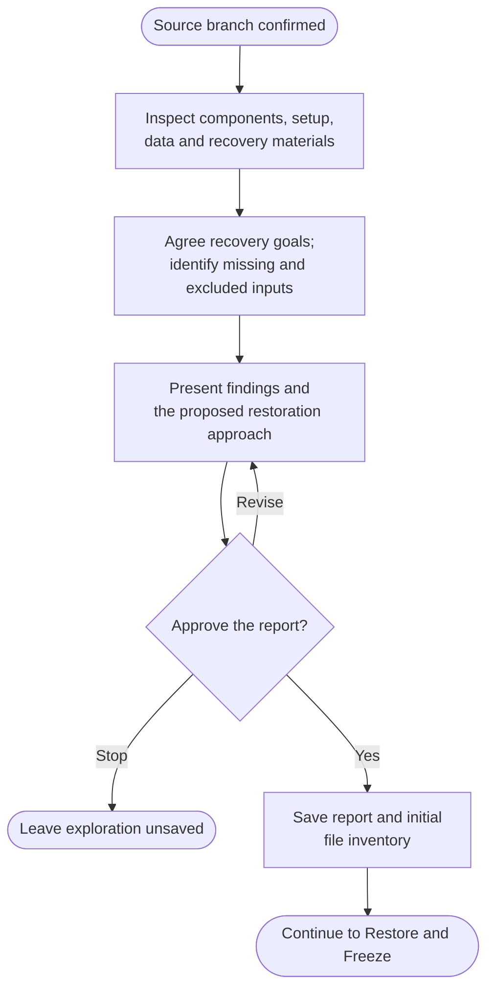

# Step 1: Explore

Understand what must be preserved before trying to restore the project. This phase uses local source and metadata inspection, without running the app or contacting services.

## Flow

## What gets discovered

The review follows each relevant component's build, runtime, data and service dependencies. It identifies:

- Purpose, architecture, key flows and a useful demonstration scope.
- Last-known-working stack, native lockfiles, platform/toolchain constraints and missing inputs.
- Databases, files, uploads, datasets, fixtures and possible recovery sources, with provenance and sensitivity concerns.
- Required external integrations, configuration key names and isolation questions.
- Existing setup notes, API materials, build outputs and useful design/history documents.
- Other branches, tags, submodules, LFS objects or hosted resources that the selected source snapshot may not preserve.

It distinguishes supplementary BA/design material from assets needed to build or run the app. Secret values and real user data are not copied into the report. Cached remote refs are not treated as fresh provider evidence.

## Agree the preservation goal

Choose the useful scope: source preservation, a runnable demonstration, offline runtime recovery or offline rebuild inputs. Missing SDKs, licensed tools, hardware, data or services remain explicit limitations. Archive does not silently modernize the project or merge another branch to fill gaps.

## What happens next

The report describes confirmed facts, uncertainties, restoration complexity and the recommended next step. You can revise it, approve it or stop without saving.

Only after approval does a fresh run create `.helm/archive/`, save `step1-explore.md`, capture its baseline inventory in `files.json` and record progress in `state.json`. [Step 2: Restore and freeze](2-restore-and-freeze.html) uses those findings to propose the actual restoration work.
