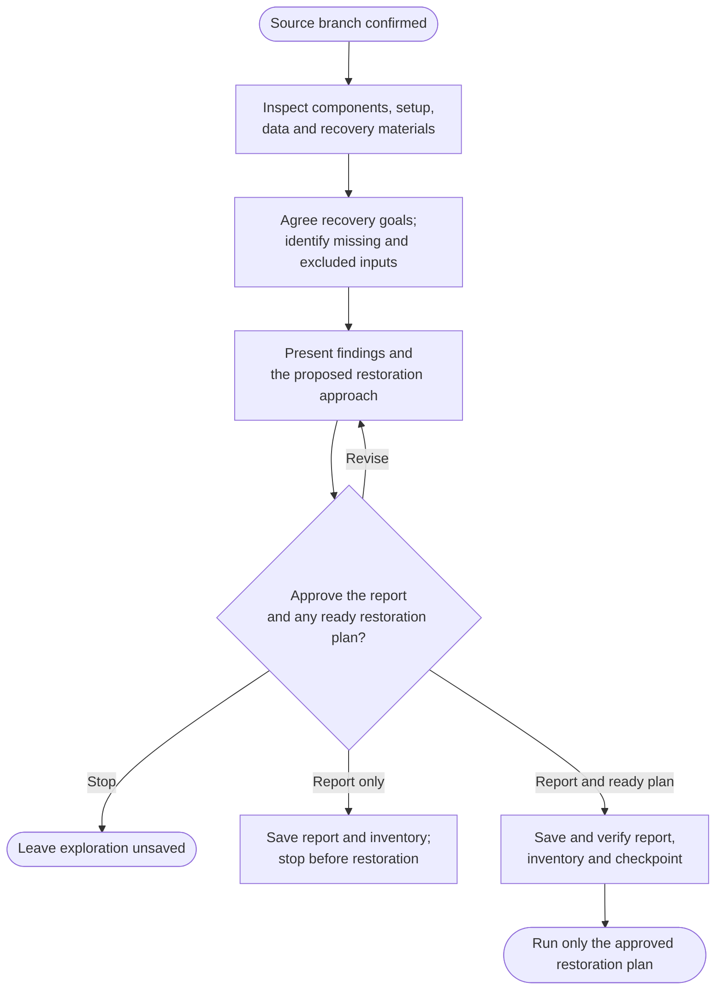

# Step 1: Explore



Exploration defines what a successful recovery would mean for this project. The agent inspects local evidence before recommending restoration, so missing services, assets or build inputs are visible before execution starts.

## Flow

## What gets discovered

The starting point is the source branch and commit you agreed to preserve. Other branches, submodules, LFS objects and hosted artifacts are identified as included, excluded or unknown; their existence is not proof they are captured in this snapshot.

The review follows the project's components and their relationships: runtime versions, build inputs, configuration roles, data stores, authentication, integrations and useful documentation. Manifests, locks and setup notes are compared rather than trusting any one file as the whole system.

Useful recovery assets are distinguished from supplementary history or design material. A database dump or model file may be essential to running the project; an old mockup may provide context without being a runtime dependency. Both can be worth retaining, but for different reasons.

This phase is read-only. It runs no project code, builds, containers, tests or network requests. Reports contain paths, key names and evidence, not credentials or private records. Cached metadata cannot establish that an external download is still available.

## Agree the preservation goal

Choose the minimum useful result that still meets your actual request. A source snapshot, a runnable demonstration, offline runtime recovery and an offline rebuild need different materials and verification.

For example, preserving a frontend build may be enough for a self-contained static site. It would leave a backend-dependent application incomplete unless its server, data and required files are also addressed. Missing licensed tools, hardware or services may limit the goal rather than justify an unrequested upgrade.

The report separates confirmed facts, plausible restoration approaches and unknowns. Complexity is explained from the evidence, not presented as a guarantee of effort or success.

## What happens next

Review the proposed scope and approach, request corrections or stop without saving. Approval records the initial report, inventory and progress in archive's own bundle.

When the exact [Restore and freeze](../2-restore-and-freeze.html) plan is ready, the same review can show its commands, targets and execution effects. Approve both to continue after the exploration checkpoint is verified, or approve only the report and stop. If restoration still depends on missing facts, its plan needs later approval; a suggested approach is not permission to execute it.

## Explore the source

For implementation details, read [prompts/archive/step1-explore.md](https://github.com/myowinthein/agent-helm/blob/main/prompts/archive/step1-explore.md).
