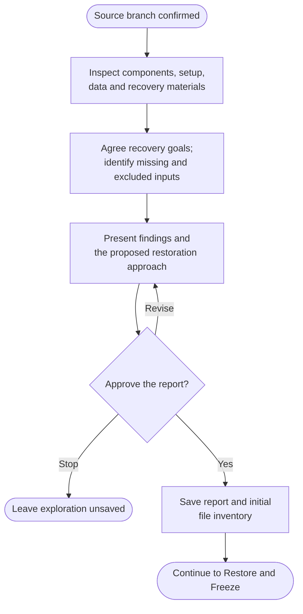

# Step 1: Explore



Agree what you want to preserve before attempting recovery. This phase inspects local source and metadata without running the project or contacting services.

## Flow

The full step follows. It runs only as part of archive, with the approvals and preservation boundaries stated below.

{{ page.guide_source | guide_intro }}

{{ page.guide_source | guide_body }}
