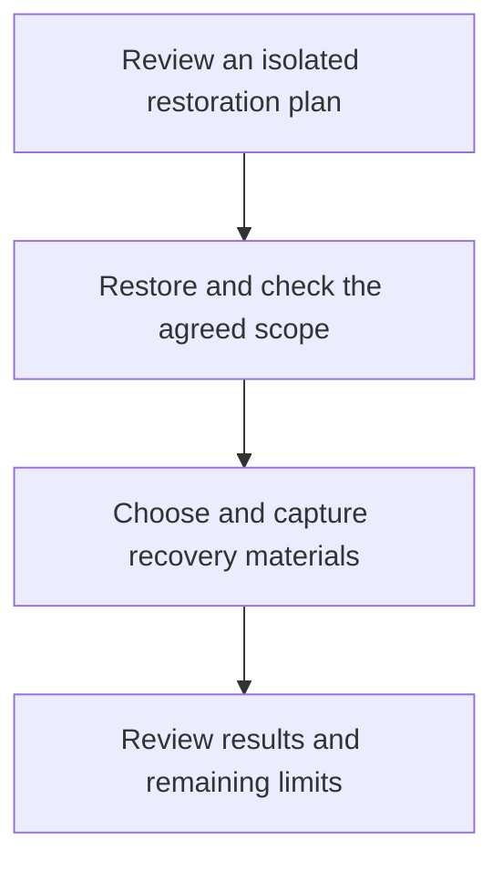

# Step 2: Restore and freeze

Restore the agreed scope, then capture what later recovery needs. What works now and what remains unverified are recorded separately.

## Flow

## Restore from reliable inputs

The agent compares setup notes with manifests, locks and scripts, favoring compatibility over upgrades. You review the edits, commands, downloads, targets and checks before execution.

Work uses owned, isolated resources without live-service contact. Uncertain isolation leaves affected work pending; a localhost address alone proves no safety.

## Choose and preserve data

Use synthetic or sanitized data, an approved local export, or accept empty/schema-only recovery. Imports require a fresh, owned, empty target and an approved plan. A partial failure stops dependent work without automatic reset or retry.

## Freeze what the project needs

You can inspect the restored result before choosing the capture. A server might need images, stores and recovery configuration; a static site might need built output and build inputs. Libraries, native apps and hardware projects need their own useful distributables and platform requirements.

Artifacts retain identities and checksums. Real credentials stay out of the kit. A working app does not prove offline rebuilding or future platform availability.

## What happens next

The setup instructions put validation, preparation, data restore, startup, demonstration and shutdown in order. Review completed and deferred checks before approving the report and continuing to [Step 3: Postman collection](3-postman.html).

A cold-recovery rehearsal needs separate approval and isolation. Existing caches and volumes are preserved. This phase does not commit.

[Read the full step](https://github.com/myowinthein/agent-helm/blob/main/prompts/archive/step2-restore-and-freeze.md).
