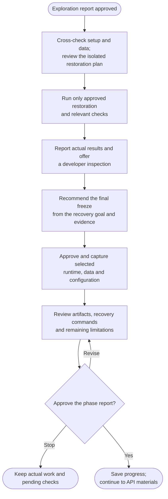

# Step 2: Restore and freeze

Restore the agreed project scope, review what actually works and preserve the setup needed to recover it later. The approach follows the project's stack and recovery goal rather than forcing every project into Docker.

## Flow

## Restore from reliable inputs

Setup notes are cross-checked with manifests, locks, scripts, CI, Dockerfiles and platform requirements. Missing instructions can be reconstructed from evidence; conflicting versions need resolution before dependent actions. Restoration favors compatible original behavior over upgrades.

Before execution, you review exact edits, commands, acquisitions, runtime targets, data operations and checks. The plan uses owned isolated resources and prevents live-service contact. If isolation or a required capability cannot be established, affected execution stays pending rather than guessing a safe target.

## Choose and preserve data

The command looks for suitable synthetic or sanitized fixtures, seeds, dumps and required files. It does not automatically prefer an old dump, assume localhost is disposable or connect to production for missing data. You can supply an approved local export, wait or accept a limited empty/schema-only restoration.

Imports use fresh owned empty targets, compatible engine-native procedures and correct initialization order. Applied migration records are preserved and pending work is identified. A partial import failure stops dependent work; it does not trigger an automatic drop, reset or retry.

## Freeze what the project needs

After restoration evidence, you get a chance to inspect the app or relevant CLI, library or native behavior. The final recommendation reflects that result and the goal:

| Project | Possible preservation route |
|---|---|
| Server or full-stack app | Compatible runtime/images, required stores and recovery configuration. |
| Self-contained static site | Built output and the build inputs needed for the selected goal. |
| Library or CLI | Source, locked environment and useful distributables. |
| Native, mobile, data or hardware project | Useful builds/models/firmware plus actual SDK, platform, hardware and acquisition constraints. |

Only selected artifacts are captured. Docker exports, when useful, go under `recovery/docker/` with real image/tag/platform mappings, sizes and checksums. Native data and distributables can stay at existing paths. A real `.env` is never copied into the recovery kit.

## What happens next

The phase prepares ordered commands in the approved setup file, normally `docs/setup.md`:

1. Validate artifacts.
2. Load or prepare the runtime.
3. Restore data before dependent consumers.
4. Start safely.
5. Demonstrate useful behavior.
6. Stop the owned services.

You review actual checks separately from unverified or deferred work. An optional cold-recovery rehearsal needs separate approval and a suitable isolated environment; the developer's existing caches and volumes are not cleared to simulate one.

Approval saves `step2-restore-and-freeze.md` and verified progress under `.helm/archive/`, then continues to [Step 3: Postman collection](3-postman.html). You may approve limited preservation with its limitations stated. No commit or push happens in this phase.
