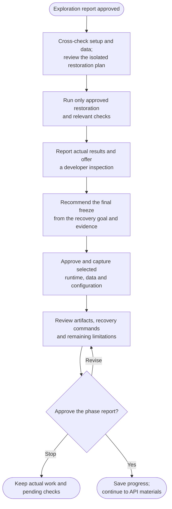

# Step 2: Restore and freeze



Restoration establishes what can actually run; freezing preserves the materials needed to repeat that result. The final capture choice follows the evidence from restoration and your opportunity to inspect it.

## Flow

## Restore from reliable inputs

The agent cross-checks setup notes, manifests, locks, build scripts and platform requirements. Compatible restoration is the goal. Modernizing a framework or runtime is not an automatic part of recovering an older project.

Before execution, review the exact edits, commands, dependency or image acquisitions, isolated targets and checks. An approved download is separate from allowing the restored app to contact live services. Runtime isolation must account for inherited endpoints, jobs, telemetry, storage and integrations; a localhost address or a new container name is insufficient.

If the no-live-contact requirement cannot be met, the affected execution remains pending or source-only. It is not silently attempted against a production dependency.

## Choose and preserve data

Choose suitable synthetic or sanitized inputs, an approved local export, or explicitly accept empty/schema-only recovery. Required uploads, file stores, models and indexes matter as well as the database.

Imports need a fresh, owned, empty target and an approved plan. A partial failure stops dependent work without an automatic reset or retry. A physical database snapshot needs an engine-supported consistency method; copying an arbitrary running volume does not establish a restorable backup.

## Freeze what the project needs

After approved checks, you can inspect the restored result before the final capture recommendation. The record distinguishes checked, declined and deferred review. A listening port alone is not evidence that the important behavior works.

| Project shape | Typical preservation need |
|---|---|
| Server-backed application | Runtime images or compatible runtime inputs, required stores/files and the safe recovery configuration. |
| Self-contained static site | Built output and the build inputs required by the chosen goal. |
| Library, native app or hardware project | Useful distributables, platform/toolchain requirements and any essential external materials. |

Capture the selected artifacts with identities, checksums, sizes and provenance. Verify export success before replacing an existing good artifact; an empty or corrupt export must not masquerade as a saved image. LFS pointers or image names alone do not preserve their bytes.

Credentials stay out of the kit. A working frozen runtime does not prove an offline rebuild, and platform availability remains a separate limitation.

## What happens next

The recovery procedure records prerequisite validation, preparation, data restoration, startup, demonstration and shutdown in the correct order. Deferred checks stay unverified when you review the phase report.

A cold-recovery rehearsal needs its own approved isolation and effects. Existing caches and volumes are preserved, and this phase does not commit. Continue to [API materials](../3-postman.html) after approving the report.

## Explore the source

For implementation details, read [prompts/archive/step2-restore-and-freeze.md](https://github.com/myowinthein/agent-helm/blob/main/prompts/archive/step2-restore-and-freeze.md).
