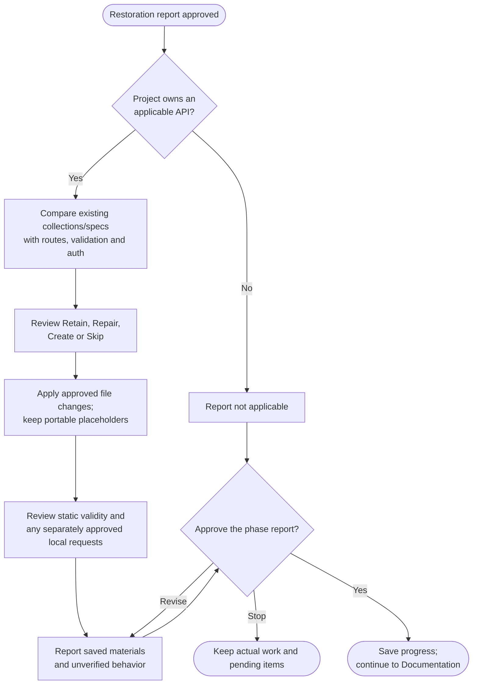

# Step 3: Postman collection

Preserve useful API recovery materials when the project owns an API. Existing collections and specifications come first; projects with no applicable API need no generated collection.

## Flow

## Retain, repair, create or skip

Owned backend APIs, server routes and serverless functions can qualify. Merely consuming a third-party API does not. The agent checks actual operations, request shapes and authentication; a route list alone cannot supply the whole contract.

You can keep a useful collection at its current path, approve targeted repairs, create missing recovery coverage or explicitly skip it. Existing custom requests and canonical specs are preserved. Unsupported protocols can keep their native materials instead of being forced into Postman.

New collections normally use Postman v2.1 at `recovery/postman/{project-name}.postman_collection.json`. Collection variables may be sufficient; a separate environment file is created only when it adds value. Examples and variables contain placeholders, not credentials, private records or production endpoints.

## Verification is optional execution work

Source-based generation and static format/reference checks do not require API requests. Any request execution first needs approval, a currently verified isolated runtime and inspection of its effects, including collection scripts. Historical running-app reports or reachable ports do not establish a safe target.

Deferred or unavailable requests are listed as unverified. The command does not repeat restoration automatically, contact live services or exercise destructive endpoints merely to increase coverage.

## What happens next

The report lists the actual Retain/Repair/Create/Skip result, paths, discovered operations, performed requests and remaining gaps. A not-applicable or skipped result still receives report approval.

Approval saves `step3-postman.md` under `.helm/archive/` and continues to [Step 4: Documentation](4-documentation.html). No commit or push happens in this phase.
