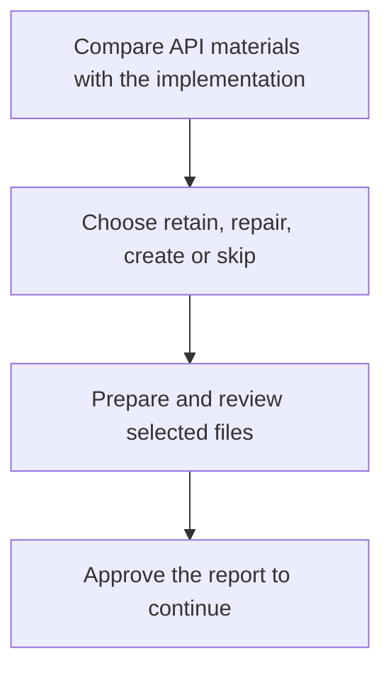

# Step 3: Postman collection



Preserve useful API materials for recovery. Projects without an applicable owned API can record this phase as not applicable.

## Flow

## Retain, repair, create or skip

Existing collections and specifications come first. The agent checks operations, inputs and authentication against owned routes or functions. Consuming a third-party API alone does not call for a collection.

Keep useful files, approve repairs, create missing coverage or skip. Preserve custom requests and canonical specifications; unsupported protocols can keep their native materials.

New collections normally use Postman v2.1 under `recovery/postman/`, with an optional environment file. Examples use portable placeholders, without credentials, private records or production endpoints.

## Verification is optional execution work

Preparing files does not send requests. Execution needs separately approved effects and a currently verified isolated runtime, including review of collection scripts. A reachable port or old report is insufficient. Deferred requests stay unverified without repeating restoration.

## What happens next

Review the files, any executed requests and remaining gaps, including skipped or not-applicable outcomes. A ready [Step 4: Documentation](4-documentation.html) plan can share the report approval; report-only approval saves progress and stops. This phase does not commit.
