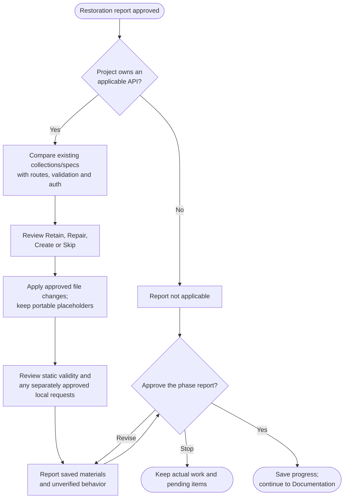

# Step 3: Postman collection



Preserve useful API materials for recovery. Projects without an applicable owned API can record this phase as not applicable.

## Flow

The full step follows. It runs only as part of archive, with the approvals and preservation boundaries stated below.

{{ page.guide_source | guide_intro }}

{{ page.guide_source | guide_body }}
