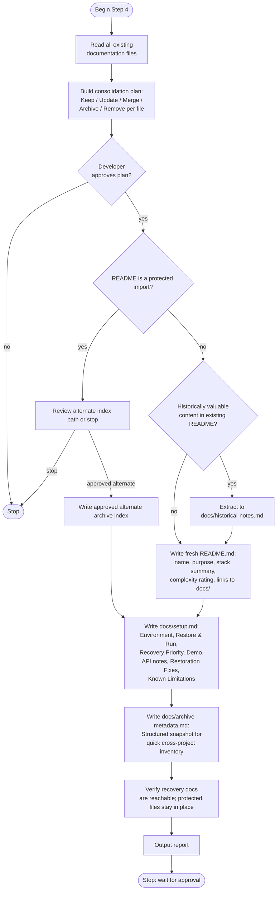

# Step 4: Documentation

Writes fresh, archive-focused documentation using verified information from all previous steps. Reads every existing doc first and presents a consolidation plan for explicit approval before touching anything. Produces three required files and one optional file.

## Flow

## Consolidation plan

First exclude protected root/nested `AGENTS.md`, overrides, `CLAUDE.md`, project-local instruction entries, in-project imports and adopted rules from consolidation. Preserve their original paths, contents and bridges, including Helm settings. Global/external instructions are documented dependencies, never silently copied. `.helm/`, `.claude/helm/` and known flat legacy state remain opaque and in place; do not parse, migrate, rewrite or move them as assets. A generic documentation-plan approval does not authorize modifying these protected inputs.

Before changes, assign each remaining recovery-documentation file an action:

| Existing doc type | Action |
|---|---|
| Accurate, has recovery or demonstration value | Keep: link from README |
| Accurate but duplicates `docs/setup.md` content | Merge into `docs/setup.md`, remove original |
| Outdated instructions that affect restoration | Update |
| Historical context, domain knowledge, business background | Archive: move to `docs/historical-notes.md` |
| Contributor guides, PR templates, code of conduct | Remove: irrelevant for private archive |
| Changelogs and release notes | Archive: move to `docs/historical-notes.md` if useful; otherwise remove |
| CI/CD documentation, deployment runbooks | Remove: no recovery value |
| Auto-generated documentation | Remove: regenerate if needed |
| Outdated and no recovery or historical value | Remove |

The plan is presented and must be explicitly approved before any file is touched.

## Required files

### README.md

Normally written fresh after preserving approved historical context. First inspect the protected-import inventory. If an active AGENTS.md/CLAUDE.md/project instruction imports README as instructions, preserve its path/content and show the conflict in the consolidation plan before any writes. Offer **Keep protected README and create an archive index** or **Stop for instruction reconciliation**. The first choice reviews an unused path such as `docs/archive-index.md`, records it in report/inventory/metadata, and uses it as the recovery entry point. It does not extract/rewrite the protected README or repoint imports. A generic consolidation approval never authorizes that change. Apply the same protection check to other required outputs.

The generated index contains project name, purpose, stack, restoration complexity and links to setup/archive metadata. Only an unprotected README follows the normal rewrite and historical-content extraction path. All recovery navigation uses the approved index; protected instruction/rule/state files remain exempt.

### docs/setup.md

The single recovery reference. Sections written only when applicable:

- **Environment**: original runtime requirements, verified restoration environment from Step 2
- **Restore & Run**: exact commands to restore and start the project
- **Recovery Priority**: each dependency classified as Required, Optional, or Not Required
- **Demo**: demo accounts, happy path walkthrough, key screens; omitted for CLI tools and libraries
- **API**: authentication method, collection location; included only if Step 3 generated a collection
- **Restoration Fixes**: every fix applied in Step 2, why it was necessary, and whether it may need revisiting
- **Known Limitations**: features that could not be restored or require unavailable services

### docs/archive-metadata.md

Structured snapshot for quick inventory across archived projects:
- Repository name and archive date
- Project purpose (one line)
- Technology stack
- Restoration outcome from Step 2
- Runtime versions used
- Database source used
- Docker images exported and tarball paths
- Postman collection generated: yes / no
- Recovery complexity rating from Step 1
- Known limitations (brief)

## Optional file

**docs/historical-notes.md**: created only when significant historical content exists that has archival value but would clutter current docs. All content is clearly labelled as historical.

## Rules

- Validate approved archive context, output fingerprints and inventory first. Read recovery documentation before edits, and record every approved change with protected-file preservation reported separately.
- Only document verified information. Label anything unverified explicitly.
- Do not invent setup procedures, demo workflows, runtime requirements, or API behavior.
- No secrets, credentials, API keys, or private/production URLs.
- Every active recovery document must be reachable from the approved archive index. Protected instruction/rule/state files are exempt from recovery navigation, so they are not moved or removed as orphans.
- Use em-dashes sparingly: only when no other punctuation works as well.
- No commit or push.
