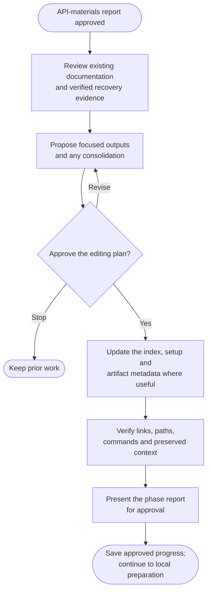

# Step 4: Documentation

Give future developers a clear entry point, ordered recovery procedure and record of captured artifacts.

## Flow

## Keep useful documentation

Retain useful setup, domain, API and historical material, including licenses and legal notices. Review focused repairs, consolidation or removals before editing.

Instructions, imports, rules and operational records remain protected. A conflicting output path needs an agreed alternative.

## Give each output a clear purpose

| Default output | Purpose |
|---|---|
| `README.md` | Snapshot, recovery route, requirements, limits and links. |
| `docs/setup.md` | Ordered preparation, data restore, run/demo and stop commands. |
| `docs/archive-metadata.md` | Artifact identities, checksums, provenance, storage and verification. |
| Optional `docs/historical-notes.md` | Useful history needing a separate home. |

Keep suitable existing locations. The archive index follows recovery needs independently of [manifest](../manifest.html) or `readme-style`.

Link procedures and artifact tables rather than copying them into the index. Use evidenced commands and actual API-material paths; retain missing inputs and unverified checks.

## What happens next

Static review checks navigation, paths and command order against recovery evidence. It does not execute the app or claim a published backup.

Approve the report to continue to [Step 5: Prepare locally](5-finalize.html). Earlier reports stay unchanged. This phase does not commit.
