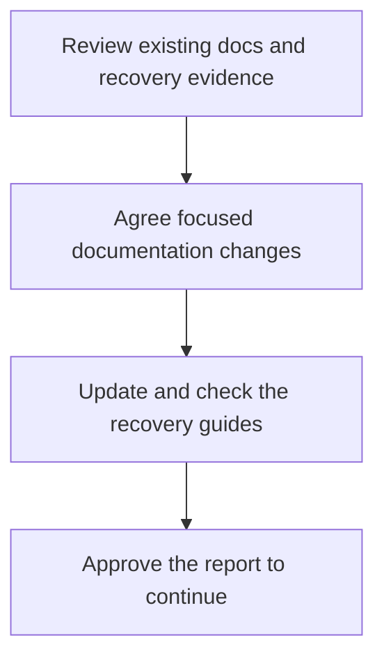

# Step 4: Documentation



Give future developers a clear starting point and an ordered recovery procedure, grounded in what the archive actually contains.

## Flow

## Keep useful documentation

Retain useful setup, domain, API and historical material, including licenses and legal notices. Review consolidation or removals before editing. Protected instructions, imports, rules and operational records stay intact; conflicting output paths need agreed alternatives.

## Give each output a clear purpose

| Default output | What readers find there |
|---|---|
| `README.md` | The snapshot, recovery route, requirements, limits and links. |
| `docs/setup.md` | Preparation, data restore, run/demo and stop commands in order. |
| `docs/archive-metadata.md` | Artifact identities, checksums, provenance, storage and verification. |

Keep suitable existing locations. Useful history can have a separate home. The archive index follows recovery needs independently of [manifest’s README style](../manifest.html#choose-the-readme-and-style).

Link to procedures and artifact tables instead of repeating them. Use evidenced commands and actual paths; keep missing inputs and unverified checks visible.

## What happens next

Static review checks navigation, paths and command order against recovery evidence. It does not run the app or establish a remote backup.

Approve the report to continue to [Step 5: Prepare locally](5-finalize.html). Earlier reports stay unchanged. This phase does not commit.
