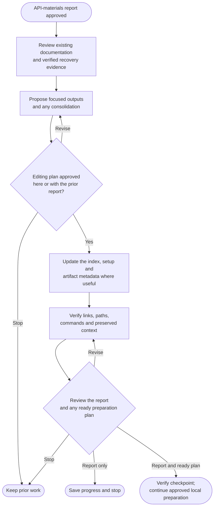

# Step 4: Documentation



Recovery documentation should help a future developer choose a route and follow it without reconstructing the archive from scattered reports. The writing reflects preserved evidence, including what still cannot be verified.

## Flow

## Keep useful documentation

The agent first identifies what existing setup, domain, API, build and historical documents are useful. Focused updates are preferred. Consolidation or removal needs a path-specific plan that preserves meaningful context, licenses and notices.

Instruction owners, imported instructions, rules and operational records are protected. If the desired README or setup path is also an active instruction input, archive uses an agreed alternative or stops for separate reconciliation. It does not repoint instructions to make space for a recovery page.

## Give each output a clear purpose

| Output | Reader's question |
|---|---|
| Recovery index, usually `README.md` | What snapshot is this, what can I recover and where do I start? |
| Setup guide, usually `docs/setup.md` | In what order do I prepare, restore data, run, inspect and stop it? |
| Metadata, usually `docs/archive-metadata.md` | Which exact artifacts, checksums, platforms and verification results belong to this snapshot? |
| Optional historical notes | Which older decisions or context remain useful? |

Existing suitable paths stay. The recovery index follows the archive goal independently of [manifest's README style](../../manifest.html#choose-the-readme-and-style).

Keep the full identity tables in metadata and link to them. Setup still includes the exact arguments readers need to execute the evidenced procedure, without becoming a duplicate inventory.

## Explain recovery in order

Commands follow the preserved inputs: validate prerequisites, obtain the already captured artifacts, prepare configuration, restore data into owned storage, then start dependent components. The guide also explains expected results and shutdown.

A recorded image should not silently trigger a fresh pull or rebuild when the selected goal is offline runtime recovery. Native or static projects receive their actual procedure rather than invented container steps. Unknown versions, absent inputs and unperformed checks remain explicit.

For example, a database restore must precede the application feature that needs those records. Merely listing both commands somewhere on the page does not give a reader a usable recovery sequence.

## What happens next

Static review follows the index to the recovery documents and checks actual file paths, configuration references and command order against earlier evidence. It does not run the app or establish a remote backup.

A ready [Prepare locally](../5-finalize.html) plan can share this report's review, including exact storage, move or service-stop actions when known. Report-only approval saves progress and stops. The final payload and fifth report are reviewed separately once their actual contents and results are known. Earlier approved reports remain historical evidence; current guides explain the current checked snapshot without rewriting that history.

## Explore the source

For implementation details, read [prompts/archive/step4-documentation.md](https://github.com/myowinthein/agent-helm/blob/main/prompts/archive/step4-documentation.md).
