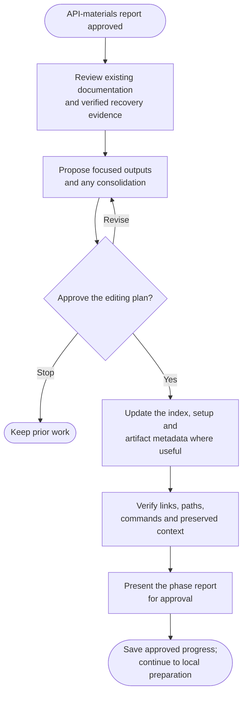

# Step 4: Documentation



Give future developers a clear starting point and an ordered recovery procedure, grounded in what the archive actually contains.

## Flow

The full step follows. It runs only as part of archive, with the approvals and preservation boundaries stated below.

{{ page.guide_source | guide_intro }}

{{ page.guide_source | guide_body }}
