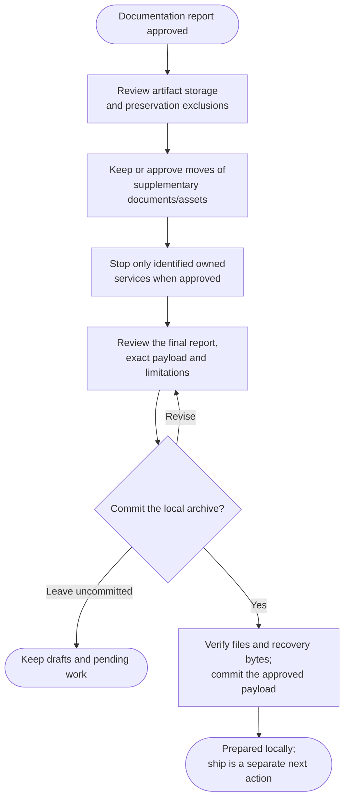

# Step 5: Prepare locally

Review the complete recovery kit and commit the approved local archive payload. Private backup publication happens later through ship.

## Flow

## Review storage and supplementary assets

Each artifact gets an agreed route: regular Git, supported Git LFS with actual local objects, or an explicitly accepted separate/local-only exclusion. The decision uses real sizes, checksums and available storage evidence. Provider limits vary; a large blob is not safe for regular Git simply because the destination is undecided. LFS pointers alone do not preserve recovery bytes.

Organized BA documents, diagrams, designs and project-history material normally stay in place. Useful consolidation can move selected scattered material into `recovery/assets/`, preserving native originals and updating all recovery references after approval. Application assets, data, fixtures and build inputs are not generic tidying targets.

Only currently identified owned project services are offered for stopping. An old report, a port number or a reused PID is not enough to establish ownership. There is no blanket daemon shutdown or volume cleanup.

## Approve the local payload

You see exact files, storage choices, exclusions, actual stop/move results and verification limits. Credentials, private data and unrelated work cannot be absorbed into the payload. Protected instruction files and other commands' state remain intact.

Choose **Commit reviewed local archive** or **Leave uncommitted**. This approval is required even with automatic commits enabled. On approval, the agent saves the final local-preparation report and inventory, stages only the agreed files and verifies the resulting payload commit.

The verified payload commit proves local preparation. Saved progress distinguishes this from a remotely completed backup, so a prepared result can finish locally without a completion receipt.

## What happens next

The result is **ARCHIVE PREPARED LOCALLY**, with the actual payload commit, recovery paths and limitations, or an honest pending-draft result. A rerun that verifies this payload reports it without replacing reports or repeating work.

When ready, use [ship](../ship.html#publish-an-archive-backup) to select an existing private destination and approve payload-then-receipt publication. Only that verified continuation records the remotely checked completion receipt. Local refs and remotes stay by default; cleanup is optional.

After a verified receipt, ship can separately offer a portable copy at an unused external destination. It includes a Git bundle and available recovery inputs with explicit omissions; a bundle alone cannot preserve external image, data or LFS bytes. No backup publication, PR, branch switching or remote cleanup happens in this archive phase.
