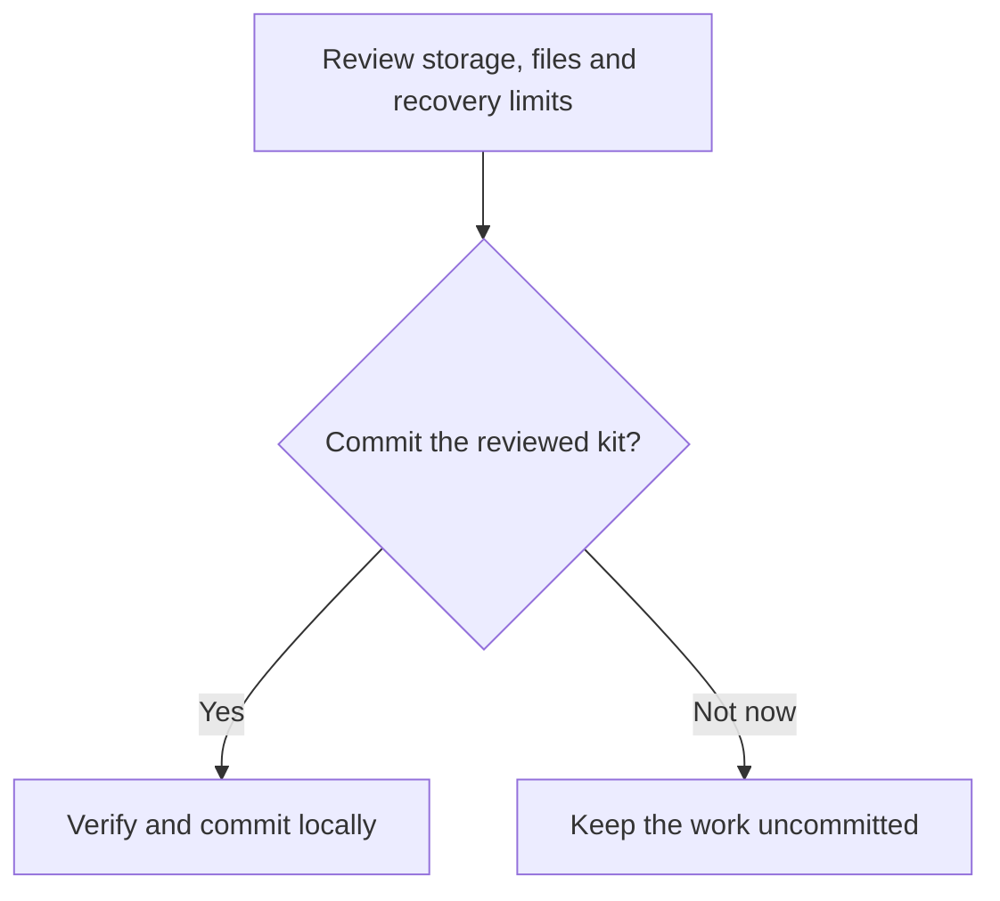

# Step 5: Prepare locally



Review and commit the local recovery kit. A private remote backup is a separate action through ship.

## Flow

## Review storage and supplementary assets

Ready storage, move and service-stop preparation can be approved with the documentation report; unchanged actions need no repeated question. For each artifact, choose regular Git, supported LFS with actual objects, or an explicit separate/local-only exclusion. LFS pointers alone do not preserve bytes, and exclusions can leave recovery incomplete.

Keep organized design and history material in place. Approved consolidation preserves originals and updates references. Runtime assets and data are not cleanup targets. Only identified, owned services may be stopped with approval; no blanket daemon or volume cleanup follows.

## Approve the local payload

Review the exact files, storage, exclusions, changes and verification limits. Credentials, private records and unrelated work stay out. Protected instructions and other commands’ state remain intact.

Choose **Commit reviewed local archive** or **Leave uncommitted**. Exact approval is required even with [auto-commit](../../rules/git.html#auto-commit) enabled.

## What happens next

You receive **ARCHIVE PREPARED LOCALLY** with the payload commit and limitations, or a pending-draft result. A rerun validates existing preparation without repeating it. **The local commit does not prove a remote backup.**

Use [ship’s private backup procedure](../ship.html#publish-an-archive-backup) for payload and receipt publication. Cleanup is optional. After a verified receipt, ship can separately offer a portable copy; a Git bundle alone omits external data, images and LFS bytes.
