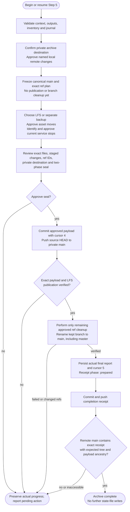

# Step 5: Finalize

Seal the approved project snapshot at a verified private remote, then publish a separate completion receipt. Validate all four prior reports, output fingerprints, selected source and file inventory first. A cursor of 4 after interruption is not permission to replay every cleanup task.

## Flow

A resumed phase skips only operations proven complete by validated journal/Git evidence. Reports and journal flags do not supply new approval for outstanding destructive actions or pushes.

## Task 1: Private destination

Present credential-free remote identities, identify external/company/client remotes, and obtain the already-existing private archive destination. Verify identity, access and privacy through an available authenticated interface, or explicit informed confirmation when privacy cannot be inspected. A URL/name alone does not prove privacy.

Approve exact local remote changes, including differing fetch/push destinations. Remove only named remote configurations and set approved origin; do not touch another retained personal remote or change global credentials/settings. Snapshot approved-origin heads and access/LFS capabilities. This task publishes/deletes no refs. Revalidate this host's Docker/process access instead of assuming another session's runtime is available.

## Task 2: Explicit branch plan

Use the validated source branch/full commit and journal, not a prose guess or the incidental current checkout. Canonical archive ref is always `refs/heads/main`, even for a `master` source. Freeze exact local/approved-origin ref IDs and proposed renames/deletions; preserve tags and unrelated remotes/worktrees. Active protected-branch prohibitions require resolution before mutation.

Plan only here. The payload is committed on the kept source branch and pushed explicitly with `HEAD:refs/heads/main`, avoiding accidentally publishing an unrelated local main. An empty destination is valid. Existing archive main must accept a normal fast-forward; divergence requires a separate reviewed plan, never force-push or deleting main to bypass rejection.

Cleanup occurs only after payload publication is verified and the seal plan authorizes those exact actions. Retire approved distinct local base/other branches, rename the kept branch to main, and delete only approved other remote heads. Preserve published main and payload history. Recheck expected IDs immediately before changes; new/changed refs invalidate the plan rather than broadening deletion. Record actual progress for safe resume. A planned deletion target already absent is reported as a satisfied postcondition, never replayed or claimed as deleted here. A clone already on canonical main at the proven payload needs no recreated source branch or rename.

## Task 3: Recovery tarballs and LFS

Report `recovery/docker/` total size and other over-100 MB paths/types/sizes. Offer LFS storage at an LFS-capable private destination, local-only separate backup, or Cancel. Use repository-local LFS setup and approved patterns; no global configuration changes. Verify tool/remote support and required object availability.

For local-only tarballs, add the ignore rule and document the separate backup and recovery placement. Ignoring an already tracked file does not untrack it: any required index removal must be explicit in the inventory/approval and must not delete the local recovery file. Other approved retained large files still use LFS. No large files is reported as not applicable. Record paths without staging whole directories.

## Task 4: Asset preservation

Review source/template/style/documentation references before approved moves into `recovery/assets/`. Referenced assets require an explicit decision and link-change review. Agent entries/imports/rules, opaque Helm state, archive metadata/reports, private client settings and credential files are never generic asset-move targets. Record verified paths/fingerprints and legitimate supersession of prior outputs.

## Task 5: Current project services

Prove current ownership using Docker context, Compose project/cwd labels and container IDs, or process PID/start identity/command/cwd. A reused PID, open port or old report is insufficient. Present exact verified targets, obtain stop approval, and recheck identity immediately before stopping. No blanket shutdown or volume deletion. Unknown/inaccessible services are reported separately; absence here does not imply another host's services stopped.

## Task 6: Two-phase seal

### Review inventory and authorization

Compare `.archive/files.json` with the actual index/working tree and approved source. List exact workflow-created/modified/deleted files, approved unchanged preservation inputs and explicit exclusions. Include restoration source/config files outside docs/recovery. Protected tracked instructions/rules/state travel through history at original paths; untracked preservation inputs need explicit review. Do not absorb pre-existing user edits or other workflows' pending ledgers.

Exclude real credential files/values, secret-bearing reports/artifacts, private client-local settings and unrelated changes. Detected credentials in selected history block publication for a separate reviewed resolution; a private remote is not a waiver, and history/tags are not rewritten automatically. Preserve protected originals locally when publication is blocked. Reports expose names/locations, never secret values or fragments.

The reviewed seal plan identifies exact file paths, staged changes, LFS pointers/objects, canonical ref and expected IDs, private destination, bounded cleanup, and both payload and receipt commits/pushes. Cancel produces no commit, ref cleanup or publication from this task; earlier approved preparation/stops are not rolled back. Auto-commit cannot bypass this approval. Changed inputs or material changes outside the plan require renewed review.

### Publish the payload

Prepare cursor-4 journal metadata before staging, then stage only approved literal created/modified paths and exact tracked deletion paths. No bare `git add -u`, `git add -A`, directory-wide additions or blindly staging `.archive/`. Reconcile unrelated index entries first; verify staged content and LFS pointers match the manifest. Internal metadata paths are explicit entries but do not recursively hash themselves; Git tree verification covers them.

Commit `chore(archive): seal project archive` with cursor 4. Record its actual ID afterward in the local journal. Push that commit from the source branch to canonical main with `git push origin HEAD:refs/heads/main`, using the approved normal fast-forward plan. Verify the exact payload/tree and destination recovery/LFS object availability. A failed/unverified push stops cleanup and keeps cursor 4. Resume the verified existing payload publication, not another restoration commit.

### Publish the completion receipt

After verified payload publication, perform only approved remaining ref cleanup with expected-ID checks. A partial cleanup remains pending at cursor 4.

Produce the factual final report with actual remote/ref changes, preservation, service results, payload ID/publication, recovery instructions and limitations. Persist it verbatim as `.archive/step5-finalize.md`, read it back, record its digest, and set local cursor 5 with `receipt_prepared` and the verified payload ID. The approved bounded seal plan covers this receipt unless material new changes require review. Local cursor 5 means the report is prepared, not proof of publication.

Stage only that report, state and approved changed inventory/journal metadata. Commit `chore(archive): record completion receipt` as a child of the payload and push main. Verify the approved remote contains the exact receipt/tree and expected payload ancestry before reporting Archive complete. Its own commit ID and final publication proof are supplied by Git in the final user-facing summary, not embedded recursively in the committed report. No files change after this final push/verification.

If receipt commit/push fails, preserve its draft/commit and report pending status. Resume only its missing operation after context/authorization checks, never payload or branch cleanup. Unavailable publication evidence means unverified completion, with no automatic mutation.
