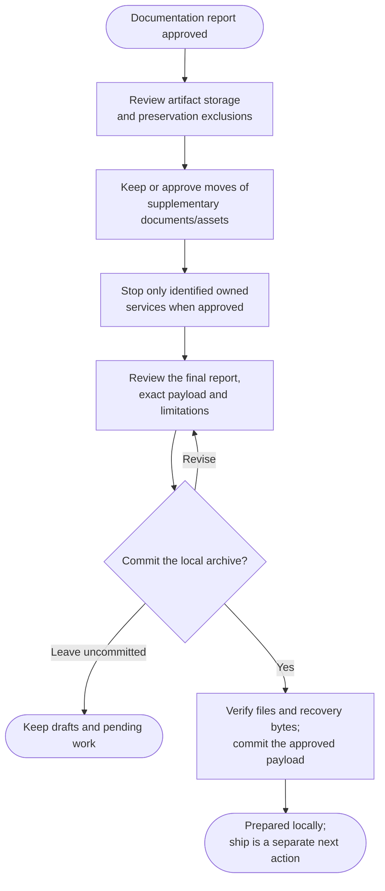

# Step 5: Prepare locally



The final archive phase turns the reviewed recovery kit into an explicitly approved local payload commit. Its report makes storage choices and remaining recovery limits clear before any later private backup publication.

## Flow

## Review storage and supplementary assets

Choose storage for each real artifact using its actual size, identity and retrieval needs. Regular Git, supported LFS and an explicitly accepted separate or local-only exclusion have different consequences. Unknown provider limits are recorded rather than guessed from one hosting service.

An LFS pointer is not the image, database or dataset it describes. Verify the actual local object bytes and retain any known retrieval limitations. An exclusion can be a sensible choice, but it may leave the promised recovery goal incomplete.

Organized design and historical materials can stay where they are. Consolidating scattered supplementary documents requires reviewed source/destination paths and updated references. Runtime icons, fonts, fixtures, data imports and required build assets keep their native wiring; they are not generic cleanup targets.

Only currently identified, owned services may be stopped with applicable approval. There is no blanket daemon shutdown, volume deletion or automatic restart to manufacture a target.

## Approve the local payload

Review the exact included files, changes, storage choices, exclusions and performed or deferred checks. The payload can include approved restoration configuration outside `docs/` and `recovery/`; its scope follows the recovery plan rather than folder names alone.

Real credentials, private records, secret-bearing artifacts and unrelated edits stay out. Protected instructions and other commands' records remain intact. An inability to establish what selected bytes contain leaves their inclusion pending.

Choose **Commit reviewed local archive** or **Leave uncommitted**. This exact local content-and-commit decision is required even with auto-commit enabled. It does not approve a remote destination or a push.

## What happens next

A verified payload is reported as **ARCHIVE PREPARED LOCALLY**, with its actual commit, preserved source scope and limitations. Declined or incomplete work remains a draft. A rerun validates existing preparation instead of replaying restoration or making a duplicate commit.

Use [ship's private backup procedure](../../ship.html#publish-an-archive-backup) for payload publication and the completion receipt. A local commit, a remote payload and a verified receipt are separate milestones.

Cleanup is optional. After receipt verification, ship can separately offer a portable copy; a Git bundle alone omits container images, external data and LFS bytes. Keep these omissions visible when deciding what a portable package can actually recover.

## Explore the source

For implementation details, read [prompts/archive/step5-finalize.md](https://github.com/myowinthein/agent-helm/blob/main/prompts/archive/step5-finalize.md).
