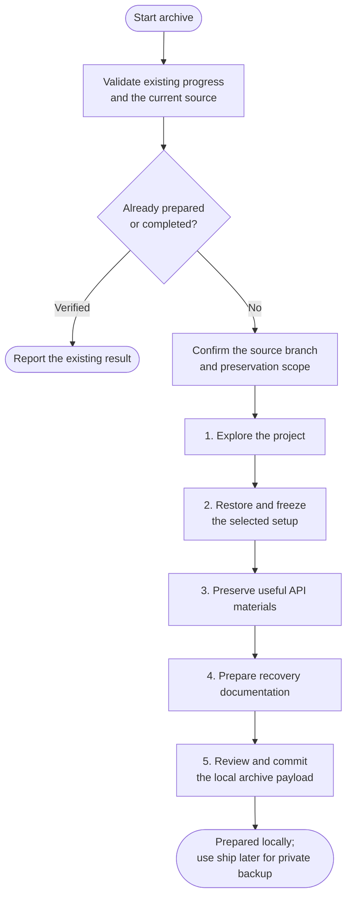

# archive



Use archive when an older project needs a recovery kit: source, setup, useful runtime/data and instructions for running it again. It prepares the kit locally; ship handles the later private backup.

## Flow

The complete procedure follows, including conditions and exceptions within each phase.

{{ page.guide_source | guide_intro }}

{{ page.guide_source | guide_body }}
