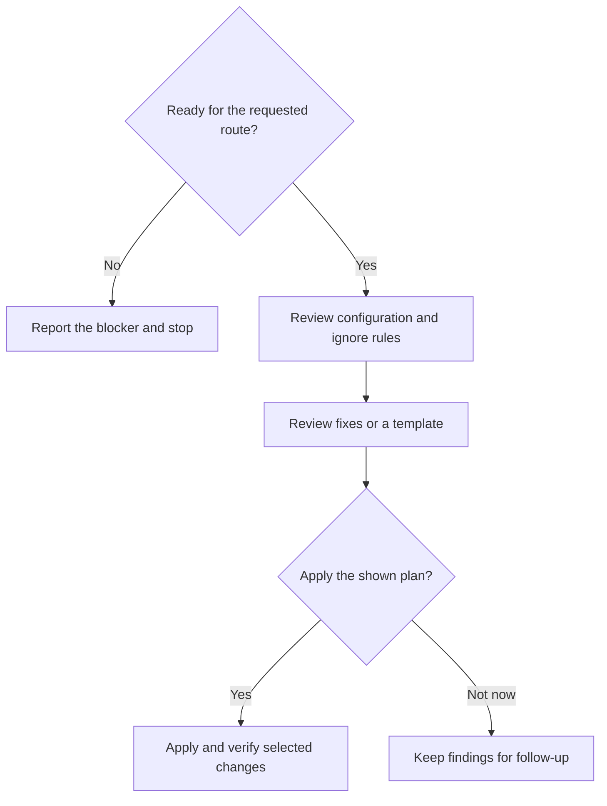

# Env



Use env when environment settings or Git ignore rules have become hard to trust. It checks how configuration is used, reports problems and lets you choose fixes or a safe template.

## Flow



## Start the command

```text
Codex → $env    Claude → /env
```

Use your client's [command prefix]({{ '/docs/setup/' | relative_url }}#run-a-command). Normal env starts on a clean, eligible **main/master, feature or confirmed environment branch**, checked before the audit. An explicitly requested read-only audit can inspect pending edits.

A required prerequisite or safe-inspection failure stops the run. An incorrect invocation or argument in an existing read-only tool call can be corrected once using the same inputs. The agent cannot create or repair a filtering script during the audit, and a tool error alone does not establish file drift. Findings already collected remain reportable, but further checks and fix planning wait for a new eligible run.

## What gets checked

| Area | Typical questions |
|---|---|
| Configuration use | Which keys are required, missing or apparently unused? |
| Values and syntax | Are there credible exposures, hardcoded settings or loader-specific problems? |
| Git protection | Are private files protected, or are ignore rules hiding files the project needs? |

The audit follows actual services and configuration layers. An override need not repeat every baseline key, and externally supplied settings need not appear in an `.env` file. Existing safe templates are also checked for stale, duplicated or misleading guidance. Findings show paths, key names and uncertainty without exposing values.

## Choose the fixes

Review one plan covering environment files, `.gitignore` or both, then approve the changes you want. A separate scope question is needed only when the plan depends on your answer. Source/templates, local-only work and external setup stay distinct; templates use placeholders and edits preserve configuration meaning.

Template cleanup is proposed before editing and preserves useful comments and safe defaults. A missing source reference alone does not prove a key can be removed; optional wording improvements stay separate from runtime and secret findings.

**Untracking needs separate approval.** It keeps the local file, but other clean copies may disappear when collaborators update. Moving or untracking a secret does not revoke it or erase its history.

## Your result

You get verified changes and remaining follow-up. Operational env contents are never staged; tracked or managed env files remain report-only. Approved ignored, untracked env edits stay local.

The audit does not start the app or contact services. Static checks cannot prove credentials work or a deployment is ready. Work finishes on the same branch; use [ship](ship.html) separately to publish source changes.
