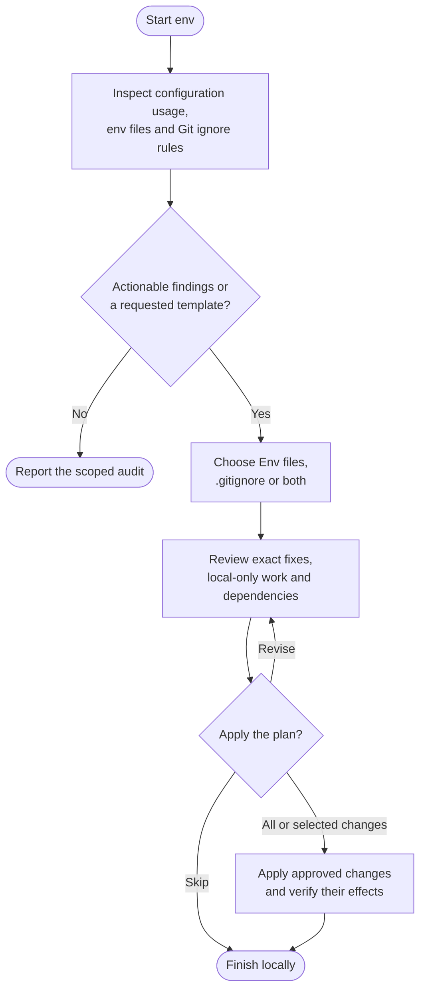

# env

Find environment configuration mismatches, credible secret exposure and misleading ignore rules, then choose which fixes to apply.

## Start the command

```text
env
```

Use the prefix for your app or terminal from [Setup]({{ '/docs/setup/' | relative_url }}#run-a-command).

The audit can inspect pending edits. Fixes require a clean, eligible **main/master, feature or confirmed environment branch** and preserve intentional environment differences.

## Flow



## What gets checked

The audit follows actual services, loaders and configuration layers. Overrides need not repeat baseline keys, and externally supplied settings need not live in an `.env` file.

| Area | Checks |
|---|---|
| Files and usage | Find env files, compare related keys, trace references and identify missing or apparently unused inputs. |
| Values and syntax | Find credible exposure, required placeholders, hardcoded settings and loader-specific syntax or duplicate problems. |
| Git protection | Check missing protection, tracked ignore matches, harmful patterns and redundant rules. |

The eleven checks report paths, key names and uncertainty without exposing values. A search miss does not prove a key is unused; a tracked ignore match does not prove a mistake.

## Choose the fixes

Choose Env files, `.gitignore` or both, then review a concrete plan. It separates committable edits, local-only changes and external provisioning. Accept all, choose findings, revise or skip; dependent fixes stay together.

Optional templates use generated placeholders without copying real values. Formatting preserves loader semantics; ignore edits preserve Git's pattern behavior.

Untracking needs separate exact-path approval. The local file remains, but the committed removal may delete clean copies elsewhere when they update. Moving or untracking a secret neither revokes it nor erases history.

## Your result

You get findings, verified changes and manual follow-up. Credential-free source, approved templates and project ignore edits may be committed under your policy. Operational env contents are never staged; tracked or managed env files remain report-only. Approved ignored, untracked env edits stay local.

Static checks establish syntax, key and ignore behavior, not working credentials or deployment readiness. Env does not start the app or contact services for the audit.

Work stays on the same branch. Shared fixes on an environment branch may need deliberate upstream application; merging does not synchronize ignored env files. Use [ship](ship.html) for publication.
