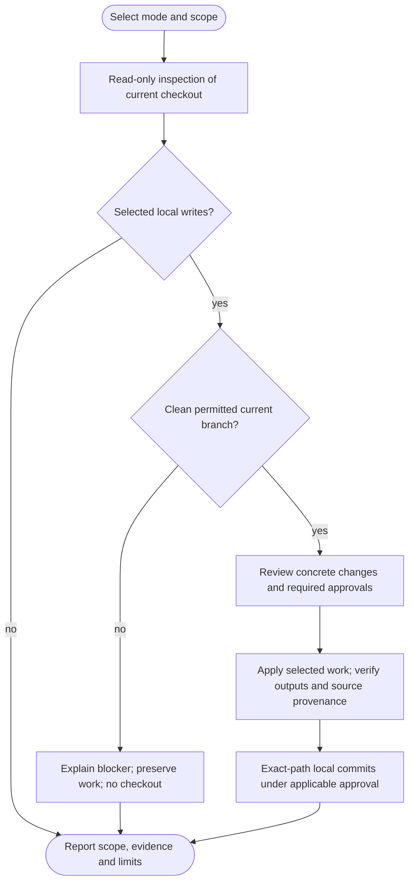

# /helm:env

Audit environment files, `.gitignore` and relevant project code/configuration, then choose which fixes to apply. The eleven checks cover loading/sync gaps, references, secrets/placeholders, hardcoded values, formatting and Git protection. Files are compared by purpose and actual loader behavior, preserving intentional differences between services and overrides.

Command names below use Claude notation. In Codex, select the same Helm workflow from the skill picker. Both hosts use the shared workflow and resolved instruction owner; see [compatibility notes](../setup/compatibility.html).

Approved edits may run on current actual main/master, an established current feature branch or a confirmed current environment branch. Prefer feature/main for shared configuration fixes and an environment branch for its intentional differences or integrated-source problems; all eligible roles allow the same approved actions. Roles come from project/deployment evidence or developer classification, not names alone; unresolved/unsupported roles block writes without checkout. Stronger project policies and actual runtime-target/effect checks still apply. Branch eligibility does not authorize publication, live provisioning or synchronization to another branch.

## Investigation depth and coverage

The audit remains a current-snapshot assessment of its selected Env files/.gitignore scope, with no new Full/Gap modes. Reconcile exact service/loader/input coverage and the existing eleven check outcomes. Inspect loader/configuration semantics and convention-aware consumers, including relevant hidden/ignored/custom env paths. Value-free projection applies to every inspected source/configuration path; unsafe reads remain blocked. Large independent code-reference work may use permitted read-only workers with safely filtered inputs, while the parent keeps sensitive projections and all actions. Searches cannot prove dynamic/external keys unused.

Follow the [shared investigation and exclusion rules](../setup/investigation.html). Inventories and worker evidence remain transient; inaccessible required material is not silently excluded or marked complete. Finding counts, duration and reasoning effort do not prove coverage.

## Flow

A blocked or incomplete unit stops its dependents. Earlier verified independent work is retained and reported; no branch, draft, index or local env edit is discarded to force completion.

## Boundaries shared by Claude and Codex

Configuration is read from the resolved owner, normally `AGENTS.md` through the Claude adapter or directly on Codex. Existing owners, bridges, overrides and recognized fenced configuration still follow the runtime. Env does not create/migrate instruction files, edit Helm settings, invoke log, or own/read/write a ledger or review marker. Operational `.helm/` and legacy Helm state remain excluded.

Safe local filtering happens before potentially secret-bearing content reaches tools or conversation. Findings, plans, diffs, errors and reports show paths, key names, locations, types and classifications, without existing values, prefixes/suffixes, value hashes, raw snippets or token-bearing URLs. Apparent placeholder values are also omitted because classification can be wrong. Newly generated synthetic placeholder literals may be shown.

The audit never sources env files, boots/imports application code, dumps resolved environments, fetches secrets or contacts services to check credentials. Unsupported filtering or missing capability blocks the affected inspection instead of exposing values. Existing secrets are not copied into temporary reports, backups or exports.

## 1. Audit the current checkout first

The first phase does not checkout, fetch, branch, stage or write files. It identifies the actual branch/HEAD and dirty/staged state, or reports unavailable metadata. Dirty/staged trees can be audited, but the write route clearly states that normal clean preparation is blocked. It never automatically commits, unstages, stashes or resets your work.

A cheap inventory identifies first-party services/packages, loaders, scripts, templates, relevant source/configuration, CI/container declarations and nested ignore files. An explicit Env files or .gitignore focus narrows the expensive checks; default scope includes both. This reorders the existing invocation without introducing another command mode or flag.

Discovery includes ignored/hidden env files and custom paths evidenced by loader options, Compose declarations, scripts or documentation. It excludes dependencies, generated/build/binary and unrelated fixture trees from ordinary source scanning, while treating relevant test setup as a separate scope. No guessed files or whole-project profile framework is added.

Coverage is declared per service/target/check as complete, partial, blocked, not applicable or out of scope. A restricted scan never produces a project-wide clean claim, and a current feature/environment/dirty snapshot is not described as the merged base or freshly fetched remote.

## 2. Keep the eleven checks, with context

| Check | What it assesses |
|---|---|
| 1.1 Detect env files | Actual inputs and roles, including templates, local files, shared defaults and mode overrides. |
| 1.2 Env sync | Effective keys within the appropriate service/loader family and its inherited layers. |
| 1.3 Source/config references | Literal keys through actual code/config conventions, scripts, containers, CI and relevant test setup; dynamic access remains explicit. |
| 1.4 Cross-reference | Required missing inputs, defaults, conditional/optional features, external provision and keys with no reference found in scope. |
| 1.5 Secrets/placeholders | Credible exposure and required unfilled inputs, assessed by role and confidence. |
| 1.6 Hardcoded values | Environment-dependent settings/credentials needing a coordinated source/config change. |
| 1.7 Env formatting | Dialect-aware syntax, duplicate and readability findings without changing values or loading behavior. |
| 1.8 Gitignore missing protection | Actual protection for local files and evidenced project artifacts, including personal versus shared rules. |
| 1.9 Tracked ignore matches | Exact tracked paths and effective rules requiring a policy decision. |
| 1.10 Harmful ignore rules | Demonstrated conflicts with intended versioned files, rather than broad-pattern guesses. |
| 1.11 Gitignore formatting | Provably redundant patterns and optional readability changes that preserve semantics. |

### Compare configuration that is actually loaded

An override may deliberately contain only differences from its baseline. Evidence of shell/CI/secret-manager provision or a visible default can explain why a key has no env-file entry. Template omissions and runtime requirements are separate findings. Built-in-looking names are classified from project evidence, not a universal exclusion list. Required/optional/conditional inference stays limited to what code/configuration/schema evidence supports.

Keys are reported as **No reference found in scanned scope**, with infrastructure, script, dependency and dynamic usage considered. Similar names do not establish staleness. Uncertain or external inputs are separated from confirmed missing/stale totals. With no env files, the report explains external configuration or uncertainty instead of declaring every access broken.

### Recognize templates and preserve safe defaults

Verified templates can include `.env.example`, `.env.sample`, `.env.template`, `.env.dist`, service-specific examples and other explicitly established paths. The same classification governs placeholders, cleanup, extraction and commit eligibility. A filename suffix alone does not make an encrypted/generated file an editable template.

Safe public/test defaults, ordinary empty values and fake fixtures are not automatically secrets or failures. Required unfilled values need evidence. Verified useful template defaults/comments are retained. Credential findings carry confidence, and confirmed/credible exposure prompts developer review and appropriate revocation/rotation follow-up. Moving or untracking a value does not revoke it or erase history; rotation and history rewriting remain separate explicit actions.

### Respect loader syntax and exposure boundaries

Hardcoded-value recommendations exclude genuine constants and fixtures. Changes follow existing configuration indirection, caching, browser/server boundaries, build-time/runtime availability, types, defaults and empty-versus-absent behavior. A credential must not become a client-public variable or remain in a source fallback.

Formatting preserves quotes, escapes, multiline values, comments, expansion/assignment order, meaningful whitespace, encoding and permissions. There is no generic keep-last duplicate rule. Differing assignments require an exact key/line choice; even identical assignments are removed only when redundant under the identified loader. Unknown dialects are report-only. Category headings are optional and normally confined to templates.

### Use Git's ignore engine

Matching uses read-only Git-native queries, including tracked-path enumeration and `git check-ignore --no-index --verbose --stdin -z` or an equivalent query. Findings account for nested rules, ordering, negation, excluded parents, escaping and literal paths, showing the responsible rule source/line with safely filtered patterns.

Personal/global exclusions are assessed but never edited. A local file protected only there still lacks shared project protection. Artifact suggestions need project evidence: `dist/`, `vendor/`, lockfiles, compiled JavaScript, shared env defaults and local config directories may be intentional. A tracked match alone establishes neither harmful ignoring nor a reason to untrack.

Pattern order, anchoring, escapes, meaningful trailing spaces and comments remain intact. Only proven redundancy is removed; removing the later of two repeated patterns can change behavior around a negation. Template exceptions must work under Git's actual parent-directory rules. No automatic sorting/regrouping or blanket exclusions of Helm state, shared instructions or rules are introduced. Legitimate client-local exclusions remain supported.

## 3. Select work and prepare the real destination

The value-free report groups findings under the eleven checks with invocation-stable IDs, impact, confidence, evidence, file roles and coverage limits. Confirmed problems are counted separately from uncertain, stylistic, informational and blocked cases.

With no actionable findings and no requested template creation, env reports the scoped result and exits without a question or branch. Skip/none also writes nothing. Optional template absence is not itself an error; a creation request can continue even without correctness findings.

For two targets with findings, the existing Env files/.gitignore multi-select remains. One target uses Work through findings/Skip; a prior explicit target choice is honored. Selecting a target authorizes planning only. Questions have two to four choices, grouping longer lists behind IDs/free text and retaining Other/none.

Selected writes require the [local-edit procedure](../setup/git-and-ci.html): clean safe inputs on current actual main/master, an established current feature branch or a confirmed current environment branch, with no pre-existing staged work absorbed. Unresolved/unsupported roles and other prerequisite failures block writes while preserving the audit. No checkout/update/branch creation occurs. Preserve ignored/untracked and secret inputs; no backup copying or automatic Git initialization occurs.

On the same validated current branch, recheck ownership/configuration, files/roles, references and ignore outcomes. If the advisory snapshot changed, reassess its findings against the actual source; never transplant them to another branch. Changed inputs refresh the investigation and proposal; no stale approval is applied to a different source. Relevant input changes are compared safely without revealing values or value hashes. Ignored local env files belong to the worktree and do not travel through branch merges.

## 4. Review one plan and apply coherent units

Review a consolidated redacted plan grouped by dependency unit, with exact finding IDs, paths/keys, proposed patches, local/external requirements, order and verification. New files are explicitly shown as Create. Choose Apply plan, Choose changes, Revise or Skip. Selective choices resolve to a bounded explicit set; untracking keeps separate approval. Valid approval of the same concrete action is reused.

On an environment branch, identify shared versus intentionally environment-specific fixes, or unresolved scope, in that same plan. Preserve intentional differences and note when shared fixes need deliberate upstream application or may be overwritten by later integration. Do not merge, copy or synchronize branches automatically. Resolve only missing material choices through existing approval, without a new per-run branch question. Ignored local env inputs remain local to the worktree.

A subset can be useful partial progress. Each dependency unit must be complete: unresolved destination readiness, template/ignore decisions or key conflicts leave its dependent source edit pending. Independent approved units may proceed. Commits follow logical units rather than the old greater-than-ten-findings/per-file threshold.

### Templates, including optional creation

Existing templates can receive approved relevant keys using their own structure/placeholder style, preserving verified safe defaults/comments. They never receive real values or every unrelated local experiment. Guidance about obtaining credentials is reused from authoritative project docs rather than invented.

When the relevant service has no template, you may explicitly choose Create template or Skip. The concrete plan names its path, keys and synthetic placeholder structure; approval of that creation satisfies the choice without another identical question. A service's `.env.example` is the default only when appropriate, with ambiguity resolved explicitly.

Before creating it, env verifies absence of a competing template, safe placement, intended tracking and effective ignore rules. Any necessary minimal exception needs an approved `.gitignore` patch. Blocked protection leaves creation pending; there is no force-add. Bootstrap uses evidenced keys and dialect-compatible synthetic placeholders, without copying values or guessing credentials/defaults. Multiple service templates require explicit path choices. Real env files are never created implicitly.

### Local/manual work and extraction

Local automatic edits require an explicitly approved existing ignored, untracked file, known loader and safe local tools. Otherwise you enter values through your normal local/provider tooling; env never asks for credentials in chat. Empty `KEY=` lines are not inserted to make the matrix complete.

For hardcoded extraction, approve the exact access expression/key, service/load phase, types/defaults, conflict resolution and local or external destination. One value is never copied into every environment. Needed approved protection, template and destination setup is verified before the dependent source patch. External provisioning requires developer attestation; unresolved readiness leaves source pending. Handoffs list newly required key names and remaining environment setup.

Unreferenced-key removal defaults to Keep. Deletion requires explicit key-and-file IDs, evidence and consideration of original feature-snapshot usage; local values may have no Git recovery. A search miss never justifies removing infrastructure/dynamic/external inputs or a whole env file.

### Tracked and managed files

Tracked non-template env files, including intentionally shared safe defaults, are report-only for edits. They are not automatically anomalies, and env never untracks them merely to bypass edit restrictions. Encrypted/generated/mounted/read-only/unsafe/unknown-dialect targets remain report-only pending a safe handling decision. Symlinks, permissions and mounts are not replaced to force a fix.

### Untracking needs an informed decision

For each bounded group, review exact paths/count, effective rules and the policy reason. Untrack listed paths/Skip is separate from generic plan approval. The local files remain, but committing the removal may delete clean copies in other clones or deployment checkouts when updated; modified copies may block updates. Environment promotion can propagate that deletion. Untracking does not revoke credentials or remove Git history.

Only explicit approval permits `git rm --cached` with literal, option-separated/NUL-safe paths as needed. There is no glob expansion, force, whole-index rebuild or worktree deletion. The exact index deletion and unchanged local files are verified, and local contents are never re-added.

## 5. Verify, commit and report actual outcomes

After Done or an automated edit, safe static readback checks key presence/absence, syntax, sentinel state, intended source behavior, formatting meaning, template credential freedom and Git outcomes. Dependent findings are refreshed. Results distinguish verified edits, still missing/unfilled keys, developer-attested external setup and blocked checks. Presence is not credential validity or a working connection. Input drift refreshes approval rather than overwriting changes; expected HEAD advances only through verified commits from this run, separately from the audited source snapshot.

Only approved credential-free source, recognized templates, project `.gitignore` changes and confirmed untracking deletions are committable. Entire resulting contents and the complete proposed index are checked before every logical-unit commit. A skipped/unresolved template secret blocks that file. Operational env contents, unrelated work, instructions/settings and ledgers never enter the commit; broad staging, force-add and automatic unstaging are prohibited.

Keep approved local-only edits on disk and outside commits. No checkout, integration or cleanup occurs; never stash/reset/discard or commit their values to make work complete. Preserve actual local drafts/index and earlier verified commits. A genuine no-write/no-commit exit performs no cleanup.

The audit/fix phase does not run application/service probes, installs, migrations, builds or tests merely to inspect/draft fixes. Required verification remains explicit; unavailable/deferred checks are not passes. Finish on the same permitted branch after verifying local outputs and eligible commits. No push/PR question, branch creation/switch/update, integration, environment promotion, return checkout or branch cleanup follows. Remote/provider access and published source IDs are not prerequisites merely to finish locally. Invoke [ship](ship.html) separately when the whole selected work is ready to publish. See [Git and CI behavior](../setup/git-and-ci.html).

Include external setup and committed-removal consequences in the local handoff for later ship review. Known unresolved provisioning dependencies remain explicit for affected integration/promotion; env never queries secret values or treats CI as proof of provisioning.

Report scoped coverage and verified resolved, retained/intentional, skipped, uncertain, developer-attested, missing or blocked findings. Include exact template edits/creations, report-only files, preserved local-only edits, exposure/provisioning dependencies, actual static checks and local commits/drafts/current branch. No publication/deployment occurred. Count actual verified changes rather than Done answers, and never call unfinished work ENV COMPLETE.

## Stop conditions

- Conflicting effective instructions, broken imports, unsafe targets or unavailable safe filtering/capabilities stop the affected scope without leaking values.
- No actionable findings or Skip/none exits before Git mutation, with actual coverage disclosed.
- Pre-existing staged/dirty work blocks writes while preserving the usable read-only audit.
- Unresolved/unsupported branch roles block edits; current actual main/master, established feature and confirmed environment branches remain eligible under project policy and runtime-target/effect checks.
- Unexpected input drift, unresolved unit dependencies, failed readback/index checks or declined commits stop dependent finalization and retain actual work.
- Local-only edits blocking Git operations remain on disk. Pending local checks/review and later publication are reported separately from completed edits.

## See also

- [`/helm:ship`](ship.html): env audits can identify configuration prerequisites before release, with runtime verification reported separately.
- [`/helm:refactor`](refactor.html): broader code quality review.
