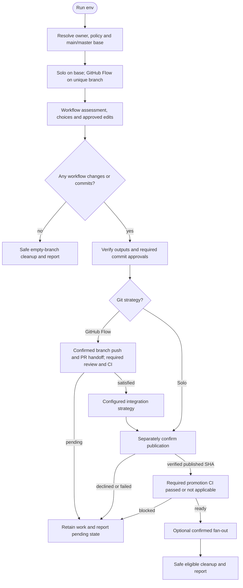

# /helm:env

Audit `.env` files, `.gitignore`, and source code to find and fix environment configuration issues. Covers sync gaps, missing vars, hardcoded values, secret/placeholder correctness, and formatting, all in one pass.

Command names below use Claude notation. In Codex, select the same Helm workflow from the skill picker. Configuration comes from the existing memory owner, including through a bridge; [compatibility notes](../setup/compatibility.html) describe host-specific behavior.

## Flow

## Steps

### Before starting

Configuration is read from the resolved project-memory owner: normally `AGENTS.md` through `CLAUDE.md`'s import on Claude, or directly on Codex. Existing legacy owners, bridges, overrides, and recognized fenced configuration blocks follow the shared runtime. This command does not create or modify Helm settings in either instruction file.

Before switching branches or writing files, stops if pre-existing staged changes are present so they cannot be accidentally included in an env commit. The developer must commit or unstage them before re-running; the command does neither automatically.

Behavior depends on that owner's `git-strategy` (absence defaults to GitHub Flow, per git.html):

Use the [shared Git and CI flow](../setup/git-and-ci.html): resolve the actual main/master base and invocation policy, require a clean setup, use a unique GitHub Flow branch (unused suffix on collisions), and revalidate destination ownership/configuration after checkout. Solo stays on the base without a temporary branch. Preserve real drafts/commits on failure; only a genuine no-write/no-commit exit safely returns before deleting its empty branch.

### 1. Scan

Credential and hardcoded-value previews show only path, key name and type. Values, prefixes/suffixes and secret-bearing URLs/snippets are omitted in every scan, replacement plan and completion report. Unsafe/unverifiable filtering blocks the inspection instead of exposing values.

Eleven read-only checks across all env files, source code, and `.gitignore`. Never stops early: a partial scan produces missed findings that silently persist.

| Check | What it finds |
|---|---|
| 1.1 Detect env files | All `.env*` files and their inferred purpose |
| 1.2 Env sync | Keys present in some files but missing from others |
| 1.3 Source code refs | Every env var accessed in source, per stack |
| 1.4 Cross-reference | Keys missing from all env files; keys never referenced in code |
| 1.5 Secret/placeholder | Real secrets in `.env.example`; unfilled placeholders in other env files |
| 1.6 Hardcoded values | String literals in source that should be env vars |
| 1.7 Env formatting | Duplicate keys, spacing, missing category groupings |
| 1.8 Gitignore missing entries | Stack-appropriate entries absent from `.gitignore` |
| 1.9 Gitignore tracked files | Tracked files that match a `.gitignore` pattern |
| 1.10 Gitignore entries to remove | Overly broad or harmful `.gitignore` entries |
| 1.11 Gitignore formatting | Duplicate entries, missing category groupings |

### 2. Report

Findings presented as a single `ENV AUDIT REPORT` grouped by category. Includes a total issue count, then asks which **targets** to work through: **Env files** and/or **.gitignore**. If both targets have findings, this is a multi-select. If only one does, a multi-select with a single option isn't valid (AskUserQuestion needs at least 2), so it asks a direct yes/no confirmation for that one target instead. Selecting/confirming a target runs every one of its sub-flows in Step 3 (each with its own Skip); selecting neither (or declining) exits without changes. The report still lists every finding regardless of what's selected.

### 3. Apply fixes

Run the selected target's sub-flows, one at a time, each completing fully before the next. Each sub-flow runs only if it has findings and offers a Skip.

All commits, including per-file commits, exclude `.env` and other non-example `.env*` contents even when already tracked. Real values stay local. Only reviewed, credential-free source changes, placeholder-only `.env.example` changes, `.gitignore` changes, and confirmed untracking deletions may be staged. Untracking preserves the local file and does not erase existing Git history. A template with skipped secret cleanup remains ineligible for staging while it contains credentials.

**Env files sub-flows** (if "Env files" selected):

- **Secret cleanup (.env.example)**: shows each flagged real secret with its planned placeholder replacement. Single-select: Replace all, Skip, or Other (free-text). Does not touch any other env file.
- **Placeholder cleanup (other env files)**: shows unfilled placeholders grouped by file. Dev fills in values manually, then marks done.
- **Env sync**: per file. Shows which keys are missing and where they exist in other files. Dev adds them manually per file, marks done before moving to the next.
- **Missing from env**: all at once. Keys referenced in code but absent from all env files, with file:line locations. Dev adds them manually, marks done.
- **Hardcoded values**: shows all findings with severity, file:line, credential/value type with the value omitted entirely, and suggested env var name. Single-select: Replace all, Skip, or Other. Real values go into local env files; templates receive placeholders. If Replace all and more than 10 findings: processes one source file at a time, committing only its safe source and template changes after each, subject to the same index checks and Auto-Commit rule.
- **Never referenced**: lists keys with no code reference, with a hint on whether each looks infrastructure-only or stale. Dev responds in free text: delete some, keep some, or wire up to code.
- **Env formatting**: single-select: Proceed or Skip. Fixes formatting, removes duplicate keys (keep last), adds category groupings consistently across all env files. Preserves existing group order.

**.gitignore sub-flows** (if ".gitignore" selected):

- **Missing entries**: shows entries with reason, single-select Add all/Skip. If approved, immediately checks for tracked files matching the new patterns.
- **Tracked files**: per-file confirmation to run `git rm --cached`. Triggered automatically after missing entries are added, and for any pre-existing tracked files found in Step 1.9.
- **Entries to remove**: shows overly broad or harmful entries with reason, single-select Remove all/Skip.
- **Gitignore formatting**: single-select Proceed/Skip. Fixes formatting, removes duplicates, adds category groupings.

### 4. Commit, push, and promote

Verify the complete index, staging only approved safe source/template/gitignore changes and confirmed untracking deletions. No non-example env contents, credentials or unrelated work may enter a commit. Earlier per-file commits still count even when the final stage has nothing new to commit, in Solo as well as GitHub Flow. Local-only env edits remain on disk and are reported; if they block checkout/integration, stop without reset, stash, discard or committing them.

Follow the [shared Git and CI flow](../setup/git-and-ci.html) after the command's own output verification and commit approvals. GitHub Flow offers separately confirmed branch publication and PR creation, or a local/manual handoff, until required review/checks pass. Integration uses the configured squash/rebase/merge strategy and actual main/master base. Solo requires no PR unless explicit project policy says otherwise. Base publication always has its own confirmation.

Before fan-out promotion, verify configured/applicable CI for the exact published source SHA with complete provider-aware coverage. Missing/failed/pending/unknown results stop or defer promotion; target selection cannot waive the gate. Use at most four target options or Yes/Skip for one, explicitly describing merge and push. Verify each operation and report completed/pending targets separately.

Declined/failed commits, unsafe local edits or incomplete checkpoints preserve actual work and stop dependent operations. Safe cleanup uses ancestry checks and `git branch -d`; squash/rebase branches outside ancestry are retained, never force-deleted. Remote deletion needs its own push confirmation. Report PR URL/review status, actual branch, commits, integration/publication, CI, and promotions separately. Summarize output verification captured before publication, not a different original checkout after cleanup.

### 5. Completion report

Summarises the outcome grouped by target (Env files, .gitignore): counts replaced, added, deleted, or fixed for each of the eleven sub-flows, including how many never-referenced keys were deleted vs kept. Lists anything needing manual follow-up: skipped secret cleanup (real secrets still in `.env.example`), skipped tracked files, local-only env edits, and any blocked commit with paths/key names only. Also reports whether the commit was pushed (or is waiting locally for a manual push), which environment branches were promoted, and, under GitHub Flow, the temporary branch's fate and which branch the command returned to.

## Stop conditions

- **Pre-existing staged changes.** Stops before branch switches or writes; leaves the developer's index intact.
- **Unsafe or unverifiable proposed commit.** Stops the commit/push path and reports paths and key names without credential values.
- **Local-only env edits block a Git operation.** Stops that operation, preserves the files, and reports the branch and remaining work.
- **No findings at all.** Nothing to fix: the report shows a clean audit.
- **User selects neither target, or Skips every sub-flow.** Clean exit, no changes written.

## See also

- [`/helm:ship`](ship.html): run env before shipping to catch missing vars before they reach production
- [`/helm:refactor`](refactor.html): broader code quality pass that pairs with env for a full pre-release sweep
