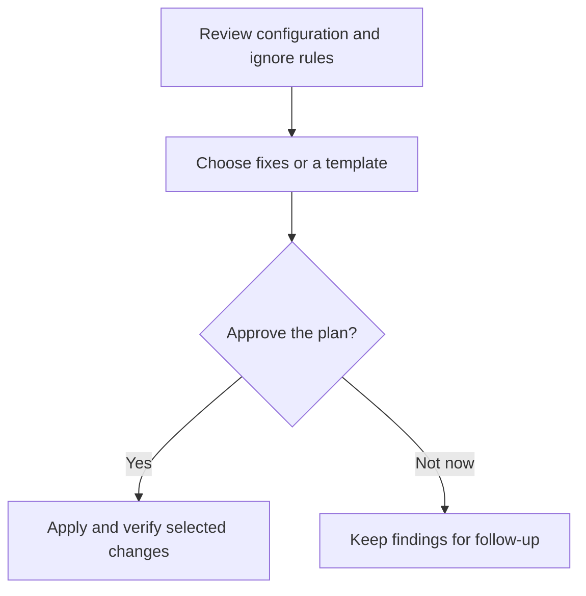

# env



Use env when environment settings or Git ignore rules have become hard to trust. It checks how configuration is used, reports problems and lets you choose fixes or a safe template.

## Flow



## Start the command

```text
env
```

Use your client's [command prefix]({{ '/docs/setup/' | relative_url }}#run-a-command). The audit can inspect pending edits. Fixes require a clean, eligible **main/master, feature or confirmed environment branch**.

## What gets checked

| Area | Typical questions |
|---|---|
| Configuration use | Which keys are required, missing or apparently unused? |
| Values and syntax | Are there credible exposures, hardcoded settings or loader-specific problems? |
| Git protection | Are private files protected, or are ignore rules hiding files the project needs? |

The audit follows actual services and configuration layers. An override need not repeat every baseline key, and externally supplied settings need not appear in an `.env` file. Findings show paths, key names and uncertainty without exposing values.

## Choose the fixes

Choose Env files, `.gitignore` or both, then review the exact changes. The plan separates committable source/templates from local-only work and external setup. Templates use placeholders, and edits preserve the loader's meaning and intentional environment differences.

**Untracking needs separate approval.** It keeps the local file, but other clean copies may disappear when collaborators update. Moving or untracking a secret does not revoke it or erase its history.

## Your result

You get verified changes and remaining follow-up. Operational env contents are never staged; tracked or managed env files remain report-only. Approved ignored, untracked env edits stay local.

The audit does not start the app or contact services. Static checks cannot prove credentials work or a deployment is ready. Work finishes on the same branch; use [ship](ship.html) separately to publish source changes.
