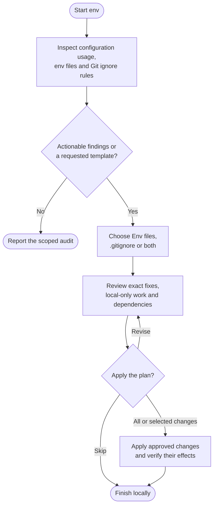

# env



Use env when environment settings or Git ignore rules have become hard to trust. It checks how configuration is used, reports problems and lets you choose fixes or a safe template.

## Flow

The complete procedure follows, including conditions and exceptions within each phase.

{{ page.guide_source | guide_intro }}

{{ page.guide_source | guide_body }}
