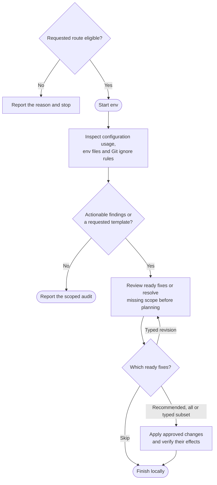

# Env



Env reviews configuration and Git protection without exposing secret values. It helps you separate real problems from intentional differences between services and environments, then plan only the fixes you want.

## Flow

## Start the command

Normal env checks for a clean, eligible main/master, established feature or confirmed environment branch before configuration discovery. Request a read-only audit explicitly to inspect pending edits; that route offers no fixes. The agent does not stash or commit unrelated work to create an eligible starting point.

The audit reads configuration roles, key names and source references. It does not start the app, test credentials, contact services or install tools just to discover a gap.

A required prerequisite or safe-inspection failure stops the run. Findings already collected remain reportable, but further checks and fix planning wait for a new eligible run. An unanswered workflow question pauses the run; it does not authorize independent investigation while you decide.

To keep values private, the audit uses existing tools to extract key names, locations and safe classifications. It does not test credentials or generate a parser during the run. Unsupported input or unavailable safe inspection is reported as a blocker; it does not become a raw-value dump or an assumed successful check.

## What gets checked

A useful review follows the actual configuration layers: application code, templates, service overrides and externally provisioned settings. Required, optional and unknown keys are distinguished. An override file need not repeat everything in a baseline, and a key supplied by hosting is not necessarily missing from the system.

The review covers required and unused keys, credible secret exposure, hardcoded configuration, templates, syntax and duplicate assignments, plus Git protection. Ignore decisions use Git's actual matching rules, including nested patterns and exceptions.

For example, an ignored local file can still lack shared protection if only your personal Git exclusions hide it. Conversely, a tracked default or lockfile is not automatically a mistake.

## Choose the fixes

The report leads with the issue count and a short note about scope or unverified areas. It shows problems directly rather than the audit's internal check/status grid. Each finding has a stable number, a short title, usually one or two sentences about what is wrong and its impact, and a diff showing the proposed change. Literal additions and removals remain readable without color, and existing values stay redacted. Manual configuration work instead identifies the exact keys, paths and actions.

A recommendation weighs whether this is a current problem, a risk under certain conditions or an improvement without a demonstrated failure. Expected benefits are balanced against implementation effort, compatibility risk, added complexity and future maintenance. Short- and long-term effects are explained when they differ meaningfully. Evidence and project context guide the judgment, without a scoring system or a long assessment form. Authoritative guidance may help settle a meaningful uncertainty; routine fixes do not require research for its own sake.

Recommended fixes have enough expected benefit to justify their tradeoffs and a concrete implementation ready without unresolved decisions or dependencies. An urgent finding may still need a choice before it is ready. Optional wording or optimization changes may be useful, but are not automatically recommended. The report gives the deciding reason and any material tradeoff briefly, keeping the diff prominent.

When the fixes are ready, **Apply recommended — 1–3** selects the named recommended set, **Apply all proposed fixes — 1–5** includes the additional ready optional fixes, and **Skip** makes no changes for that review. These numbers are illustrative; the choices always identify the actual set. If recommended and all are identical, only Apply all proposed fixes appears; empty apply choices are omitted. You can type `2, 4–5`, exclusions or a revision instead of using separate Choose changes or Revise options. Subsets are checked for dependencies without silently adding changes you did not select. The agent asks about scope first only when your answer would change the plan.

Large reports start with a compact numbered index and show full explanations and diffs in manageable batches. The review identifies its current numbers and what remains undisplayed. Each approval covers only the displayed ready fixes, never unseen later work. Dependencies are reviewed together or left pending. Skipping a later batch preserves changes already verified; it does not undo them.

| Output | How it is handled |
|---|---|
| Safe template or source change | Use placeholders or approved access expressions; eligible for a source commit. |
| Existing ignored, untracked env file | Approved local-only edits require a known loader; values stay private. |
| Tracked operational env file | Report its issues without treating its contents as a committable template. |
| Managed or external configuration | Leave entry to the appropriate owner or provider workflow. |

Templates are optional. Env proposes one only when it serves the selected work, rather than treating every missing `.env.example` as an error. Existing safe templates are assessed for their actual setup purpose, not just missing keys. Stale instructions, repeated explanations or examples from an unrelated service can receive a specific correction, consolidation or removal proposal in the same plan. Useful comments, safe defaults and established placeholder conventions remain in place.

A key with no reference found is not automatically obsolete: deployment, external providers or dynamic configuration may still consume it. Unknown purpose remains an explicit uncertainty. Optional wording improvements are reported separately from confirmed configuration or secret problems, and template review does not expose operational values.

## Preserve configuration meaning

Formatting depends on the actual loader. Quotes, expansion order, multiline values and empty-versus-absent settings can change behavior. Duplicate keys therefore need evidence and a specific choice, not a blanket keep-last cleanup.

Moving a hardcoded secret into an environment variable also needs a known destination and provisioning plan. A source edit cannot prove that production has received the value. Real credentials never become examples or client-visible fallbacks.

Untracking is a separate decision: `git rm --cached` keeps your local file, but its committed removal can delete clean copies when collaborators update. It neither revokes a credential nor erases its history.

## Your result

The report separates verified source changes, local configuration work and pending external actions. Syntax and ignore checks are different from working credentials or a ready deployment. Manual or deferred work remains explicit.

Only approved credential-free source, templates and ignore changes enter commits. With auto-commit off, a fully known source diff can be approved with or without its local commit in the same review. Operational values stay local, and work finishes on the same branch. Use [ship](../ship.html) separately to publish source changes.

## Explore the source

For implementation details, read [guides/env.md](https://github.com/myowinthein/agent-helm/blob/main/guides/env.md).
