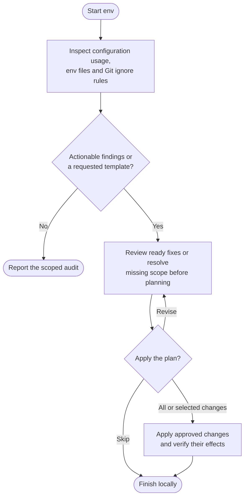

# env



Env reviews configuration and Git protection without exposing secret values. It helps you separate real problems from intentional differences between services and environments, then plan only the fixes you want.

## Flow

## Start the command

The audit can inspect pending edits on the current checkout. Applying fixes needs a clean, eligible main/master, established feature or confirmed environment branch. The agent does not stash or commit unrelated work to create that starting point.

The audit reads configuration roles, key names and source references. It does not start the app, test credentials, contact services or install tools just to discover a gap.

## What gets checked

A useful review follows the actual configuration layers: application code, templates, service overrides and externally provisioned settings. Required, optional and unknown keys are distinguished. An override file need not repeat everything in a baseline, and a key supplied by hosting is not necessarily missing from the system.

The review covers required and unused keys, credible secret exposure, hardcoded configuration, templates, syntax and duplicate assignments, plus Git protection. Ignore decisions use Git's actual matching rules, including nested patterns and exceptions.

For example, an ignored local file can still lack shared protection if only your personal Git exclusions hide it. Conversely, a tracked default or lockfile is not automatically a mistake.

## Choose the fixes

Findings identify paths and key names, explain the evidence and distinguish confirmed problems from uncertainty. When the fixes are clear, one review shows the exact environment and `.gitignore` changes and lets you approve all or a coherent subset. The agent asks about scope first only when your answer would change the plan. A changed selection is checked for dependencies before editing.

| Output | How it is handled |
|---|---|
| Safe template or source change | Use placeholders or approved access expressions; eligible for a source commit. |
| Existing ignored, untracked env file | Approved local-only edits require a known loader; values stay private. |
| Tracked operational env file | Report its issues without treating its contents as a committable template. |
| Managed or external configuration | Leave entry to the appropriate owner or provider workflow. |

Templates are optional. Env proposes one only when it serves the selected work, rather than treating every missing `.env.example` as an error.

## Preserve configuration meaning

Formatting depends on the actual loader. Quotes, expansion order, multiline values and empty-versus-absent settings can change behavior. Duplicate keys therefore need evidence and a specific choice, not a blanket keep-last cleanup.

Moving a hardcoded secret into an environment variable also needs a known destination and provisioning plan. A source edit cannot prove that production has received the value. Real credentials never become examples or client-visible fallbacks.

Untracking is a separate decision: `git rm --cached` keeps your local file, but its committed removal can delete clean copies when collaborators update. It neither revokes a credential nor erases its history.

## Your result

The report separates verified source changes, local configuration work and pending external actions. Syntax and ignore checks are different from working credentials or a ready deployment. Manual or deferred work remains explicit.

Only approved credential-free source, templates and ignore changes enter commits. With auto-commit off, a fully known source diff can be approved with or without its local commit in the same review. Operational values stay local, and work finishes on the same branch. Use [ship](../ship.html) separately to publish source changes.

## Explore the source

For implementation details, read [guides/env.md](https://github.com/myowinthein/agent-helm/blob/main/guides/env.md).
