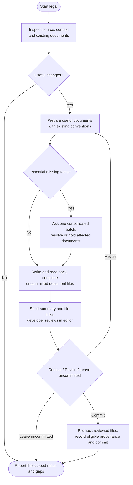

# legal

Prepare source-based legal documents and write uncommitted drafts for editor review. You decide whether to commit them.

## Start the command

```text
legal
```

Use the prefix for your app or terminal from [Setup]({{ '/docs/setup/' | relative_url }}#run-a-command).

Start on clean **main or master**. Legal commits need explicit content and commit approval, even with auto-commit enabled.

## Flow



## Understand the service first

Review actual data flows, integrations, payments and existing policies. Source and supplied answers come first; essential missing facts are asked in one batch.

Relevant provider or legal research may be needed, but there is no standard business interview, home-address requirement or worldwide clearance process. Off-code practices remain limits of source inspection.

## Prepare the useful documents

| Document | Purpose |
|---|---|
| Privacy policy | Explain personal-data processing. |
| Terms | Set approved service rules. |
| Cookie policy | Explain tracking/storage not already covered. |
| Refund policy | Describe confirmed sales/refund responsibilities. |
| EULA | Set an approved compatible licensing arrangement. |
| Disclaimer | Explain relevant content or advice limitations. |

Prepare the smallest useful set. Terms, refund policies and EULAs need your request or an existing approved policy. You can request or exclude supported types; no useful changes can mean no files written.

## Draft from confirmed facts

Follow existing locations and language. Preserve approved custom or lawyer-reviewed clauses unless a specific replacement is agreed. Missing facts do not become invented promises.

Routing, consent controls, navigation and store submissions are separate implementation work.

## Handle gaps precisely

Omit optional unsupported promises, narrow claims or ask about indispensable missing facts. A known material problem holds the affected document while other complete drafts may proceed. Incomplete preliminary wording stays off public routes.

Unassessed sufficiency is a limit, not automatically a violation. Drafting and owner approval do not establish compliance or enforceability.

## Review before committing

Read complete files in your editor or Markdown preview. Chat stays with links, meaningful changes and important gaps. A full chat dump or second-model critique is available only on request.

Choose **Commit / Revise / Leave uncommitted**. Approval covers actual content, dates and the disclosed commit/record changes. You may edit drafts yourself; the agent rereads them before committing. Unchanged approved work needs no second question.

## Your result

You get document links, gaps and local commit or draft status. Only approved complete substantive changes advance `.helm/legal-manifest.json`; cosmetic edits and uncommitted drafts do not.

Unchanged source does not prove business or legal freshness. Work stays on the same branch; use [ship](ship.html) for publication.
