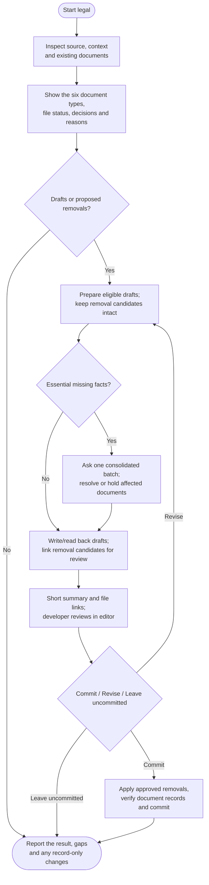

# legal

Prepare source-based legal documents and write uncommitted drafts for editor review. You decide whether to commit them.

## Start the command

```text
legal
```

Use the prefix for your app or terminal from [Setup]({{ '/docs/setup/' | relative_url }}#run-a-command).

Start on clean **main or master**. Commits containing legal document text need explicit content and commit approval, even with auto-commit enabled.

## Flow



## Understand the service first

Review actual data flows, integrations, payments and existing policies. Source and supplied answers come first; essential missing facts are asked in one batch.

Relevant provider or legal research may be needed, but there is no standard business interview, home-address requirement or worldwide clearance process. Off-code practices remain limits of source inspection.

## Prepare the useful documents

| Document | Purpose |
|---|---|
| Privacy policy | Explain personal-data processing. |
| Terms | Set approved service rules. |
| Cookie policy | Explain tracking/storage not already covered. |
| Refund policy | Describe confirmed sales/refund responsibilities. |
| EULA | Set an approved compatible licensing arrangement. |
| Disclaimer | Explain relevant content or advice limitations. |

Prepare the smallest useful set. Terms, refund policies and EULAs need your request or an existing approved policy. You can request or exclude supported types; no useful changes can mean no files written.

After assessment, one table lists **Document type | Existing files | Decision | Reason** for all six types. Existing files receive **Keep / Update / Recommend removal / Uncertain—missing facts**; missing files receive **Create / Do not create / Uncertain—missing facts**. Explicitly excluded types show **Out of scope**, without a forced assessment. Use separate rows when files or locales need different actions.

Every decision needs a reason; preserving a file does not replace assessing its continuing purpose. Not creating new Terms does not itself justify deleting existing Terms. The table appears before document changes and adds no approval gate; completed no-op/read-only assessments include it, while early blocked/cancelled runs report their limits.

## Draft from confirmed facts

Follow existing locations and language. Preserve approved custom or lawyer-reviewed clauses unless a specific replacement is agreed. Missing facts do not become invented promises.

Routing, consent controls, navigation and store submissions are separate implementation work.

## Reconcile missing recorded documents

Legal checks the current files/Git snapshot, current conversation, existing project documents and references, then relevant local Git history as needed. It automatically corrects a confirmed move's recorded path or removes a confirmed deleted document's entry, preserving historical assessment dates/source IDs. It asks where a file went only after relevant investigation cannot resolve it; uncertain records stay intact. Record reconciliation never deletes actual documents; proposed file removals use the final review below.

No cleanup approval is added. With drafts, record repairs join the existing content commit or stay uncommitted with the drafts. Record-only work follows auto-commit or existing commit authorization; otherwise it stays uncommitted. Explicit read-only requests remain read-only.

## Handle gaps precisely

Omit optional unsupported promises, narrow claims or ask about indispensable missing facts. A known material problem holds the affected document while other complete drafts may proceed. Incomplete preliminary wording stays off public routes.

Unassessed sufficiency is a limit, not automatically a violation. Drafting and owner approval do not establish compliance or enforceability.

## Review before committing

Read complete files in your editor or Markdown preview. Chat stays with links, meaningful changes and important gaps. A full chat dump or second-model critique is available only on request.

Choose **Commit / Revise / Leave uncommitted**. The review names exact proposed deletions, reasons and dependency effects alongside drafts and record changes. Commit can approve that entire shown unit once, including a removal-only proposal. Files stay intact until deletion is explicitly approved; Leave uncommitted preserves removal candidates. Completed deletions remove only their corresponding manifest records in the same unit. Unresolved integration requirements remain pending.

You may edit drafts yourself; the agent rereads them before committing. Unchanged approved work needs no second removal or cleanup question.

## Your result

You get document links, gaps, record repairs and local commit or draft status. Only approved complete substantive document changes refresh assessment dates/source IDs in `.helm/legal-manifest.json`; path/removal reconciliation makes no new legal assessment.

Unchanged source does not prove business or legal freshness. Work stays on the same branch; use [ship](ship.html) for publication.
