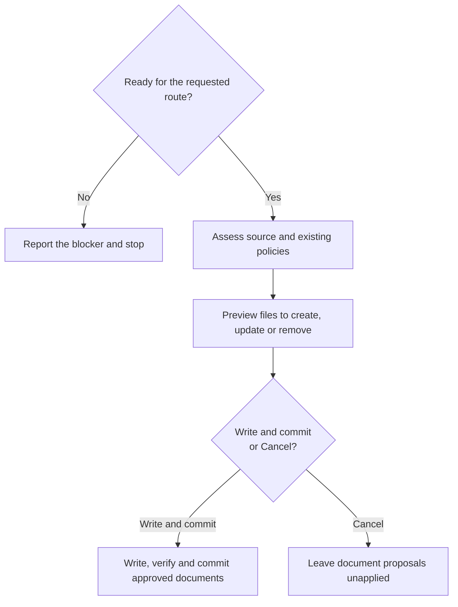

# Legal



Use legal to prepare the legal documents a project needs, based on its source and confirmed facts. You review exact changes and proposed results before approving their write and commit.

## Flow



## Start the command

```text
Codex → $legal    Claude → /legal
```

Use your client's [command prefix]({{ '/docs/setup/' | relative_url }}#run-a-command). Legal checks for clean **main or master** before source and document discovery. Legal document commits need explicit content and commit approval, even with [auto-commit](../rules/git.html#auto-commit) enabled.

A Git, ownership, path or state-validation blocker ends the run before further investigation or proposals. Missing facts for an individual document remain distinct from those workflow prerequisites.

<span id="understand-the-service-first"></span>

## Prepare the useful documents

Helm reviews the service, data flows, integrations, payments and existing policies. You can request or exclude document types; it recommends the smallest useful set.

| Document | What it explains |
|---|---|
| Privacy policy | How personal data is processed. |
| Terms | Approved rules for using the service. |
| Cookie policy | Tracking/storage not already covered. |
| Refund policy | Confirmed sales and refund responsibilities. |
| EULA | An approved compatible licensing arrangement. |
| Disclaimer | Relevant content or advice limitations. |

Terms, refund policies and EULAs need your request or an existing approved policy. Legal assesses the supported types within your scope, then previews only files it proposes to create, update or remove. Unchanged documents need no individual status entries. Excluded types stay out of scope; held documents and important gaps receive a short note. If no useful change is needed, it reports that directly.

## Draft from confirmed facts

Existing approved clauses, locations and language are preserved unless you agree to a replacement. Essential missing facts are asked together; there is no standard home-address intake or worldwide clearance process.

Legal starts from local and supplied evidence. Online legal, provider or store research needs your explicit request or agreed scope. Unverified external requirements remain identified limits, and indispensable missing evidence keeps the affected conclusion pending.

<span id="handle-gaps-precisely"></span>

A known material gap holds the affected document while other complete drafts may proceed. Missing facts do not become invented promises. Drafting and owner approval do not establish legal compliance; consent controls, routing and other implementation work remain separate.

<span id="review-before-committing"></span>

## Review before writing

For existing documents, you see a diff and the clean proposed result for affected passages. Each new document appears once in full. Proposed dates, removals and record/commit effects are shown before any document write.

Choose **Write and commit** or **Cancel**. You can type exact corrections, select particular files or request **write without committing**. That draft-only request leaves files proposed for removal untouched and does not advance assessment dates or source records. Cancel leaves pending document changes unapplied; earlier approved work or verified record repairs remain preserved.

## Your result

You get document links, remaining gaps and the actual commit or draft status, on the same branch.

<span id="reconcile-missing-recorded-documents"></span>

Confirmed document moves or deletions can update saved records automatically; uncertain whereabouts need clarification. Record repair never deletes actual files or counts as a new legal assessment. Unchanged source alone does not prove business or legal freshness.

Use [ship](ship.html) separately for publication.
