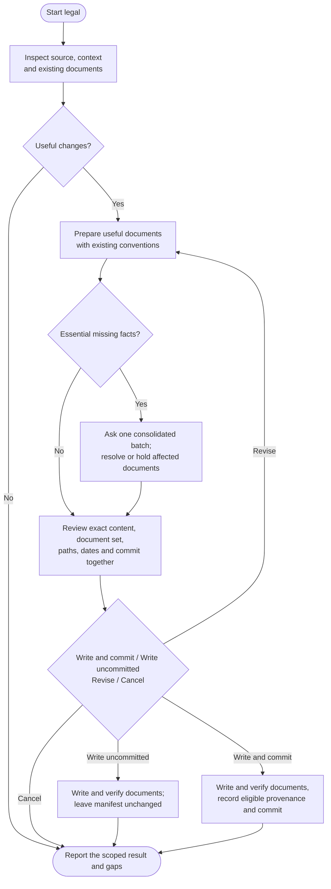

# legal

Draft or maintain practical legal documents from the project's source, existing documentation and confirmed facts. Legal reads first, prepares a useful document set, asks only for essential missing information and brings the content to one consolidated review. It needs no legal-template service or second AI reviewer.

## Start the command

```text
legal
```

Use the prefix for your app or terminal from [Setup]({{ '/docs/setup/' | relative_url }}#run-a-command).

Start on a clean **main or master** branch. Legal reads shared instructions without changing them. Document commits always need explicit content and commit approval, even when automatic commits are enabled.

## Flow



## Understand the service first

The command scopes the product or service, which may include several related packages. It checks accounts, data flows, integrations, tracking, payments and existing policies, then distinguishes observed implementation from inference and facts you need to confirm.

Existing project information and your supplied answers come first. There is no standard business, country or markets interview. If omitting or narrowing a claim would still leave an essential factual gap, legal batches the missing questions together. A genuinely new contradiction can require a focused follow-up. It does not invent facts from dependency names or infer domicile from a repository location.

Investigation follows the project's actual data flows. An external favicon warrants describing its browser request; it does not trigger an audit of the portfolio serving it. Provider logging is not assumed absent just because the project has no analytics. Targeted primary research checks claims and concrete legal/store questions when relevant, without requiring global legal clearance. Writing a notice implements no consent, deletion or publication mechanism.

## Prepare the useful documents

| Document | When it may be useful |
|---|---|
| Privacy policy | Explain relevant personal-data processing and applicable disclosures. |
| Terms | Set approved rules for the actual service, accounts or commercial offering. |
| Cookie policy | Explain tracking or storage not adequately covered elsewhere. |
| Refund policy | Describe the operator's confirmed sales and refund responsibilities. |
| EULA | Document an approved end-user licensing arrangement compatible with existing licenses. |
| Disclaimer | Address specific relevant advice, content or AI limitations. |

The command proposes the smallest useful set, rather than asking you to choose every type before drafting. Privacy/storage notices and specific disclaimers can follow inspected behavior. Terms, refund policies and EULAs need your request or an existing approved policy to maintain; detecting payments does not authorize invented refund or contract terms. All six types remain available on request.

The final review lets you accept, exclude or revise the proposed documents together with their wording. Recommendations distinguish useful documents from identified requirements and uncertain suggestions. Existing suitable coverage avoids duplicates. With no signals or no relevant source changes/gaps, legal can report a no-write result without another exit question; you can still request drafting or broader review. Neither result certifies legal currency or absence of legal need.

## Draft from confirmed facts

Existing approved wording is maintained through targeted edits. New documents default to source evidence, confirmed facts and relevant primary sources. A supplied trusted baseline remains supported, but there is no routine template-choice question. Templates never prove your practices or establish commercial choices.

Output follows existing legal locations, language and supported Markdown, MDX or HTML conventions, falling back to `legal/` Markdown when needed. Paths, locale and baseline appear in the final review, without separate routine setup approvals. Routing, navigation, store submissions and operational controls remain separately authorized work.

Legal reuses intended-public project contacts or your explicit confirmation. Author/Git metadata alone is only a lead. It never requests your home address. A postal-address question needs an identified applicable requirement and asks only for a suitable intended-public contact arrangement, whose legal sufficiency is not assumed. Refusal is respected. Public issues can handle general questions; private privacy requests need a suitable private route.

## Handle gaps precisely

| Situation | Action |
|---|---|
| Unsupported optional promise or unrequested commercial choice | Omit it and report a relevant open decision. |
| Verified implementation supports narrower useful wording | Describe that behavior without inventing off-code facts. |
| Indispensable missing fact or an identified applicable requirement | Ask in the essential-facts batch; show the basis for a claimed requirement. |
| Known false claim, unresolved indispensable omission or harmful clause replacement | Hold only the affected document. |
| Legal sufficiency or provider/deployment detail not assessed | State the actual limit; do not equate uncertainty with a known violation or global clearance. |

A complete source-based document truthfully covers its purpose at the inspected snapshot, with confirmed owner facts and no known indispensable omission. This does not establish compliance, enforceability or sufficiency in every jurisdiction. Known obligations cannot be hidden by calling them unassessed. Free, solo or unregistered projects receive proportionate drafting assistance, not an automatic exemption or a business-compliance interview.

Held preliminary documents stay in conversation unless you request a separate nonpublic file. They receive no public date or manifest update. Unaffected complete documents can proceed with held work clearly excluded.

## Review before committing

Before canonical writes, you see complete new content or exact existing diffs, what is kept or removed, a short **Claim or clause / Basis / Confirmation or gap** table, defaults used, paths, dates, held work and the proposed manifest/commit. Existing Foreign or lawyer-reviewed content receives its exact review in this same step. Nothing is silently replaced.

A separate drafting critique runs only if you request one, with any necessary authorization for sharing private material. There is no recurring critique picker, second-model requirement or blanket lawyer-consultation prerequisite. Concrete unresolved legal questions remain visible; neither another AI nor your approval establishes legal validity.

Choose **Write and commit / Write uncommitted / Revise / Cancel** once for that exact proposal. You can exclude documents or request changes; changed content is reviewed before writing. Approval covers the shown document set, exact text, paths and dates, plus the manifest/local commit only for Write and commit. Automatic commits do not bypass this decision, and the unchanged approved unit needs no second commit question. Cancel preserves canonical inputs; actual prior work and failed writes are never automatically cleaned up.

## Your result

Approved files are written and compared with the reviewed content before state or staging. Only accepted complete substantive changes receive source provenance in `.helm/legal-manifest.json` under Write and commit. Write uncommitted writes the approved documents and preserves the prior manifest. Cosmetic work retains dates/provenance.

The result counts public documents separately from the internal manifest. It reports the source snapshot, actual checks, confirmed facts, specific gaps and researched/unassessed scopes without claiming legal certification. No new profile, mode, schema or third-party service is introduced.

On the next run, legal distinguishes source changes from business, provider and legal freshness; an unchanged commit does not establish that all four remain current. Unsupported state blocks dependent work without automatic conversion or reset.

The command finishes locally on the same branch. Use [ship](ship.html) separately to publish. Drafting, owner approval and a successful commit do not establish legal validity or compliance.
