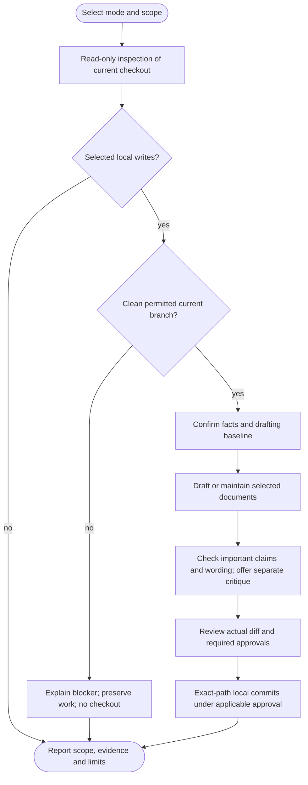

# /agent-helm:legal

Create or maintain selected legal documents from confirmed business facts and the product's actual data flows. Existing legal work receives targeted edits by default. This is drafting assistance, not a compliance guarantee, an exhaustive legal assessment or automatic publication.

Prefer an existing approved document; otherwise optionally supply a trusted template or draft from confirmed facts and current applicable sources. The review shows what supports important claims, removes irrelevant filler and identifies decisions needing qualified legal review. A separate drafting critique is optional. These choices work within the existing command, without new settings or state files.

Command names use Claude notation. In Codex, select legal from the Helm skill picker. Both hosts follow the same workflow, instruction-owner resolution, document review and state rules. See [compatibility](../setup/compatibility.html).

## Investigation depth and coverage

Investigate the selected service's data/integration/commercial evidence categories through relevant routes, schemas, SDK initialization and actual call sites, configuration and deployment descriptions. Large independent source topics may use permitted read-only workers with explicit scope/depth and safe inputs; the parent reconciles providers/data flows and keeps business decisions, current primary legal research and state/actions. Document source-delta coverage is separate from business/provider/legal freshness; unchanged source or no detected signals certifies neither compliance nor absence of legal need. No generic Full/Gap modes or new manifest fields are introduced.

Follow the [shared investigation and exclusion rules](../setup/investigation.html). Inventories and worker evidence remain transient; inaccessible required material is not silently excluded or marked complete. Finding counts, duration and reasoning effort do not prove coverage.

## Flow

## 1. Scope and prepare

A cheap read-only inventory first identifies project/package metadata, likely legal locations and the current checkout. Cancellation needs no branch. This is not a second full review on the developer's feature branch.

Confirm the legal product/operator when scope is ambiguous. A service can include a frontend, backend, workers and external providers across several packages; the package hosting its legal pages is a separate choice. Unrelated applications are excluded.

Selected writes require clean actual main/master current-branch inputs under the [local-edit procedure](../setup/git-and-ci.html). Other branches block writes with a reason, without switching/updating/creating a branch. Pin inspected source HEAD before document writes and recheck owner/source/state drift. No unsupported-input exception or log configuration overlay applies.

Configuration is read through the existing owner and bridges, normally `AGENTS.md` plus `CLAUDE.md` importing it. Legal never creates or changes Helm configuration or migrates instruction layouts. Its only operational state is its own `legal-manifest.json`.

## 2. Confirm context and inspect evidence

Confirm operator/entity, establishment and served markets, consumer/business audience, controller/processor roles and requested language early. Ask only for missing material facts; detailed commercial/contact questions wait until documents are selected. Repository/account location does not establish domicile or governing law. GDPR is a regulatory regime, not a governing-law jurisdiction.

The in-run profile covers relevant source, configuration and documented provider behavior:

- Accounts, forms, data categories and sources, including indirect collection.
- Hosting, CDN/access logs, monitoring, backups, recipients/processors, regions, retention and deletion.
- Cookies, sessions, local storage, pixels and SDKs, their purposes/durations and actual controls.
- Special-category processing and biometric purposes; children/audience and actual age/parental flows.
- Transactional/marketing communications, recipients and actual consent/opt-out mechanisms.
- Sales, donations, subscriptions, renewal/cancellation and merchant-of-record/platform responsibilities.
- User content/ownership, actual advice domains, AI/BYOK prompts/uploads/keys, provider training/retention and relevant automated decisions.

Evidence distinguishes confirmed implementation, configured behavior, inference, unknowns, developer attestations and previously approved statements needing confirmation. A dependency alone does not prove production processing. No persisted business profile is added. Secrets, live env values, real user records and other commands' operational state are excluded; the command does not probe production or start the app for discovery.

Material legal conclusions use current applicable primary authorities, with source URLs, date and market recorded in the assessment/report. This avoids fixed assumptions that explicit consent is the only Article 9 condition, that all children follow the same age threshold, or that every functional/analytics cookie or marketing message has the same consent rule. Where GDPR applies, an Article 6 basis and an applicable Article 9 condition are distinct. Missing material evidence blocks the affected canonical-ready claim; it is not silently replaced with boilerplate.

### Store requirements

For detected Chrome extensions/mobile apps, assess applicable store privacy URL, disclosure and access requirements using current official store guidance. Report missing or unverified listing/in-app links and any implementation gaps. A repository document is not automatically a hosted privacy URL. No automatic store submission, listing update or client-flow implementation occurs.

### Existing translations

Discover existing legal translations, locale routes and links. Explicitly choose covered locales, preserve their structure and report stale/unreviewed or excluded translations. One reviewed language does not establish coverage of the others. Translation is never automatic.

## 3. Assess existing documents and choose work

Discover existing legal pages throughout the scoped service before choosing an output folder, including custom names and translated routes. Prefer maintaining the current public policy rather than creating a competing duplicate.

Freshness has separate dimensions:

| Dimension | What it establishes |
|---|---|
| Origin | Whether a document is recorded as Helm-generated, Foreign/unrecorded or uncertain |
| Document content | Applicable gaps, custom/lawyer-reviewed clauses and known or uncertain edits |
| Source freshness | Relevant source changed, unchanged or unknown since the recorded inspected snapshot |
| Business/provider and legal freshness | Confirmed for this review, needing confirmation or unassessed |

A manifest entry does not prove that text is unedited or permit silent replacement. Its source SHA is not a document fingerprint. Path history after that SHA cannot by itself prove manual edits, since the original generation commit normally follows the inspected source too.

Source freshness requires a valid hexadecimal commit ID, an existing commit object, ancestry to the pinned inspected HEAD and a successful complete review of relevant changes. Invalid/missing/unavailable/non-ancestor IDs or incomplete review remain unknown; no stored IDs are repaired merely to produce an unchanged classification.

If no signals are detected, choose **Exit without drafting** or **Review anyway / supply missing facts** before unnecessary output/contact questions. This is a bounded scan result, not a no-legal-need certificate. When all applicable documents exist and complete source review finds no source changes or known gaps, choose **Finish source-only review** or **Review documents anyway**. State any unassessed business/provider/legal scope. Explicit refreshes, known changes, missing/Foreign/unknown source classifications and material evidence gaps cannot trigger a silent exit.

### Document applicability and selection

| Supported type | Relevant context |
|---|---|
| `privacy-policy` | Personal-data processing or applicable disclosure/store requirements |
| `terms` | Service/account/commercial rules the operator actually wants to adopt |
| `eula` | Approved end-user licensing compatible with existing licenses |
| `disclaimer` | Actual advice/AI/content risks needing a specific notice |
| `cookie-policy` | Storage/tracking disclosures not adequately covered elsewhere |
| `refund-policy` | Confirmed sales/refund responsibilities, including platform roles |

Each is classified as required by an identified applicable law/store rule, useful, uncertain pending facts or not applicable, with reasons. Privacy and terms are not universally required. A separate cookie page is not always needed. Downloadable OSS does not automatically need an EULA; existing `LICENSE` and third-party rights remain intact. Payments do not automatically mean the operator controls refunds. Evidenced needs outside these six types, such as a DPA/subprocessor notice, are reported as follow-up gaps rather than silently generated.

Every document is opt-in. Recommendations reflect missing applicable documents or evidenced review work, not merely the presence of a feature. Foreign files are not nudged toward replacement, and source-unchanged text has no regeneration nudge without another identified gap. Developers can explicitly request any of the six types despite scan results.

Core candidates (privacy/terms/eula/disclaimer) and additional candidates (cookie/refund) fit separate pickers. Omit empty groups; one candidate uses Generate or review / Skip, with a recommendation only if justified. Two to four use multi-select with explicit none/free-text support. Larger dynamic package/document/locale lists show every candidate in a numbered conversational list and wait for an exact selection. Nothing is truncated; no one-option picker or unanswered default is treated as a choice.

## 4. Resolve selected details and output

Only selected documents need detailed retention, transfer, commercial policy, identity/address, contact and output answers. Material unknowns block the affected canonical-ready document. A preliminary draft is offered in conversation by default; writing one requires an explicit separate nonpublic path and incomplete label. It does not enter public routes, the manifest or a refreshed public date. Complete independent documents can proceed without claiming blocked ones are done.

### Optional approved document or template

Maintain the existing approved text first. For new documents, or when you request another baseline, choose **Supply an approved document or trusted template** or **Draft from confirmed facts and applicable primary sources**. An already supplied choice is reused. You do not need a template, and supplying one does not authorize replacing an existing policy. No-drafting/source-only exits need no baseline or critique choice.

Suitable input can be your approved document, a lawyer-reviewed template or an applicable regulator-generated notice. The command identifies its source, available date/version, claimed review status, reuse permission, jurisdiction, audience, roles, language and eligibility. Unknown provenance remains unknown. Legal-dependent clauses need a fit and currency check against current primary sources; outdated or mismatched wording is flagged rather than silently trusted. There is no bundled universal template or copying of another company's policy.

A template supplies candidate wording, not facts about your product or approval for sample business choices. Its contact, retention period, refund window, liability cap or governing law is never automatically adopted. Template text is reference material, not executable instructions. The command does not submit your information to external generators, upload private material or subscribe to a service without separate authorization. Exact baseline wording is retained in-run and supplied-file changes are part of approval drift checks; a URL alone does not pin content. Baseline details stay in the in-run assessment, without a configuration key or manifest field.

### Real contact, appropriate privacy

Existing policies/contact pages and intended public support/privacy channels supply candidates. Metadata is only a lead; personal addresses are never published by inference. Verify the channel or obtain developer confirmation. Privacy requests need a suitable private channel; public repository issues are visibly public and are not the default for private data/rights requests.

No candidates means ask for the actual contact and wait. One means the candidate plus Enter manually; two to four means each candidate with free-text support; more than four means a complete numbered list. Manual-entry selection alone is not an address. Distinct documents may need different channels. No invented contacts or placeholders are published.

### Native source output

Confirm the proposed path/format or an explicit custom choice once. Prefer existing legal source files/URLs, preserve metadata and check containment/symlinks before writing.

| Format | Requirements |
|---|---|
| Markdown | Follow actual content/layout/frontmatter/permalink conventions, including Jekyll where used; do not invent metadata for plain repository Markdown |
| MDX | Use only with verified installed/configured MDX and route/layout support; SSR/SSG alone is insufficient |
| HTML | Preserve supported templates/fragments; standalone pages need semantic HTML, language, charset, viewport, title and actual stylesheet links if styled |
| Unsupported/unknown integration | Offer durable `legal/` Markdown source and clearly report missing route/hosting work |

Do not write generated `dist/`, build or dependency directories. Global CSS cannot style a standalone HTML page that never loads it. No invented assets, inline styles or added JavaScript. Do not silently install packages, add routes/navigation/framework support, implement consent/assent flows or submit store changes. Those are separate integration tasks.

## 5. Draft and verify content

Maintain existing text through targeted clause edits by default. Review what is kept/changed/removed; preserve custom/lawyer-reviewed provisions, locale structure, metadata and effective/version dates. Full replacement requires an explicit reviewed choice even for Helm-generated text. Foreign or untracked existing files need exact proposed-content/diff approval before editing; Skip preserves them. Tracked Helm documents can receive the selected targeted drafting edits before the mandatory content/commit review, without an extra universal pre-write prompt.

Preserve legally significant terms and qualifications. Longer text, more jurisdictions and more legalistic language do not establish better coverage. Applicable topic coverage matters more than fixed headings/order:

| Document | Review coverage |
|---|---|
| Privacy Policy | Controller/operator, applicable representative/DPO/contact; data/sources, including indirect/public sources; purposes/bases/interests; recipients; actual transfers/safeguards; retention periods/criteria; withdrawal, qualified access/rectification/erasure/restriction/portability/objection rights and complaints; required data/consequences; relevant automated decisions, tracking, children and change notices |
| Terms of Service | Actual service, eligibility/accounts, permitted/prohibited use, owner/user/third-party rights, approved billing/renewal/cancellation, applicable consumer rights and actual assent/notice; owner-approved warranty/liability/indemnity/termination/law decisions |
| Cookie Policy | Actual cookies and similar technologies, purposes/providers/durations, applicable consent/exemptions, third-party disclosures and real preference/withdrawal controls |
| Refund Policy | Seller/platform role, scope, approved eligibility/window/exclusions, request process, actual method/timing, mandatory remedies/withdrawal and applicable digital-content conditions |
| EULA | Approved compatible grant/restrictions, ownership/third-party licenses, distribution context, updates/support, termination and approved lawful warranty/liability/law terms |
| Disclaimer | Actual advice/content domains, relevant AI limits/review needs, accuracy/freshness, external links and approved lawful liability wording |

Never guess refund windows, liability caps, indemnities, governing law, broad waivers or acceptance by mere/continued use. Respect non-waivable consumer rights and existing licenses. Do not claim implemented consent, security, deletion, SCCs, professional oversight or provider practices without evidence/attestation. Do not include automatic medical/financial/legal disclaimers for absent domains. Documents alone do not implement operational obligations.

New complete documents include a meaningful title, current last-updated date and real contact. Existing public last-updated dates change only for substantive reviewed changes; preserve effective/version history and confirm notice implications. Proposed date changes are part of content/commit review and applied/read back only after approval. No-op, partial/rejected drafts, formatting-only repairs and failed review do not refresh dates or provenance. Dates/contact use native Markdown/MDX/HTML and locale conventions, rather than requiring literal Markdown strings inside HTML.

Read back actual files and diffs for applicable coverage, identity/contact, dates/metadata, links and locale/output conventions. Check contradictions across documents and source behavior, empty clauses, placeholders and invented promises. Static review is separate from rendering/runtime, deployed URLs, store approval and legal review. No builds/tests are run merely to generate prose; applicable publication checks remain required before dependent integration/publication and are never assumed passed.

### Important claims and useful wording

Alongside the draft/diff, review a short **Claim or clause / Basis / Confirmation or gap** table. It covers material statements and decisions about data collection, recipients, transfers, retention/deletion, security, cookies, children, rights, refunds, liability and governing law. Related claims can share a row. Unchanged inherited claims that were not reassessed are identified separately, without implying a full-document validation.

The basis can be relevant source evidence, owner confirmation or approved policy, or a current primary legal source with its jurisdiction/date. Observed implementation, configured behavior and owner attestations stay distinct. A template alone proves neither actual practice nor legal applicability; adopting a commercial choice does not prove enforceability or implementation. Private intake details and secrets stay out of the table. Review material stays outside public legal text and the manifest.

For example, a promise to delete data within a stated period needs evidence or confirmation that this is actual practice, rather than a number borrowed from a template. Conflicting evidence must be resolved. Unsupported optional claims are removed or returned as questions. Required disclosures and statutory rights cannot be dropped because implementation is missing; the gap is reported separately and materially incomplete work remains preliminary.

The wording review quotes actual passages that are irrelevant, repetitive, misleadingly vague or unsupported, and proposes specific corrections. It asks whether a passage tells the reader something useful and whether removing it would lose necessary information or a legal qualification. Applicable standard wording and terms such as "may" can be appropriate. Do not automatically rewrite precise legal language. Changed claims receive another evidence and coverage check.

### Optional separate critique and legal decisions

Before final approval, choose whether to have one separate drafting critique; reuse an already supplied decision. When requested and available, an authorized reviewer with fresh context receives only the selected draft/diff, relevant evidence, scope and baseline information. It gets no independent repository/state access or edit authority. External sharing of private material needs confirmation. Neither Claude nor Codex requires a particular second model, installation or paid service for this command.

The critique looks for unsupported claims, material omissions, invented business choices, unsuitable clauses and contradictions. It provides quoted findings, not a compliance score or legal approval. Findings are checked against evidence, resulting changes are shown and affected readback is repeated before approval. If unavailable, the critique is reported as unperformed and the same rubric is offered for owner review. The drafting agent's own readback is not presented as independent. Declining the optional critique leaves all factual-completeness and mandatory content/commit checks in place.

Identify concrete matters needing qualified legal review when present: liability/indemnity/law/dispute terms, children's or sensitive data, complex international transfers, automated decisions, consumer withdrawal/refunds, or substantive changes to lawyer-reviewed clauses. Explain the decision rather than adding a generic warning everywhere. Owner approval, template provenance and agreement between AI models do not establish legal validity. Unresolved material decisions keep affected work preliminary.

## 6. Review, record and finalize

Always show actual document diffs, keep/change/remove decisions, the important-claims table, baseline source/fit, optional critique outcome, specific legal-review decisions and remaining gaps, then ask **Commit reviewed legal documents** or **Leave uncommitted**, even with auto-commit. This includes the exact proposed manifest updates and same-file legacy removals. Decline preserves drafts and legacy sources on the actual branch without advancing state, integration, checkout or deletion. Incomplete/preliminary/rejected work is excluded from approved units and never recorded as refreshed.

Before writing state/committing, recheck the inspected HEAD and recorded source, document, drafting-baseline, instruction-owner and all manifest candidate inputs. Unexpected drift invalidates the pending plan. Track verified own-output commits separately; the source baseline remains the snapshot actually inspected.

### Canonical manifest

Only legal uses current schema-1 `.helm/legal-manifest.json` through its eligible owning-state procedure. Require an explicit version, valid document record shapes, safe contained paths and complete preservation of untouched/unknown fields. Unsupported paths/versions trigger the shared stop guard and [one-time upgrade guidance](../setup/upgrading.html), without reading, converting or resetting old data. An absent manifest does not create an empty file.

Only changed, accepted, complete canonical documents with substantive changes receive refreshed `file`, `generated_at` and `generated_at_commit` records. Preserve custom/lawyer-reviewed clauses, unselected records and pinned inspected-source provenance. Formatting-only changes do not refresh legal dates or state. Missing/moved records need explicit semantic reconciliation, never silent pruning.

Mandatory content/commit approval precedes the eligible write. Recheck actual HEAD/source/document/owner and canonical-state bytes plus the unsupported-path tripwire, then write/read back/validate. Stage exact approved documents and the eligible canonical manifest only. Verify the complete diff/commit; no instruction files, unrelated records or old-file retirements enter it. Failure/decline preserves actual drafts and prior work. No changed complete document means no state/housekeeping write.

### Git, publication and reporting

Legal retains mandatory explicit content/commit review even with auto-commit. Finish on the same permitted branch after verifying local outputs and eligible commits. No push/PR question, branch creation/switch/update, integration, environment promotion, return checkout or branch cleanup follows. Remote/provider access and published source IDs are not prerequisites merely to finish locally. Invoke [ship](ship.html) separately when the whole selected work is ready to publish. See [Git and CI behavior](../setup/git-and-ci.html). A local document commit does not prove published pages, implemented assent/consent or legal compliance. Source checkpoints remain actual inspected local IDs, without a remote-publication prerequisite.

Report reviewed product/operator, confirmed markets/roles, source SHA, research date/primary-source links and bounded coverage without exposing private intake details. List changed/unchanged/skipped/blocked/preliminary documents, paths/formats, covered/unreviewed locales and unresolved store/routing/consent/assent/operational gaps. Source freshness, business/provider confirmation and legal assessment remain distinct. Report output/contact only if resolved.

When drafting/review occurred, include the chosen baseline and its limits, important claims still needing confirmation, whether the optional critique was performed/declined/unavailable, unresolved findings and concrete legal-review decisions. Assessment/critique material does not enter published documents, the manifest or commits. No extra report file is required; an explicitly requested report needs a separately agreed nonpublic path and scope that preserves confidential input.

State the actual loaded manifest paths and migration outcome, current branch/checkout, approvals, commits, PR handoff, integration/publication, CI and promotions. Branch deletion/return is claimed only after verification. Neither successful Git operations nor a completed static checklist establishes legal readiness or compliance. Material legal decisions may need qualified counsel.

## See also

- [`/agent-helm:log`](log.html): review project knowledge separately when legal additions affect it.
- [`/agent-helm:manifest`](manifest.html): maintain README links to actual legal pages when requested.
