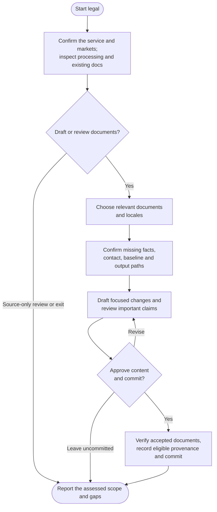

# legal

Prepare or maintain legal documents that fit the project's actual service and practices. Legal reviews the source, asks for material business facts and drafts the documents you choose from confirmed information.

## Start the command

```text
legal
```

Use the prefix for your app or terminal from [Setup]({{ '/docs/setup/' | relative_url }}#run-a-command).

Start on a clean **main or master** branch. Legal reads shared instructions without changing them. Document commits always need explicit content and commit approval, even when automatic commits are enabled.

## Flow



## Understand the service first

The command scopes the product or service, which may include several related packages. It checks accounts, data flows, integrations, tracking, payments and existing policies, then distinguishes observed implementation from inference and facts you need to confirm.

Questions focus on material gaps: the operator, served markets, audience, roles, providers, retention, contacts or commercial choices relevant to the selected documents. An installed SDK does not prove production use, and the repository's location does not establish governing law.

Current primary legal or store sources are consulted when applicability depends on them. Existing translations and store disclosure requirements are considered when relevant. Unreviewed locales and missing implementation controls remain visible; writing a policy does not implement consent, deletion or publication.

## Choose documents

| Document | When it may be useful |
|---|---|
| Privacy policy | Explain relevant personal-data processing and applicable disclosures. |
| Terms | Set approved rules for the actual service, accounts or commercial offering. |
| Cookie policy | Explain tracking or storage not adequately covered elsewhere. |
| Refund policy | Describe the operator's confirmed sales and refund responsibilities. |
| EULA | Document an approved end-user licensing arrangement compatible with existing licenses. |
| Disclaimer | Address specific relevant advice, content or AI limitations. |

Recommendations explain whether a document is required by an identified rule, useful, uncertain or not applicable. They are not a requirement to generate all six. Existing policies can already cover a need; other legal needs outside these types are reported as follow-ups.

With no detected signals, you can exit or supply facts for further review. When existing applicable documents have no identified source changes or gaps, you can finish a source-only review or review them anyway. Neither exit certifies legal or business currency.

## Draft from confirmed facts

Existing approved wording is maintained through targeted edits by default. For new drafting, you can supply an approved document or suitable trusted template, or use confirmed facts and applicable primary sources. Templates provide candidate wording, never proof of your practices or permission to copy another company's policy.

Output follows the project's actual Markdown, MDX or HTML conventions and existing legal locations. The chosen contact must be real, public and suitable; private rights requests should not default to a public issue tracker. Routing, navigation, store submissions and operational controls are separate work.

Material unknowns keep affected documents preliminary. Drafts normally stay in the conversation; writing an incomplete draft requires an explicitly chosen separate nonpublic path. Complete documents can proceed independently of blocked ones.

## Review before committing

You see the proposed content or diff, what is kept or removed, and a short **Claim or clause / Basis / Confirmation or gap** table for important facts and promises. This makes invented retention periods, unsupported security claims or unconfirmed liability choices easier to catch.

An optional separate drafting critique can check omissions and contradictions. It is not a compliance score or legal approval. Specific unresolved decisions needing qualified legal review are identified, rather than hidden behind generic reassurance.

Choose **Commit reviewed legal documents** or **Leave uncommitted** after reviewing the exact output and proposed record changes. Automatic commits never bypass this decision. Dates and provenance are not refreshed for incomplete, rejected or merely cosmetic work.

## Your result

You get the selected documents, confirmed facts, unresolved decisions and any integration or locale gaps. Only accepted complete substantive document changes receive source provenance in `.helm/legal-manifest.json` after commit approval. Leaving drafts uncommitted preserves the prior manifest.

On the next run, legal distinguishes source changes from business, provider and legal freshness; an unchanged commit does not establish that all four remain current. Unsupported state blocks dependent work without automatic conversion or reset.

The command finishes locally on the same branch. Use [ship](ship.html) separately to publish. Drafting, owner approval and a successful commit do not establish legal validity or compliance.
