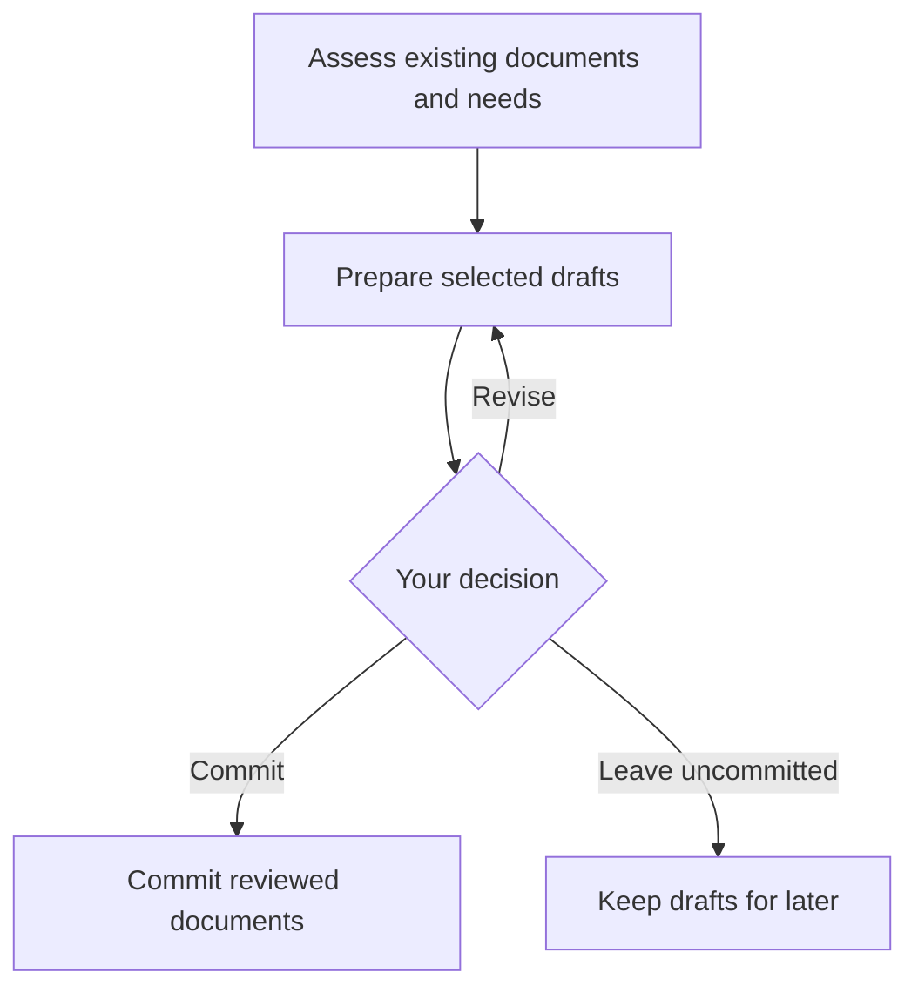

# legal



Use legal to prepare the legal documents a project needs, based on its source and confirmed facts. It writes complete drafts for you to read in your editor; you decide whether to commit them.

## Flow



## Start the command

```text
Codex → $legal    Claude → /legal
```

Use your client's [command prefix]({{ '/docs/setup/' | relative_url }}#run-a-command). Start on clean **main or master**. Legal document commits need explicit content and commit approval, even with [auto-commit](../rules/git.html#auto-commit) enabled.

<span id="understand-the-service-first"></span>

## Prepare the useful documents

Helm reviews the service, data flows, integrations, payments and existing policies. You can request or exclude document types; it recommends the smallest useful set.

| Document | What it explains |
|---|---|
| Privacy policy | How personal data is processed. |
| Terms | Approved rules for using the service. |
| Cookie policy | Tracking/storage not already covered. |
| Refund policy | Confirmed sales and refund responsibilities. |
| EULA | An approved compatible licensing arrangement. |
| Disclaimer | Relevant content or advice limitations. |

Terms, refund policies and EULAs need your request or an existing approved policy. One decision table explains what to keep, update, create or recommend removing, with reasons. Excluded types stay out of scope. No useful change can mean no draft is needed.

## Draft from confirmed facts

Existing approved clauses, locations and language are preserved unless you agree to a replacement. Essential missing facts are asked together; there is no standard home-address intake or worldwide clearance process.

<span id="handle-gaps-precisely"></span>

A known material gap holds the affected document while other complete drafts may proceed. Missing facts do not become invented promises. Drafting and owner approval do not establish legal compliance; consent controls, routing and other implementation work remain separate.

## Review before committing

Read the full files in your editor or Markdown preview. Chat gives you file links, meaningful changes and important gaps.

Choose **Commit / Revise / Leave uncommitted**. Any proposed removals are named with their effects and require explicit approval; leaving drafts uncommitted also preserves removal candidates. You can edit the drafts yourself before the agent rereads them for the approved commit.

## Your result

You get document links, remaining gaps and the actual commit or draft status, on the same branch.

<span id="reconcile-missing-recorded-documents"></span>

Confirmed document moves or deletions can update saved records automatically; uncertain whereabouts need clarification. Record repair never deletes actual files or counts as a new legal assessment. Unchanged source alone does not prove business or legal freshness.

Use [ship](ship.html) separately for publication.
