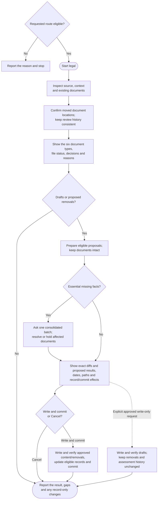

# Legal



Legal prepares complete document proposals from project evidence and confirmed facts. You review exact content and resolve material gaps before approving writing and committing together.

## Flow

## Start the command

Start on clean main or master. Git and ownership eligibility are checked before discovery, and existing assessment records are validated before substantive source/document review. Legal reviews the source and existing documents before proposing work; a command invocation is not a declaration that every legal document is required.

Legal commits need your exact content and commit approval, even when local [auto-commit](../../rules/git.html#auto-commit) is enabled. Drafting, owner approval and publication remain separate results.

A Git, ownership, path or state-validation blocker ends the run before further investigation or a decision table. Missing facts for an individual document remain distinct from those workflow prerequisites. An unanswered workflow question pauses the run; it does not authorize independent investigation while you decide.

## Prepare the useful documents

The agent checks the service, data flows, integrations and existing policies. One decision table explains which documents should be kept, updated, created or considered for removal, with the reasons and unresolved facts.

Privacy, cookie and relevant disclaimer drafts follow evidenced processing and content. Terms, refunds and EULAs require your request or an existing approved policy. Requested exclusions remain out of scope; the workflow does not generate a standard bundle just to fill a checklist.

For example, browser storage already explained clearly in a privacy notice may not justify a separate cookie document. A new payment flow, however, can raise questions that source code alone cannot answer.

## Draft from confirmed facts

Existing approved clauses, document locations and language provide the baseline. The agent asks essential missing questions together. There is no routine home-address intake, and uncertain retention periods, refund promises or jurisdictions are not invented.

A concrete material omission holds the affected draft until it can be resolved. Other complete documents may proceed. This differs from declaring an entire project legally insufficient when no such assessment was made.

The drafts explain what the implementation and confirmed policy support. They do not establish compliance, add missing consent controls or publish a legal route automatically. Those integration changes have their own scope.

## Review before writing

The proposal stays in conversation while existing documents remain intact. For each existing file, you see a diff with literal additions and removals, followed by a **Proposed result after approval** preview of affected passages. Each new document appears once in full, without a duplicate additions-only diff. Dates, metadata and protected clauses are included in the review. Proposed deletions show exactly what would disappear and explain their dependency effects.

Choose **Write and commit** or **Cancel** after the exact content, paths, record changes and commit subject are visible. One approval covers those writes and the commit, even with auto-commit enabled; successful readback and required checks still come first. It grants no publication authority. A failed write or check leaves the actual work recoverable and stops dependent actions.

You can type exact selections, corrections or replacement wording. Only affected previews and missing approval need refreshing; the command does not automatically restart its scan or rewrite unrelated clauses. You can also request **write without committing** for the shown content. Those files become uncommitted drafts with proposed dates, while removal candidates stay intact and assessment provenance does not advance.

Cancel leaves pending document proposals unapplied. It preserves any earlier specifically approved work or verified record-path repairs, without a separate metadata commit. Files are linked after approved writes so you can continue reviewing them in your editor.

## Your result

You receive file links, unresolved facts and the actual draft or commit status on the same branch. The saved assessment advances only for approved substantive document changes, not cosmetic edits or an unrelated source update.

A confirmed document move can be reconciled in the saved record without deleting files or claiming a new legal assessment. Uncertain locations need clarification. Use [ship](../ship.html) separately when the reviewed work is ready for publication.

## Explore the source

For implementation details, read [guides/legal.md](https://github.com/myowinthein/agent-helm/blob/main/guides/legal.md).
