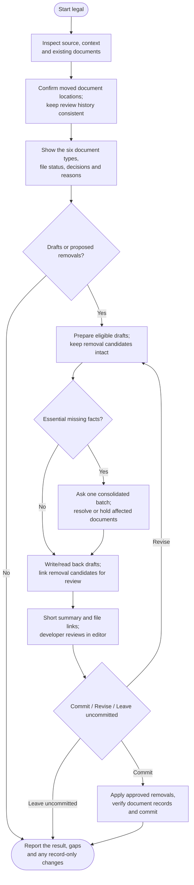

# legal



Legal prepares complete document drafts from project evidence and confirmed business facts. You read the files, resolve material gaps and decide whether their exact content should be committed.

## Flow

## Start the command

Start on clean main or master. Legal reviews the source and existing documents before proposing work; a command invocation is not a declaration that every legal document is required.

Legal commits need your exact content and commit approval, even when local [auto-commit](../../rules/git.html#auto-commit) is enabled. Drafting, owner approval and publication remain separate results.

## Prepare the useful documents

The agent checks the service, data flows, integrations and existing policies. One decision table explains which documents should be kept, updated, created or considered for removal, with the reasons and unresolved facts.

Privacy, cookie and relevant disclaimer drafts follow evidenced processing and content. Terms, refunds and EULAs require your request or an existing approved policy. Requested exclusions remain out of scope; the workflow does not generate a standard bundle just to fill a checklist.

For example, browser storage already explained clearly in a privacy notice may not justify a separate cookie document. A new payment flow, however, can raise questions that source code alone cannot answer.

## Draft from confirmed facts

Existing approved clauses, document locations and language provide the baseline. The agent asks essential missing questions together. There is no routine home-address intake, and uncertain retention periods, refund promises or jurisdictions are not invented.

A concrete material omission holds the affected draft until it can be resolved. Other complete documents may proceed. This differs from declaring an entire project legally insufficient when no such assessment was made.

The drafts explain what the implementation and confirmed policy support. They do not establish compliance, add missing consent controls or publish a legal route automatically. Those integration changes have their own scope.

## Review before committing

Read the full drafts in your editor or Markdown preview. Chat links to the files and explains meaningful changes or gaps; it does not replace your review with a long pasted document.

Choose **Commit**, **Revise** or **Leave uncommitted**. You can edit a file yourself before the agent rereads it for the approved commit. Removal candidates are named and require explicit approval; leaving drafts uncommitted also leaves those candidates intact.

## Your result

You receive file links, unresolved facts and the actual draft or commit status on the same branch. The saved assessment advances only for approved substantive document changes, not cosmetic edits or an unrelated source update.

A confirmed document move can be reconciled in the saved record without deleting files or claiming a new legal assessment. Uncertain locations need clarification. Use [ship](../ship.html) separately when the reviewed work is ready for publication.

## Explore the source

For implementation details, read [guides/legal.md](https://github.com/myowinthein/agent-helm/blob/main/guides/legal.md).
