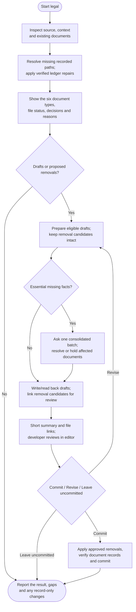

# legal



Use legal to prepare the legal documents a project needs, based on its source and confirmed facts. It writes complete drafts for you to read in your editor; you decide whether to commit them.

## Flow

The complete procedure follows, including conditions and exceptions within each phase.

{{ page.guide_source | guide_intro }}

{{ page.guide_source | guide_body }}
